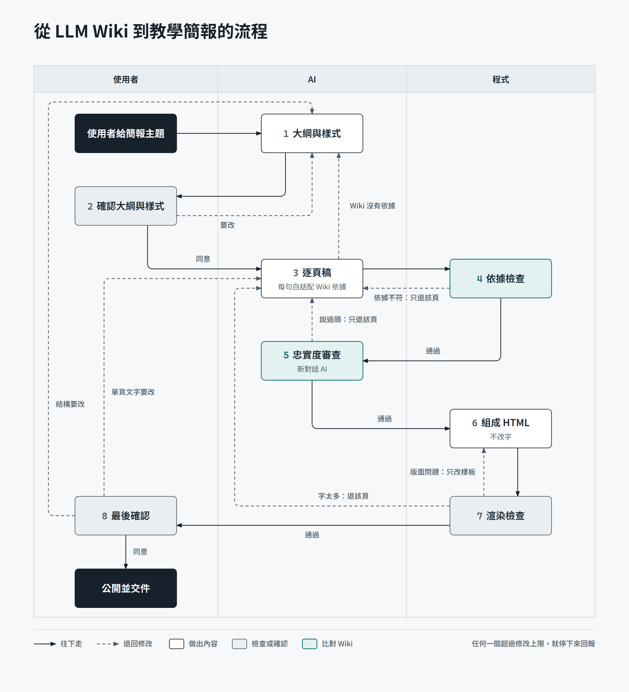
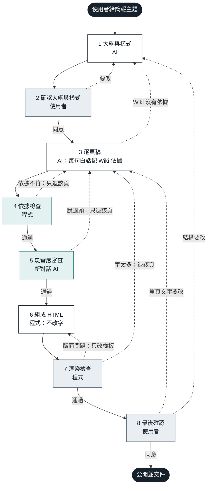

# 簡報 Workflow：從 LLM Wiki 到教學 HTML 簡報

狀態：已確認（2026-11-23）

這份文件說明「CNN 看到什麼」的簡報怎麼從 Wiki 產生、怎麼檢查，以及出錯時退回哪裡。第 8 關時使用者指出新手看不懂專有名詞，所以退回第 1 關改過大綱，再跑一次第 3～7 關，經使用者再次確認定案後已公開。實際執行結果見 [run-report.md](reports/run-report.md)。

## 流程圖



網頁版：[workflow-diagram.html](workflow-diagram.html)

白底是做出內容，灰底是檢查或確認，綠底是比對 Wiki 的檢查，黑底是開始和結束。實線往下走，虛線退回修改。任何一關超過修改上限，就停下來回報，不繼續往下走。

### Mermaid 版

同一張流程圖的文字版，節點和退回路線與上圖相同，可以直接修改。



## 五件事

| 項目 | 內容 |
|---|---|
| 目標 | 只用 `wiki/` 的內容，做出一份讓不熟 CNN 的人看得懂的教學 HTML 簡報 |
| 限制 | Wiki 沒寫的不補；別人的圖和資料集照片只附原文連結；用 `wiki/glossary.md` 的主名詞；開頭放基礎段，並標示學過 CNN 的人從第 5 頁開始；難詞能改寫就改寫，非必要術語留在 Wiki 不塞進簡報；畫面文字只寫給聽眾，不出現大綱欄位或流程用語 |
| 完成標準 | 12～15 頁；每個陳述句、數字和圖說都有 Wiki 依據；忠實度審查沒有未解決的問題；1280×720 下沒有溢出；圖片全部載入；HTML 的文字和通過檢查的逐頁稿一致；畫面沒有工作用語 |
| 停止條件 | 工具試跑 3 次還不過、單頁修 2 輪還不過、整體跑 3 輪還不過、忠實度考題調整 2 次還不過，都停下回報；Wiki 沒有依據時不自己補，改大綱或問使用者 |
| 觸發 | 使用者給一個簡報主題 |

單頁一輪是「修一次，再跑一次檢查」。整體一輪是從第 4 關跑到第 7 關。問句標題、地圖、頁碼和段落名稱不是陳述句，不需要依據。

## 每一關

| 關卡 | 誰做 | 只能看 | 產出 | 怎麼算通過 | 不通過時 |
|---|---|---|---|---|---|
| 1 大綱與樣式 | AI | `wiki/index.md`、名詞表、相關 Wiki 頁 | `deck/outline.md`、樣式範本 | 每頁的 Wiki 頁和圖都存在；嵌這張圖的 Wiki 頁也列在該頁；圖、算式和互動用到的內容都在 Wiki 裡；每頁要解釋的名詞都列出來，最多 3 個 | 改大綱，或問使用者 |
| 2 確認 | 使用者 | 大綱、3 種樣式 | 定案的大綱和樣式 | 使用者同意 | 退回第 1 關 |
| 3 逐頁稿 | AI | 大綱、該頁列出的 Wiki 頁 | `deck/drafts/pNN.md` | 大綱列的名詞都寫出解釋並配依據，不用難詞解釋難詞；交給第 4 關檢查 | Wiki 沒有依據就退回第 1 關 |
| 4 依據檢查 | `scripts/check_deck_evidence.py` | 逐頁稿、Wiki | `deck/reports/evidence.md` | 依據句在指定 Wiki 頁逐字找得到；白話裡的數字都在依據裡；用主名詞；圖存在且該 Wiki 頁有用到；工作用語和保留語的掃描結果都看過 | 只退該頁 |
| 5 忠實度審查 | 兩個新對話的 AI 各審全份一次，改過的頁面由其中一位複審，不能改稿 | 每句白話和它的依據 | `deck/reports/faithfulness.md` | 先通過考題；白話沒有比依據說得更多、更肯定，也沒有改變意思 | 只退該頁，再跑第 4、5 關 |
| 6 組成 HTML | `scripts/build_deck.py` | 通過的逐頁稿、樣板 | `deck/index.html` | 不能改任何字；一頁超過 3 個名詞就報錯 | 修程式或樣板；名詞太多退該頁 |
| 7 渲染檢查 | `scripts/check_deck_render.py` | `deck/index.html`、逐頁稿 | `deck/reports/render.md`、截圖 | 1280×720 沒有溢出；圖片全部載入；畫面文字等於逐頁稿加固定標籤；工作用語的掃描結果都看過；截圖逐頁看過 | 版面問題改樣板；字太多退該頁，再跑第 4、5 關 |
| 8 最後確認 | 使用者 | 簡報、檢查報告 | 是否公開 | 使用者同意 | 單頁文字退第 3 關；結構退第 1 關 |

每次實際執行的結果，彙整在 `deck/reports/run-report.md`。

**工具試跑**：如果這次新寫或改過組裝、檢查程式，第 3 關之前先用測試和一張範例頁跑通。試跑最多 3 次，不算第 4～7 關的輪次。這條是這次執行後才加的，下次開始適用。

**保留語掃描**：第 4 關會列出依據所在整行裡、引用範圍外的「可能」「似乎」「作者說」這類字。掃描到的字不一定有問題，所以只列清單，逐筆看過，不直接判定失敗。

### 逐頁稿格式

每頁一個檔案。畫面上的每段文字都放在下面其中一個區塊，寫成「白話」，下面接一句或多句 Wiki 原句：

| 區塊 | 放什麼 | 要不要依據 |
|---|---|---|
| `標題` | 這一頁的問句 | 不用 |
| `承上` | 串接上一頁到這一頁的單行過渡句（第 2～15 頁） | 要 |
| `重點` | 這一頁要記住的一句話 | 要 |
| `內文` | 條列或步驟（可加固定對應標籤） | 要 |
| `圖` | 圖檔、圖標標籤、裁切範圍、圖說 | 圖說要 |
| `圖內文字` | 圖上的標籤，以及自繪圖的方塊和箭頭文字 | 要 |
| `互動` | 互動每一步的文字和算式 | 要 |
| `名詞` | 這一頁第一次出現的名詞和一句話解釋，寫成「名詞：解釋」，每頁最多 3 個（顯示在標題正下方） | 要 |

資料來源列由程式根據依據和 `raw/SOURCES.md` 產生，不手寫。

```markdown
# 怎麼知道一個神經元在找什麼？

- 區段：一個神經元
- 地圖：中層

## 重點

- 白話：從雜訊出發，依導數一步步調整影像，得到一張讓目標反應很強的影像。
  依據：methods/feature-visualization.md｜從隨機雜訊開始。
  依據：methods/feature-visualization.md｜依導數一步步調整影像，往目標變大的方向走。
  依據：methods/feature-visualization.md｜一張讓目標反應很強的影像

## 圖

- 檔案：raw/screenshots/feature-visualization/fig03.png
  裁切：1082,17,280,280
  白話：第 2048 步
  依據：methods/feature-visualization.md｜圖中依序是第 0、4、48、2048 步的影像

## 內文

- 白話：算目標對輸入影像的導數。
  依據：methods/feature-visualization.md｜神經網路對輸入大致可微，所以可以算目標對輸入影像的導數。
```

### 畫面固定標籤

除了逐頁稿的內容，畫面上只能出現這些標籤：

| 位置 | 文字 |
|---|---|
| 區段名稱 | 開始之前（第 1 頁）、CNN 基礎（第 2～4 頁）、看神經元（第 5～8 頁）、看一張圖（第 9～10 頁）、看一整層（第 11～12 頁）、能信多少（第 13 頁） |
| 地圖 | 影像、低層、中層、高層、類別機率 |
| 每頁固定 | 重點、資料來源、頁碼 |
| 名詞欄 | 名詞（選用，極簡版已拿掉名詞欄以減少視覺干擾） |
| 原文連結 | 圖見原文（第 10、12 頁） |
| 跳讀提示 | 學過 CNN 的人可以從第 5 頁開始 |
| 圖文對應標籤 | 圖 A、圖 B、對應圖 A、對應圖 B、見圖 A、見圖 B、演化結果、完成結果 |

程式另外掃描大綱欄位和流程用語。掃描到的字可能是正常內容，所以要逐筆看過，不直接判定失敗。

### 忠實度考題

審查正式開始前，先用 Wiki 階段真實抓到的錯誤測試它，並混入正確的句子當對照，共 10 題、順序打亂。考題和正式審查的格式相同，依據都是目前 Wiki 的原句。審查要抓出全部錯誤句，也不能誤判正確句，否則這次審查不算數。實際題目和回覆見 [faithfulness-exam.md](reports/faithfulness-exam.md)。

| 白話（說過頭） | 白話（正確對照） | 依據（Wiki 原句） |
|---|---|---|
| 多義神經元同時回應幾種不相干的概念 | 多義神經元同時回應幾種顯著概念，例如貓和車 | 同時回應幾種顯著概念的神經元，例如貓和車 |
| 激活空間裡的任何方向都可以當最佳化目標 | 激活空間裡的方向也能拿來當最佳化目標 | 激活空間裡的方向也可以當最佳化目標 |
| 填充會移動感受野區域 | 感受野區域的位置和填充有關，大小則不受填充影響 | 填充不影響感受野大小，但感受野區域的位置和填充有關 |
| ReLU 網路適合用 NMF | ReLU 網路的激活值一定是正的，所以 NMF 的非負限制不成問題 | ReLU 網路的激活值一定是正的，所以 NMF 的非負限制沒有問題 |
| 旋轉語意字典後，各成分會變成激活空間裡的其他方向 | 旋轉語意字典可以讓各成分更分得開 | 旋轉語意字典，讓各成分更分得開 |

## 資訊怎麼變成簡報

1. **取得**：7 份來源先存進 `raw/`，逐篇討論後 ingest 成 Wiki。
2. **查詢**：簡報只讀 `wiki/`，每頁只用大綱列出的 Wiki 頁。
3. **整理**：把內容排成一頁一個問題，每頁一句重點，再由使用者確認大綱。
4. **檢查**：程式查依據是否存在，兩個新對話的 AI 各查一次白話有沒有說過頭。
5. **產生**：程式把通過的逐頁稿組成 HTML，再實際渲染檢查。

## 哪些步驟會重複

| 重複的範圍 | 什麼時候重複 | 上限 |
|---|---|---|
| 逐頁稿 ↔ 依據檢查 | 依據找不到、數字對不上、名詞不對 | 單頁 2 輪 |
| 逐頁稿 ↔ 忠實度審查 | 白話說過頭 | 單頁 2 輪 |
| 組成 HTML ↔ 渲染檢查 | 版面溢出、圖片載入失敗 | 整體 3 輪內 |
| 第 4～7 關 | 有頁面被退回修改 | 整體 3 輪 |

## 為什麼這樣設計

- **用 graph，不用單一 loop**：內容、忠實度和版面是三種不同標準，錯了要回不同的地方。單一 loop 每次整份重來，可能改壞已經通過的頁面。
- **人工確認放在大綱**：大綱最容易看出該講的有沒有講到，逐頁稿太細，不適合請人逐句看。
- **每句白話配 Wiki 依據**：白話最容易在不知不覺中說過頭，把依據放在旁邊，才能逐句比對。
- **不另做證據卡**：Wiki 每句都已標出處，逐頁稿直接引用 Wiki 句子，少一層轉寫。
- **審查用兩個新對話，而且要先考試**：寫稿的 AI 容易認同自己的寫法；審查也要先證明抓得到真實錯誤，通過才算數。考題全對的審查員仍可能漏句，所以由兩個新對話各審一次。
- **HTML 由程式組成**：排版時不會順手改字，通過審查的文字就是畫面上的文字。
- **修改設上限**：同一頁修兩次還不過，問題通常在大綱或 Wiki，不是措辭，應該停下來處理。

## 流程改過什麼

| 發現的問題 | 怎麼發現 | 改了什麼 |
|---|---|---|
| 程式檢查通過之後，6 篇來源裡仍有 5 篇找到說過頭的句子 | ingest 後逐句對原文，紀錄在 `wiki/log.md` | 把檢查往前移到句子：加入「每句白話配依據」和「忠實度審查」 |
| 第 3 頁要逐步示範 4 次計算，Wiki 只寫了第 1 次 | 設計大綱時發現（`bce69ce` 補上） | 第 1 關加一條：圖、算式和互動用到的內容都要在 Wiki 裡 |
| 樣式範本把大綱欄位「帶走」放上畫面，聽眾看不懂 | 使用者看範本時發現 | 定出畫面固定標籤，第 4、7 關加上工作用語掃描 |
| 第 4、5 頁用的圖，嵌圖的 Wiki 頁沒列在大綱 | 第 4 關依據檢查 | 檢查往前移到第 1 關：大綱要列出嵌這張圖的 Wiki 頁 |
| 考題全對的審查員，審全份時仍漏掉說過頭的句子 | 複審和第二位審查員才抓到（第 7、14 頁） | 第 5 關改成兩個新對話各審一次 |
| 渲染檢查通過，畫面仍有裁切漏出的原圖文字 | 看截圖時發現（第 6、8 頁） | 修裁切並補測試；第 7 關加上截圖逐頁看過 |
| 依據只引半句時，審查員看不到被截掉的保留語 | 審查後用一次性程式掃描依據所在的整行（第 4、5、7、8 頁） | 補回 5 處並複審；檢查往前移到第 4 關，寫進 `check_deck_evidence.py` |
| 新程式第一次跑就在正式流程裡，渲染失敗 4 次，超過 3 輪上限也沒有停 | 整理執行紀錄時發現 | 第 3 關之前加工具試跑，工具問題不佔內容的修改輪次 |
| 全部檢查都通過，新手還是看不懂：第 2 頁標題直接用「全連接層」 | 使用者在第 8 關發現 | 補基礎來源 `d2l-basics`；檢查往前移到第 1、3 關：大綱先列每頁要解釋的名詞，逐頁稿加 `名詞` 區塊，解釋也要有 Wiki 依據，每頁最多 3 個由組版程式檢查 |
| 新手仍看不出閱讀順序、頁間沒有承接、圖片對不上文字說明 | 使用者以新手視角審閱成品時指出 | 先嘗試做加法（加承上句、名詞欄上移、圖文徽章），使用者檢視後認為資訊仍過於雜亂；改回第 1 關做減法重構：刪除非必要術語與名詞欄、精簡為 13 頁核心主線、標題本身自然承接上一頁、一頁只留 3 個清爽區塊（頁頂標題 → 圖與 2～3 句無框重點 → 頁底重點） |
