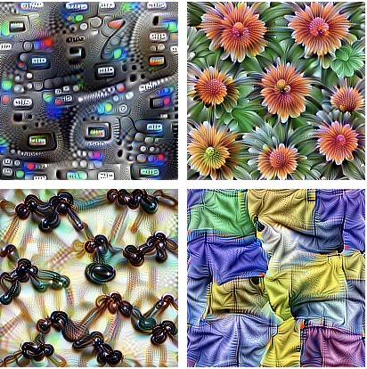
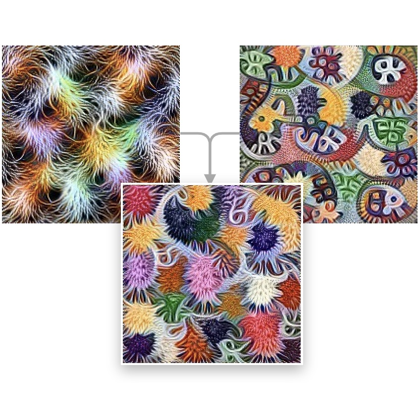

# 激活空間

## 是什麼

神經元（neuron）是某一層、某個空間位置、某個通道上的一個值，寫成 $\text{layer}_n[x,y,z]$（[Feature Visualization](../sources/feature-visualization.md) § Optimization Objectives）。激活空間（activation space）是所有可能的神經元激活值組合；每個神經元的激活值可以看成這個空間的基底向量，神經元的組合就是空間裡的一個向量（[Feature Visualization](../sources/feature-visualization.md) § Interaction between Neurons）。

> 原文（feature-visualization）：We can then think of individual neuron activations as the basis vectors of this activation space. Conversely, a combination of neuron activations is then just a vector in this space.

這樣看，「神經元」和「神經元的組合」就統一成激活空間裡的向量；接著可以問：基底向量的方向，會不會比空間裡其他方向更容易解讀（[Feature Visualization](../sources/feature-visualization.md) § Interaction between Neurons）。

d2l 有類似的說法：不一定是單一通道對應邊緣偵測器，可能是通道空間（channel space）裡的某個方向對應偵測邊緣，見[通道](channel.md)（[d2l](../sources/d2l-ch7.md) § 7.4.2. Multiple Output Channels）。

> 原文（d2l-ch7）：This means that rather than mapping a single channel to an edge detector, it may simply mean that some direction in channel space corresponds to detecting edges.

Activation Atlas 說激活值有組合結構（compositional structure）：混合幾百個基底神經元就能得到任何激活向量；但這個空間大到指數級，很難找到有意思的激活向量（[Exploring Neural Networks with Activation Atlases](../sources/activation-atlas.md) § Doesn't Surface Compositionality）。

> 原文（activation-atlas）：We can mix together a couple hundred basis neurons to get any activation vector.

## 為什麼重要

加上多樣性項之後，有些例子同時回應好幾種不相干的東西，例如 mixed4e 層 unit 55 同時回應兩種動物的臉和車身；作者認為這暗示神經元不一定是理解網路的正確語意單位（[Feature Visualization](../sources/feature-visualization.md) § Achieving Diversity with Optimization）。實際上，是神經元的組合一起在網路裡表示影像，激活空間提供了思考這些組合的幾何方式（[Feature Visualization](../sources/feature-visualization.md) § Interaction between Neurons）。

> 原文（feature-visualization）：In real life, combinations of neurons work together to represent images in neural networks.

Activation Atlas 用字母比喻：26 個字母是英文的基底，但看字母怎麼組成單字，比只看字母更能看出能表達哪些概念；同樣地，網路很少單獨使用一個神經元，要看神經元的常見組合（[Exploring Neural Networks with Activation Atlases](../sources/activation-atlas.md) § Introduction）。

> 原文（activation-atlas）：As an analogy, while the 26 letters in the alphabet provide a basis for English, seeing how letters are commonly combined to make words gives far more insight into the concepts that can be expressed than the letters alone.

圖：Activation Atlas 開頭比較看隱藏層的方法。上圖是單一神經元，看不到神經元之間的互動，只是高維激活空間裡一維、互相正交的探針；下圖是兩兩神經元的互動，看得到互動效果，但只是數百維空間裡的二維切片，很多組合也不會實際出現（[Exploring Neural Networks with Activation Atlases](../sources/activation-atlas.md) § Introduction）

Building Blocks 把同時回應幾種不相干概念的神經元叫多義神經元（poly-semantic neurons），例如同時回應貓和車（[The Building Blocks of Interpretability](../sources/building-blocks.md) § How Trustworthy Are These Interfaces?）。介面可以這樣應對：用多樣性的視覺化顯示一個神經元的各種意義，或旋轉[語意字典](semantic-dictionary.md)，讓各成分更分得開（[The Building Blocks of Interpretability](../sources/building-blocks.md) § How Trustworthy Are These Interfaces?）。

> 原文（building-blocks）：There are natural ways that interfaces could respond to this: we could use diversity visualizations to reveal the variety of meanings the neuron can take, or rotate our semantic dictionaries so their components are more disentangled.

Building Blocks 也提到，很多前人研究發現神經網路裡的方向有語意；特別醒目的例子是語意算術，例如 "king" - "man" + "woman" = "queen"（[The Building Blocks of Interpretability](../sources/building-blocks.md) § How Trustworthy Are These Interfaces?）。

> 原文（building-blocks）：Much prior research has found that directions in neural networks are semantically meaningful.

基底方向是否比其他方向好解讀，前人結論不同：Szegedy et al. 發現隨機方向看起來和基底方向一樣有意義；Bau、Zhou et al. 發現基底方向比隨機方向更常看得懂（[Feature Visualization](../sources/feature-visualization.md) § Interaction between Neurons）。作者的經驗和兩者大致一致：隨機方向常常也看得懂，但比例低於基底方向（[Feature Visualization](../sources/feature-visualization.md) § Interaction between Neurons）。

> 原文（feature-visualization）：Our experience is broadly consistent with both results; we find that random directions often seem interpretable, but at a lower rate than basis directions.

圖見原文：[Feature Visualization：Interaction between Neurons（隨機方向的資料集範例和最佳化結果）](https://distill.pub/2017/feature-visualization/#random-optimization-and-examples)（[Feature Visualization](../sources/feature-visualization.md) § Interaction between Neurons）

## 和其他概念的關係

- [特徵視覺化](../methods/feature-visualization.md)：激活空間裡的方向也可以當最佳化目標；原文對隨機方向同時列出資料集範例和最佳化結果，這些方向是挑過、比較好解讀的（[Feature Visualization](../sources/feature-visualization.md) § Interaction between Neurons）。
- 神經元相加：對神經元做算術，可以得到激活空間裡有意思的方向；例如把「黑白」神經元加上「馬賽克」神經元，得到黑白版的馬賽克。這讓人想到 Word2Vec 詞向量的語意算術，或生成模型的潛在空間（[Feature Visualization](../sources/feature-visualization.md) § Interaction between Neurons）。
- 內插：最佳化目標是兩個通道目標之間的線性內插；為了讓結果好看，另外加一個小的對齊目標讓低層的激活值相近，並混用分開和共用的影像參數化（[Feature Visualization](../sources/feature-visualization.md) § Interaction between Neurons）。這和在生成模型的潛在空間裡內插類似（[Feature Visualization](../sources/feature-visualization.md) § Interaction between Neurons）。
- [通道](channel.md)：通道目標是一整個通道所有空間位置的值（[Feature Visualization](../sources/feature-visualization.md) § Optimization Objectives）。
- [語意字典](semantic-dictionary.md)：語意字典以神經元介紹，但可以用在任何激活值的基底上（[The Building Blocks of Interpretability](../sources/building-blocks.md) § Making Sense of Hidden Layers）。
- [激活網格](../methods/activation-grid.md)：把一個元素上所有通道的激活值當成一個激活向量（activation vector）一起畫，看的是神經元的組合，不是單一神經元（[The Building Blocks of Interpretability](../sources/building-blocks.md) § What Does the Network See?）。
- [矩陣分解](../methods/matrix-factorization.md)：分出來的神經元群組是另一種基底；作者說用其他基底提供更好的理解單位，才剛開始探索（[The Building Blocks of Interpretability](../sources/building-blocks.md) § Making Things Human-Scale）。
- [激活圖譜](../methods/activation-atlas.md)：把大量激活向量降到二維；圖譜上畫出的路徑只在低維投影裡是平滑的，不知道它們在原本的高維激活空間裡怎麼走；圖譜靠取樣找出有意思的激活向量，卻完全失去組合結構（[Exploring Neural Networks with Activation Atlases](../sources/activation-atlas.md) § Aggregating Multiple Images；[Exploring Neural Networks with Activation Atlases](../sources/activation-atlas.md) § Doesn't Surface Compositionality）。
- [多用途特徵](multi-use-features.md)：多義神經元說的是單一神經元；多用途特徵說的是類別激活圖譜上的一個偵測器，也就是一格的平均激活向量，回應幾種很不一樣、但看起來相似的概念（[The Building Blocks of Interpretability](../sources/building-blocks.md) § How Trustworthy Are These Interfaces?；[Exploring Neural Networks with Activation Atlases](../sources/activation-atlas.md) § Further Isolating Classes）。

> 原文（feature-visualization）：For example, if we add a "black and white" neuron to a "mosaic" neuron, we obtain a black and white version of the mosaic.

> 原文（activation-atlas）：They are smooth paths in this reduced projection but we don't necessarily know how the paths operate in the original higher-dimensional activation space.

圖見原文：[Feature Visualization：Interaction between Neurons（兩個神經元一起最佳化）](https://distill.pub/2017/feature-visualization/#linear-combinations)（[Feature Visualization](../sources/feature-visualization.md) § Interaction between Neurons）

圖見原文：[Feature Visualization：Interaction between Neurons（在兩個神經元之間內插）](https://distill.pub/2017/feature-visualization/#interpolation)（[Feature Visualization](../sources/feature-visualization.md) § Interaction between Neurons）

這些只是神經元互動的開頭：作者說幾乎不知道怎麼挑出有意義的方向，也不知道是否真的存在特別有意義的方向；內插只能看少數方向怎麼互動，實際上有數百個方向在互動（[Feature Visualization](../sources/feature-visualization.md) § Interaction between Neurons）。理解神經元的互動，仍列在待解決的問題裡（[Feature Visualization](../sources/feature-visualization.md) § Conclusion）。

> 原文（feature-visualization）：The truth is that we have almost no clue how to select meaningful directions, or whether there even exist particularly meaningful directions.

## 相關頁面

- [Feature Visualization（來源）](../sources/feature-visualization.md)
- [特徵視覺化](../methods/feature-visualization.md)
- [通道](channel.md)
- [d2l 第 7 章](../sources/d2l-ch7.md)
- [The Building Blocks of Interpretability](../sources/building-blocks.md)
- [語意字典](semantic-dictionary.md)
- [激活網格](../methods/activation-grid.md)
- [矩陣分解](../methods/matrix-factorization.md)
- [Exploring Neural Networks with Activation Atlases](../sources/activation-atlas.md)
- [激活圖譜](../methods/activation-atlas.md)
- [多用途特徵](multi-use-features.md)
