# 棋盤狀假影

## 是什麼

棋盤狀假影（checkerboard artifacts）是神經網路產生的影像近看時常出現的奇怪棋盤狀圖樣；近來很多模型都有，在顏色強烈的影像裡最明顯（[Deconvolution and Checkerboard Artifacts](../sources/deconv-checkerboard.md) § Deconvolution and Checkerboard Artifacts）。

> 原文（deconv-checkerboard）：When we look very closely at images generated by neural networks, we often see a strange checkerboard pattern of artifacts.

圖見原文：[Deconvolution and Checkerboard Artifacts：開頭的四組模型樣本](https://distill.pub/2016/deconv-checkerboard/)（[Deconvolution and Checkerboard Artifacts](../sources/deconv-checkerboard.md) § Deconvolution and Checkerboard Artifacts）

假影出現在兩個地方（[Deconvolution and Checkerboard Artifacts](../sources/deconv-checkerboard.md) § Deconvolution & Overlap；[Deconvolution and Checkerboard Artifacts](../sources/deconv-checkerboard.md) § Artifacts in Gradients）：

- 產生影像時：用轉置卷積（transposed convolution）做上採樣（upsampling），卷積核大小不能被步幅整除時重疊不均勻；二維時兩個軸的不均勻相乘，形成棋盤狀假影，見[上採樣](../methods/upsampling.md)（[Deconvolution and Checkerboard Artifacts](../sources/deconv-checkerboard.md) § Deconvolution & Overlap）。
- 梯度裡：計算卷積層的梯度時，反向傳播做的是轉置卷積，所以梯度裡也可能出現棋盤狀假影（[Deconvolution and Checkerboard Artifacts](../sources/deconv-checkerboard.md) § Artifacts in Gradients）。

> 原文（deconv-checkerboard）：This can cause checkerboard patterns in the gradient, just like when we use deconvolution to generate images.

### 產生影像時

訓練前就看得到差別：生成對抗網路（GAN）的生成器（generator）用隨機權重初始化時，產生的影像就已經有假影；作者說這暗示假影來自這種產生影像的方式，而不是對抗訓練（[Deconvolution and Checkerboard Artifacts](../sources/deconv-checkerboard.md) § Image Generation Results）。

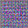 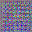
圖：還沒訓練、隨機權重的生成器，最後兩層用轉置卷積，已經有假影（[Deconvolution and Checkerboard Artifacts](../sources/deconv-checkerboard.md) § Image Generation Results）

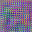 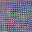
圖：只有最後一層用轉置卷積，訓練前也有假影（[Deconvolution and Checkerboard Artifacts](../sources/deconv-checkerboard.md) § Image Generation Results）

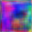 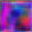
圖：所有層都用 resize-convolution，訓練前後都沒有假影（[Deconvolution and Checkerboard Artifacts](../sources/deconv-checkerboard.md) § Image Generation Results）

> 原文（deconv-checkerboard）：This suggests that the artifacts are due to this method of generating images, rather than adversarial training.

其他模型也有：直接產生風格轉換影像的即時藝術風格轉換網路，也容易出現棋盤狀假影，訓練目標沒有明確抵抗假影時尤其明顯；把轉置卷積層換成 resize-convolution 層，假影就消失（[Deconvolution and Checkerboard Artifacts](../sources/deconv-checkerboard.md) § Image Generation Results）。

圖見原文：[Deconvolution and Checkerboard Artifacts：Image Generation Results（風格轉換用轉置卷積和用 resize-convolution 的結果）](https://distill.pub/2016/deconv-checkerboard/)（[Deconvolution and Checkerboard Artifacts](../sources/deconv-checkerboard.md) § Image Generation Results）

### 梯度裡

特徵視覺化領域早就知道影像模型的梯度裡有高頻「雜訊」，這是一大挑戰，特徵視覺化的方法必須想辦法補償（[Deconvolution and Checkerboard Artifacts](../sources/deconv-checkerboard.md) § Artifacts in Gradients）。DeepDream 似乎用好幾種方式讓假影互相破壞性干涉，例如同時最佳化很多特徵、在很多位移和尺度上最佳化；其中在不同位移上最佳化的抖動（jitter）能抵消一部分棋盤狀假影（[Deconvolution and Checkerboard Artifacts](../sources/deconv-checkerboard.md) § Artifacts in Gradients）。

> 原文（deconv-checkerboard）：In particular, the "jitter" of optimizing at different offsets cancels out some of the checkerboard artifacts.

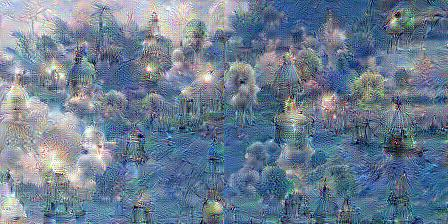
圖：DeepDream 每一步都把網路套在同一個位置，假影很嚴重（[Deconvolution and Checkerboard Artifacts](../sources/deconv-checkerboard.md) § Artifacts in Gradients）

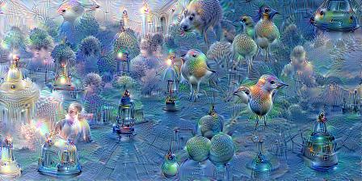
圖：DeepDream 每一步把網路套在不同位置，假影減少（[Deconvolution and Checkerboard Artifacts](../sources/deconv-checkerboard.md) § Artifacts in Gradients）

近來的特徵視覺化研究已經明確注意到並補償這些梯度裡的高頻成分，見[正則化與預條件](../methods/regularization-and-preconditioning.md)；作者好奇更好的網路架構能不能讓這些努力變得不必要（[Deconvolution and Checkerboard Artifacts](../sources/deconv-checkerboard.md) § Artifacts in Gradients）。

梯度假影會影響特徵視覺化裡依梯度最佳化的影像，作者因此預期它也會影響 GAN 裡由鑑別器（discriminator）最佳化的生成器影像，並發現有些情況確實如此：生成器既不偏向也不排斥棋盤狀假影時，鑑別器裡有步幅的卷積就能造成這種假影（[Deconvolution and Checkerboard Artifacts](../sources/deconv-checkerboard.md) § Artifacts in Gradients）。

> 原文（deconv-checkerboard）：When the generator is neither biased for or against checkerboard patterns, strided convolutions in the discriminator can cause them.

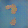 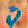 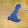
圖：鑑別器第一層用步幅 2 的卷積，生成器的輸出有很強的頻率 2 假影（[Deconvolution and Checkerboard Artifacts](../sources/deconv-checkerboard.md) § Artifacts in Gradients）

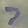 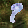 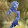
圖：鑑別器第一層用一般的卷積，假影很輕微（[Deconvolution and Checkerboard Artifacts](../sources/deconv-checkerboard.md) § Artifacts in Gradients）

## 為什麼重要

很多近來的模型都有這種假影；作者說它的原因其實很簡單，避免的方法也一樣簡單（[Deconvolution and Checkerboard Artifacts](../sources/deconv-checkerboard.md) § Deconvolution and Checkerboard Artifacts）。

> 原文（deconv-checkerboard）：The actual cause of these artifacts is actually remarkably simple, as is a method for avoiding them.

梯度假影的影響還不清楚：可以想成有些神經元拿到的梯度是鄰居的好幾倍，基本上沒有理由；等於網路沒來由地特別在意輸入的某些像素（[Deconvolution and Checkerboard Artifacts](../sources/deconv-checkerboard.md) § Artifacts in Gradients）。導數集中在少數像素上，這些像素的小擾動就可能有過大的影響，所以可能放大對抗樣本；作者沒有研究這一點（[Deconvolution and Checkerboard Artifacts](../sources/deconv-checkerboard.md) § Artifacts in Gradients）。

> 原文（deconv-checkerboard）：One way to think about them is that some neurons will get many times the gradient of their neighbors, basically arbitrarily.

> 原文（deconv-checkerboard）：We have not investigated this.

## 和其他概念的關係

- [上採樣](../methods/upsampling.md)：產生影像時的假影來自轉置卷積；resize-convolution 可以修好（[Deconvolution and Checkerboard Artifacts](../sources/deconv-checkerboard.md) § Better Upsampling）。
- [卷積運算](../methods/convolution-operation.md)：卷積層的反向傳播就是轉置卷積（[Deconvolution and Checkerboard Artifacts](../sources/deconv-checkerboard.md) § Artifacts in Gradients）。
- [正則化與預條件](../methods/regularization-and-preconditioning.md)：Feature Visualization 說高頻圖樣為什麼形成還不完全清楚，看起來重要的一部分是有步幅的卷積和池化在梯度裡造成的棋盤狀假影（[Feature Visualization](../sources/feature-visualization.md) § The Enemy of Feature Visualization）。
- [填充與步幅](../methods/padding-and-stride.md)：作者說類似的論證表示，一般有步幅的卷積層可能也有問題（[Deconvolution and Checkerboard Artifacts](../sources/deconv-checkerboard.md) § Conclusion）。
- [池化](../methods/pooling.md)：池化在梯度裡造成什麼圖樣，各篇說法不同，見下一段（[Deconvolution and Checkerboard Artifacts](../sources/deconv-checkerboard.md) § Artifacts in Gradients；[Feature Visualization](../sources/feature-visualization.md) § The Enemy of Feature Visualization；[The Building Blocks of Interpretability](../sources/building-blocks.md) § How Are Concepts Assembled?）。

## 說法不一致

**池化在梯度裡造成什麼圖樣。** 前兩篇的說法不同，第三篇和 Feature Visualization 一致（[Deconvolution and Checkerboard Artifacts](../sources/deconv-checkerboard.md) § Artifacts in Gradients；[Feature Visualization](../sources/feature-visualization.md) § The Enemy of Feature Visualization；[The Building Blocks of Interpretability](../sources/building-blocks.md) § How Are Concepts Assembled?）：

- Deconvolution and Checkerboard Artifacts（2016）：梯度裡的棋盤狀假影來自卷積層的反向傳播；DeepDream 的假影裡另有比較不規則的高頻圖樣，作者認為是最大池化造成的（[Deconvolution and Checkerboard Artifacts](../sources/deconv-checkerboard.md) § Artifacts in Gradients）。
- Feature Visualization（2017）：反向傳播經過每一個有步幅的卷積或池化，梯度大小都會出現棋盤狀假影（[Feature Visualization](../sources/feature-visualization.md) § The Enemy of Feature Visualization）。
- The Building Blocks of Interpretability（2018）：GoogLeNet 有步幅的最大池化在梯度裡帶來很多雜訊和棋盤狀假影；作者做空間歸因時放寬最大池化的梯度，並把棋盤狀假影抵消掉，見[歸因](../methods/attribution.md)（[The Building Blocks of Interpretability](../sources/building-blocks.md) § How Are Concepts Assembled?）。

> 原文（deconv-checkerboard）：We believe these to be caused by max pooling.

> 原文（feature-visualization）：Each strided convolution or pooling creates checkerboard patterns in the gradient magnitudes when we backprop through it.

> 原文（building-blocks）：GoogLeNet's strided max pooling introduces a lot of noise and checkerboard patterns to it's gradients.

本 Wiki 以 Feature Visualization 的說法為主軸：池化也會在梯度裡造成棋盤狀假影。理由是它比較新，而且 Building Blocks 也這樣說；Building Blocks 同時提到雜訊，和 Deconvolution and Checkerboard Artifacts 說的不規則高頻圖樣並不衝突（[Deconvolution and Checkerboard Artifacts](../sources/deconv-checkerboard.md) § Artifacts in Gradients；[Feature Visualization](../sources/feature-visualization.md) § The Enemy of Feature Visualization；[The Building Blocks of Interpretability](../sources/building-blocks.md) § How Are Concepts Assembled?）。

## 相關頁面

- [Deconvolution and Checkerboard Artifacts（來源）](../sources/deconv-checkerboard.md)
- [上採樣](../methods/upsampling.md)
- [卷積運算](../methods/convolution-operation.md)
- [填充與步幅](../methods/padding-and-stride.md)
- [池化](../methods/pooling.md)
- [正則化與預條件](../methods/regularization-and-preconditioning.md)
- [特徵視覺化](../methods/feature-visualization.md)
- [Feature Visualization（來源）](../sources/feature-visualization.md)
- [The Building Blocks of Interpretability（來源）](../sources/building-blocks.md)
- [歸因](../methods/attribution.md)
