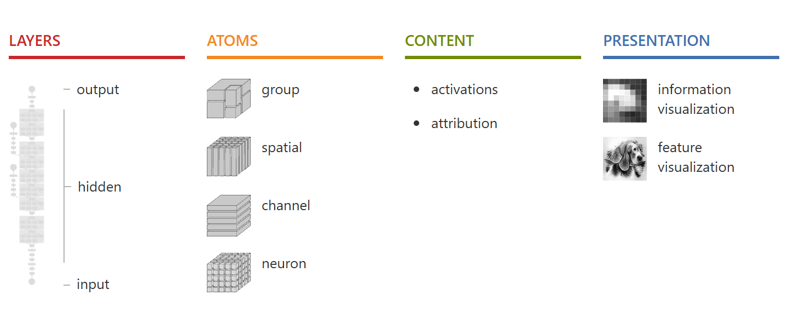

# 特徵圖

## 是什麼

d2l 把卷積層的輸出叫特徵圖（feature map），因為它可以看成在空間維度上學到、要交給下一層的表示（特徵）（[d2l](../sources/d2l-ch7.md) § 7.2.6. Feature Map and Receptive Field）。

> 原文（d2l-ch7）：As described in Section 7.1.4, the convolutional layer output in Fig. 7.2.1 is sometimes called a feature map, as it can be regarded as the learned representations (features) in the spatial dimensions (e.g., width and height) to the subsequent layer.

Building Blocks 把每一層學到的表示畫成三維的立方體，叫激活立方體（cube of activations），本 Wiki 把它當作特徵圖的別名（[The Building Blocks of Interpretability](../sources/building-blocks.md) § Making Sense of Hidden Layers）。立方體的 x、y 軸是影像上的位置，z 軸是通道（channel）；每一格是一個激活值（activation），也就是一個神經元（neuron）激發的程度（[The Building Blocks of Interpretability](../sources/building-blocks.md) § Making Sense of Hidden Layers）。

> 原文（building-blocks）：We can think of each layer's learned representation as a three-dimensional cube.

> 原文（building-blocks）：The x- and y-axes correspond to positions in the image, and the z-axis is the channel (or detector) being run.

### 四種切法

從不同方向切特徵圖，可以看不同單位的激活值（[The Building Blocks of Interpretability](../sources/building-blocks.md) § Making Sense of Hidden Layers；[The Building Blocks of Interpretability](../sources/building-blocks.md) § Making Things Human-Scale）：

| 切法 | 切出來的一塊 |
|---|---|
| 神經元 | 一個空間位置、一個通道上的一格（[The Building Blocks of Interpretability](../sources/building-blocks.md) § Making Sense of Hidden Layers） |
| 元素（原文叫 spatial position） | 同一個位置上所有通道的值，合起來是一個激活向量（activation vector）（[The Building Blocks of Interpretability](../sources/building-blocks.md) § Making Sense of Hidden Layers；[The Building Blocks of Interpretability](../sources/building-blocks.md) § What Does the Network See?） |
| 通道 | 一個通道在所有空間位置上的值（[The Building Blocks of Interpretability](../sources/building-blocks.md) § Making Sense of Hidden Layers） |
| 神經元群組（neuron groups） | 空間位置和通道比較任意的組合，用矩陣分解找出來（[The Building Blocks of Interpretability](../sources/building-blocks.md) § Making Things Human-Scale） |

> 原文（building-blocks）：In addition to naturally slicing a hidden layer's cube of activations into neurons, spatial locations, or channels, we can also consider more arbitrary groupings of locations and channels.

圖：Building Blocks 的介面四個面向。ATOMS 欄的四個小立方體就是特徵圖的四種切法：group（神經元群組）、spatial（元素）、channel（通道）、neuron（神經元）（[The Building Blocks of Interpretability](../sources/building-blocks.md) § The Space of Interpretability Interfaces）

圖見原文：[The Building Blocks of Interpretability：Making Sense of Hidden Layers（激活立方體的三種切法）](https://distill.pub/2018/building-blocks/#ActivationCube)（[The Building Blocks of Interpretability](../sources/building-blocks.md) § Making Sense of Hidden Layers）

圖見原文：[The Building Blocks of Interpretability：Making Things Human-Scale（加上神經元群組的四種切法）](https://distill.pub/2018/building-blocks/#CubeGroups)（[The Building Blocks of Interpretability](../sources/building-blocks.md) § Making Things Human-Scale）

## 為什麼重要

怎麼切特徵圖是介面設計的重要決定；作者不只用立方體的自然切法，還另外建構更好的神經元分組（[The Building Blocks of Interpretability](../sources/building-blocks.md) § Making Things Human-Scale）。三種自然切法各有大缺點（[The Building Blocks of Interpretability](../sources/building-blocks.md) § Making Things Human-Scale）：

- 只看元素或只看通道，兩種匯總都嚴重失真，會漏掉重要的部分；例如偵測垂耳的通道幫網路判斷出拉布拉多犬很有意思，但配上它在哪些位置激發更有意思（[The Building Blocks of Interpretability](../sources/building-blocks.md) § Channel Attribution；[The Building Blocks of Interpretability](../sources/building-blocks.md) § Making Things Human-Scale）。
- 細到神經元可以講完整的故事，但一層有好幾萬個神經元，資訊太多；連幾百個通道都可能讓使用者看不完（[The Building Blocks of Interpretability](../sources/building-blocks.md) § Making Things Human-Scale）。

> 原文（building-blocks）：One can try to drill down to the level of neurons to tell the whole story, but the tens of thousands of neurons are simply too much information.

任何分組都要在「壓到人看得完」和「保留資訊」之間取捨，因為任何匯總都會失真；矩陣分解可以指定分組要為什麼最佳化，取捨得比自然切法好（[The Building Blocks of Interpretability](../sources/building-blocks.md) § Making Things Human-Scale）。

> 原文（building-blocks）：Unfortunately, any grouping is inherently a tradeoff between reducing things to human scale and, because any aggregation is lossy, preserving information.

## 和其他概念的關係

- [通道](channel.md)：立方體的 z 軸；Building Blocks 也把通道叫 detector（[The Building Blocks of Interpretability](../sources/building-blocks.md) § Making Sense of Hidden Layers）。
- [感受野](receptive-field.md)：特徵圖上的每個元素都有自己的感受野（[d2l](../sources/d2l-ch7.md) § 7.2.6. Feature Map and Receptive Field）。
- [激活空間](activation-space.md)：每個神經元的激活值是激活空間的基底向量（[Feature Visualization](../sources/feature-visualization.md) § Interaction between Neurons）；Building Blocks 的語意字典也可以換成其他基底（[The Building Blocks of Interpretability](../sources/building-blocks.md) § Making Sense of Hidden Layers）。
- [語意字典](semantic-dictionary.md)：替每個神經元配上特徵視覺化，讓立方體裡的數字有意義（[The Building Blocks of Interpretability](../sources/building-blocks.md) § Making Sense of Hidden Layers）。
- [激活網格](../methods/activation-grid.md)：按元素切，把每個激活向量畫出來（[The Building Blocks of Interpretability](../sources/building-blocks.md) § What Does the Network See?）。
- [歸因](../methods/attribution.md)：顯著圖等於按元素切、把所有通道加總；通道歸因改成按通道切（[The Building Blocks of Interpretability](../sources/building-blocks.md) § Channel Attribution）。
- [矩陣分解](../methods/matrix-factorization.md)：把特徵圖攤成矩陣，分解出神經元群組（[The Building Blocks of Interpretability](../sources/building-blocks.md) § Making Things Human-Scale）。

> 原文（building-blocks）：Saliency maps implicitly slice our cube of activations by applying attribution to the spatial positions of a hidden layer.

## 相關頁面

- [The Building Blocks of Interpretability](../sources/building-blocks.md)
- [d2l 第 7 章](../sources/d2l-ch7.md)
- [通道](channel.md)
- [感受野](receptive-field.md)
- [激活空間](activation-space.md)
- [語意字典](semantic-dictionary.md)
- [激活網格](../methods/activation-grid.md)
- [歸因](../methods/attribution.md)
- [矩陣分解](../methods/matrix-factorization.md)
