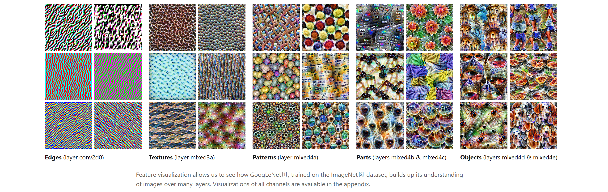
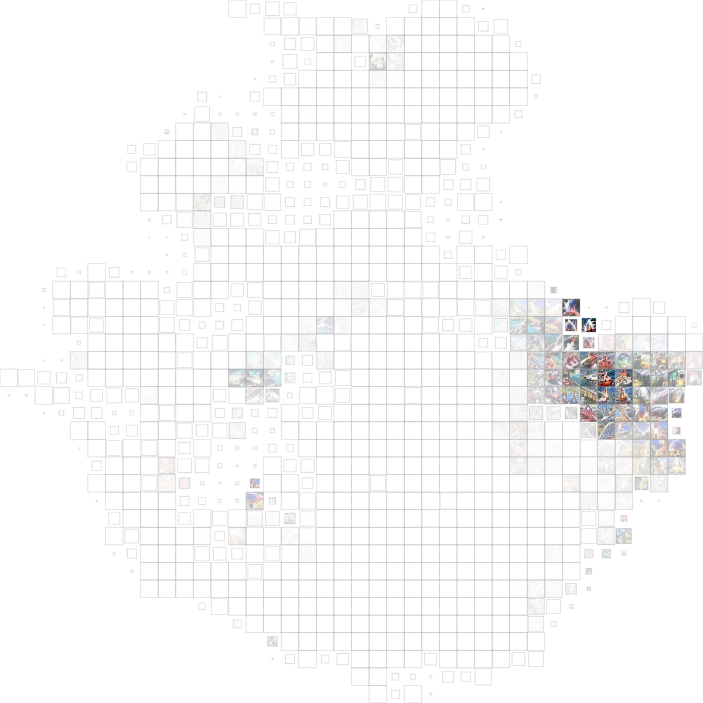
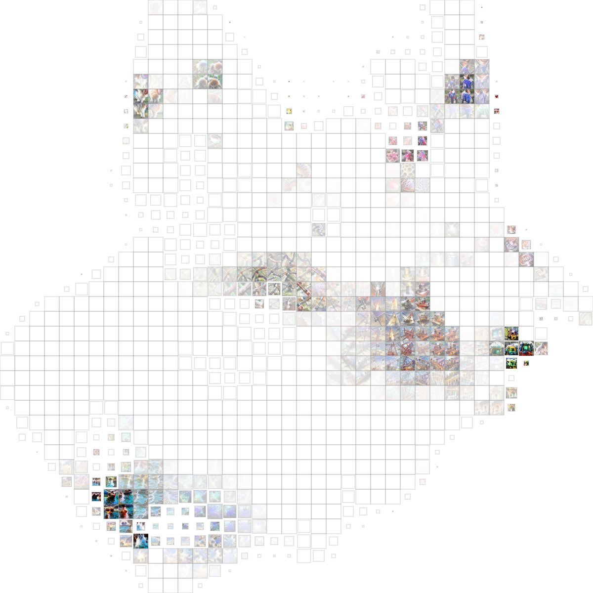

# 逐層抽象

## 是什麼

CNN 的每一層建立在前一層的激活值上；越往後，表示的東西越具體、越複雜，也越接近輸出類別（[Exploring Neural Networks with Activation Atlases](../sources/activation-atlas.md) § Looking at Multiple Layers）。各篇的描述：

- **d2l：** 直覺上，靠近輸入的低層可能有些通道專門辨認邊緣，有些辨認紋理（[d2l](../sources/d2l-ch7.md) § 7.1.4. Channels）。
- **Feature Visualization：** 用最佳化畫出 GoogLeNet 各層的通道，由低到高依序像邊緣（conv2d0）、紋理（mixed3a）、圖案（mixed4a）、部件（mixed4b、mixed4c）、物體（mixed4d、mixed4e）（[Feature Visualization](../sources/feature-visualization.md) § Feature Visualization）。
- **Building Blocks：** 比較 mixed3a、mixed4a、mixed4d、mixed5a 的[激活網格](../methods/activation-grid.md)，網路的理解從前面幾層的邊緣，變成後面幾層更複雜的形狀和物件部位（[The Building Blocks of Interpretability](../sources/building-blocks.md) § What Does the Network See?）。
- **Activation Atlas：** 比較三層的[激活圖譜](../methods/activation-atlas.md)，前面的層（例如 mixed3b）表示紋理和簡單圖案；中間的層（例如 mixed4c）的圖示是眼睛、葉子、水這類很多類別共用的概念；最後的層（例如 mixed5b）的抽象概念和輸出類別更接近（[Exploring Neural Networks with Activation Atlases](../sources/activation-atlas.md) § Looking at Multiple Layers）。

> 原文（d2l-ch7）：Intuitively, you might imagine that at lower layers that are closer to inputs, some channels could become specialized to recognize edges while others could recognize textures.

> 原文（building-blocks）：And, by working across layers (eg. "mixed3a", "mixed4d"), we can observe how the network's understanding evolves: from detecting edges in earlier layers, to more sophisticated shapes and object parts in the latter.

> 原文（activation-atlas）：By mid layers (eg. mixed4c), icons evoke individual concepts like eyes, leaves, water, that are shared among many classes.

圖：GoogLeNet 由低到高各層的特徵視覺化，圖中標示 Edges（conv2d0）、Textures（mixed3a）、Patterns（mixed4a）、Parts（mixed4b、mixed4c）、Objects（mixed4d、mixed4e）（[Feature Visualization](../sources/feature-visualization.md) § Feature Visualization）

**不只細分，也組合出新概念。** Activation Atlas 指出，後面的層除了把概念細分，也把舊概念組合成新概念：在 mixed4c，沙和水是兩個不同的概念，都強烈歸因到「sandbar」；到了 mixed5b，兩者似乎融合成一個激活（[Exploring Neural Networks with Activation Atlases](../sources/activation-atlas.md) § Looking at Multiple Layers）。

> 原文（activation-atlas）：There is another phenomenon worth noting: not only are concepts being refined, but new concepts are appearing out of combinations of old ones.

**激活空間的形狀逐層改變。** 看連續幾層裡相似的區域，可以看到概念一層層細分（[Exploring Neural Networks with Activation Atlases](../sources/activation-atlas.md) § Looking at Multiple Layers）：

- mixed4a：一塊模糊的「哺乳類」區域（[Exploring Neural Networks with Activation Atlases](../sources/activation-atlas.md) § Looking at Multiple Layers）。
- mixed4b：動物和人分開，中間出現一些水果和食物（[Exploring Neural Networks with Activation Atlases](../sources/activation-atlas.md) § Looking at Multiple Layers）。
- mixed4c：所有概念再細分成一個個小「半島」（[Exploring Neural Networks with Activation Atlases](../sources/activation-atlas.md) § Looking at Multiple Layers）。
- mixed4d、mixed4e：繼續特化（[Exploring Neural Networks with Activation Atlases](../sources/activation-atlas.md) § Looking at Multiple Layers）。

> 原文（activation-atlas）：In mixed4a we see very vague, generic blob, which gets refined into much more specific "peninsulas" by mixed4e.

其他例子：mixed4a 有彎曲的邊緣偵測器，mixed5b 有碗和杯子；mixed4b 這類前面的層把紋理相似的東西排在一起，例如布料，後面的層則出現特定種類的衣服（[Exploring Neural Networks with Activation Atlases](../sources/activation-atlas.md) § Looking at Multiple Layers）。

圖見原文：[Exploring Neural Networks with Activation Atlases：Looking at Multiple Layers（各層的激活圖譜並排比較）](https://distill.pub/2019/activation-atlas/#all-layer-comparison)（[Exploring Neural Networks with Activation Atlases](../sources/activation-atlas.md) § Looking at Multiple Layers）

## 為什麼重要

**要整體理解模型，就要看抽象概念怎麼跨層發展。** 卷積網路通常很深，由很多層逐步建立更強的抽象概念（[Exploring Neural Networks with Activation Atlases](../sources/activation-atlas.md) § Looking at Multiple Layers）。

> 原文（activation-atlas）：In order to get a holistic view, we must look at how the model's abstractions develop over several layers.

**同一個類別，不同層用不同的東西判斷。** 在最後的 mixed5b，對「消防船」（fireboat）貢獻大的激活值集中在一群：紅色的船和噴濺的水（[Exploring Neural Networks with Activation Atlases](../sources/activation-atlas.md) § Focusing on a Single Classification）。往前一點的 mixed4d 分成好幾群：窗戶、間歇泉和水花、像起重機的東西，像是網路在後面的層用來判斷消防船的組成概念（[Exploring Neural Networks with Activation Atlases](../sources/activation-atlas.md) § Focusing on a Single Classification）。

> 原文（activation-atlas）：It's almost as if we can see a collection of the component concepts the network will use in later layers to classify "fireboat".

> 原文（activation-atlas）：Windows + crane + water = "fireboat".

圖：上圖是 mixed5b、下圖是 mixed4d 的激活圖譜，不透明度依每個激活值對「消防船」的貢獻；mixed5b 集中在一群，mixed4d 分散在好幾群（[Exploring Neural Networks with Activation Atlases](../sources/activation-atlas.md) § Focusing on a Single Classification）

**前面的層單獨看，很難對應到類別。** 前面的層平均歸因很小，最支持的類別相當隨意，因為紋理這類低階視覺特徵沒有脈絡時不太能區分類別（[Exploring Neural Networks with Activation Atlases](../sources/activation-atlas.md) § Aggregating Multiple Images）。

## 和其他概念的關係

- [感受野](receptive-field.md)：後面的層感受野通常比前面的層大，看到影像中較大的範圍，所以概念似乎涵蓋物體較完整的部分（[Exploring Neural Networks with Activation Atlases](../sources/activation-atlas.md) § Looking at Multiple Layers）。d2l 也說網路越深，每個隱藏節點的感受野越大（[d2l](../sources/d2l-ch7.md) § 7.5. Pooling）。
- [通道](channel.md)：主流架構通常越深通道越多（[d2l](../sources/d2l-ch7.md) § 7.4.2. Multiple Output Channels）。
- [特徵視覺化](../methods/feature-visualization.md)：上面各層的圖都是用特徵視覺化畫的（[Feature Visualization](../sources/feature-visualization.md) § Feature Visualization；[Exploring Neural Networks with Activation Atlases](../sources/activation-atlas.md) § Aggregating Multiple Images）。
- [激活圖譜](../methods/activation-atlas.md)：比較各層時，兩層之間沒有對齊，相似的特徵出現在隨機的位置（[Exploring Neural Networks with Activation Atlases](../sources/activation-atlas.md) § No alignment between layers）。
- [歸因](../methods/attribution.md)：mixed5b 和 logit 之間是線性關係，更前面的層要用後面幾層的線性近似來估計對類別的貢獻（[Exploring Neural Networks with Activation Atlases](../sources/activation-atlas.md) § Focusing on a Single Classification）。

> 原文（activation-atlas）：The later layers also tend to have larger receptive fields than the ones that precede them (meaning they are shown larger subsets of the image) so the concepts seem to encompass more of the whole of objects.

## 說法不一致

**mixed3a 是邊緣還是紋理。** Building Blocks 說前面的層偵測邊緣，比較的最前一層是 mixed3a（[The Building Blocks of Interpretability](../sources/building-blocks.md) § What Does the Network See?）。Feature Visualization 的圖把 mixed3a 標成紋理，邊緣標在更前面的 conv2d0（[Feature Visualization](../sources/feature-visualization.md) § Feature Visualization）。

本 Wiki 以 Feature Visualization 的層名對照為主：它逐層標出各層像什麼；Activation Atlas 說 mixed3b 表示紋理和簡單圖案，和它一致；Building Blocks 的句子描述的是整體趨勢，沒有逐層標出（[Feature Visualization](../sources/feature-visualization.md) § Feature Visualization；[Exploring Neural Networks with Activation Atlases](../sources/activation-atlas.md) § Looking at Multiple Layers；[The Building Blocks of Interpretability](../sources/building-blocks.md) § What Does the Network See?）。

> 原文（activation-atlas）：In early layers (eg. mixed3b), the network seems to represents textures and simple patterns.

## 相關頁面

- [Exploring Neural Networks with Activation Atlases](../sources/activation-atlas.md)
- [Feature Visualization](../sources/feature-visualization.md)
- [The Building Blocks of Interpretability](../sources/building-blocks.md)
- [d2l 第 7 章](../sources/d2l-ch7.md)
- [感受野](receptive-field.md)
- [通道](channel.md)
- [特徵視覺化](../methods/feature-visualization.md)
- [激活網格](../methods/activation-grid.md)
- [激活圖譜](../methods/activation-atlas.md)
- [歸因](../methods/attribution.md)
