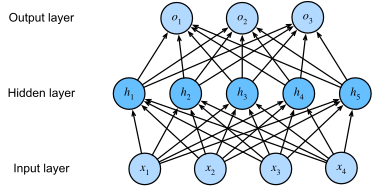

# 神經網路基礎

## 是什麼

參數（parameter）是決定程式行為的數字，可以想成能轉動的旋鈕；參數固定下來的程式叫模型（model）（[d2l 基礎](../sources/d2l-basics.md) § 1.1. A Motivating Example）。

> 原文（d2l-basics）：You can think of the parameters as knobs that we can turn, manipulating the behavior of the program.

神經網路可以把很多層（layer）疊起來：每一層把結果交給下一層，直到產生輸出（[d2l 基礎](../sources/d2l-basics.md) § 5.1.1.2. Incorporating Hidden Layers）。

> 原文（d2l-basics）：Each layer feeds into the layer above it, until we generate outputs.

全連接層（fully connected layer）裡，每個輸入都影響這一層的每個神經元（neuron）（[d2l 基礎](../sources/d2l-basics.md) § 5.1.1.2. Incorporating Hidden Layers）。

> 原文（d2l-basics）：Every input influences every neuron in the hidden layer, and each of these in turn influences every neuron in the output layer.

圖：全連接網路，由下到上是 4 個輸入、有 5 個神經元的隱藏層和 3 個輸出；每個輸入都連到隱藏層的每個神經元（[d2l 基礎](../sources/d2l-basics.md) § 5.1.1.2. Incorporating Hidden Layers）

## 為什麼重要

d2l 第 7 章從全連接層出發，推導出卷積層（[d2l](../sources/d2l-ch7.md) § 7.1. From Fully Connected Layers to Convolutions）。

要讓每個隱藏單元都接收每個輸入像素，1000×1000 的影像接到同樣大小的隱藏表示，一層就要 $10^{12}$ 個參數（[d2l](../sources/d2l-ch7.md) § 7.1.2. Constraining the MLP）。

> 原文（d2l-ch7）：This requires \(10^{12}\) parameters, far beyond what computers currently can handle.

## 和其他概念的關係

- [卷積層](convolutional-layer.md)：對全連接層加上平移不變性和局部性兩個限制，就推出卷積層（[d2l](../sources/d2l-ch7.md) § 7.1.2.1. Translation Invariance；[d2l](../sources/d2l-ch7.md) § 7.1.2.2. Locality）。
- [訓練與梯度下降](../methods/gradient-descent.md)：參數的值是訓練時用資料找出來的（[d2l 基礎](../sources/d2l-basics.md) § 1.1. A Motivating Example）。
- [特徵圖](feature-map.md)：每一格是一個激活值，也就是一個神經元激發的程度（[The Building Blocks of Interpretability](../sources/building-blocks.md) § Making Sense of Hidden Layers）。

## 說法不一致

「神經元」在兩篇來源指的範圍不同。d2l 在全連接網路裡，把一層中算出來的一個單位叫神經元，也叫隱藏單元（hidden unit）（[d2l 基礎](../sources/d2l-basics.md) § 3.1.4. Linear Regression as a Neural Network；[d2l 基礎](../sources/d2l-basics.md) § 5.1.1.2. Incorporating Hidden Layers）。Feature Visualization 用 $\text{layer}_n[x,y,z]$ 指 CNN 某一層、某個元素、某個通道上的一個值（[Feature Visualization](../sources/feature-visualization.md) § Optimization Objectives）。

本 Wiki 講 CNN 時以 Feature Visualization 的定義為主軸，因為這份 Wiki 的主題是 CNN 的特徵圖；講全連接層時照 d2l 的說法（[d2l 基礎](../sources/d2l-basics.md) § 5.1.1.2. Incorporating Hidden Layers；[Feature Visualization](../sources/feature-visualization.md) § Optimization Objectives）。

## 相關頁面

- [d2l 基礎小節](../sources/d2l-basics.md)
- [訓練與梯度下降](../methods/gradient-descent.md)
- [卷積層](convolutional-layer.md)
- [特徵圖](feature-map.md)
