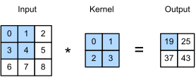

# 感受野

## 是什麼

在 CNN 裡，某一層的元素 $x$ 的感受野（receptive field），是前向傳播時可能影響 $x$ 計算結果的所有前層元素（[d2l](../sources/d2l-ch7.md) § 7.2.6. Feature Map and Receptive Field）。感受野可能比輸入的實際大小還大（[d2l](../sources/d2l-ch7.md) § 7.2.6. Feature Map and Receptive Field）。

> 原文（d2l-ch7）：In CNNs, for any element \(x\) of some layer, its receptive field refers to all the elements (from all the previous layers) that may affect the calculation of \(x\) during the forward propagation.

> 原文（d2l-ch7）：Note that the receptive field may be larger than the actual size of the input.

例子：下圖是 3×3 輸入配 2×2 卷積核，輸出值 19 那個元素的感受野，就是輸入陰影部分的 4 個元素。把 2×2 的輸出 $\mathbf{Y}$ 再接一層 2×2 卷積層、輸出單一元素 $z$，則 $z$ 在 $\mathbf{Y}$ 上的感受野是 $\mathbf{Y}$ 的全部 4 個元素，在輸入上的感受野是全部 9 個元素（[d2l](../sources/d2l-ch7.md) § 7.2.6. Feature Map and Receptive Field）。

圖：二維卷積運算，輸入的陰影部分就是輸出 19 的感受野（[d2l](../sources/d2l-ch7.md) § 7.2.1. The Cross-Correlation Operation；[d2l](../sources/d2l-ch7.md) § 7.2.6. Feature Map and Receptive Field）

## 為什麼重要

特徵圖裡的元素如果需要更大的感受野，才能偵測輸入中更大範圍的特徵，就把網路做深（[d2l](../sources/d2l-ch7.md) § 7.2.6. Feature Map and Receptive Field）。

> 原文（d2l-ch7）：Thus, when any element in a feature map needs a larger receptive field to detect input features over a broader area, we can build a deeper network.

很多任務最後問的是整張影像的問題，例如「裡面有沒有貓」，所以最後一層的單元要對整個輸入敏感。網路越深，每個隱藏節點的感受野（相對於輸入）越大（[d2l](../sources/d2l-ch7.md) § 7.5. Pooling）。

> 原文（d2l-ch7）：The deeper we go in the network, the larger the receptive field (relative to the input) to which each hidden node is sensitive.

感受野這個名稱來自神經生理學。Hubel 和 Wiesel 的一系列動物實驗發現，視覺皮質的低層大多對邊緣和相關形狀有反應；後來 Field (1987) 在自然影像上用可以稱為卷積核的東西說明了這個效應（[d2l](../sources/d2l-ch7.md) § 7.2.6. Feature Map and Receptive Field）。Kuzovkin et al. (2018) 顯示，這種對應連影像分類網路深層算出的特徵也成立（[d2l](../sources/d2l-ch7.md) § 7.2.6. Feature Map and Receptive Field）。

圖見原文：[d2l 7.2.6 Feature Map and Receptive Field](https://d2l.ai/chapter_convolutional-neural-networks/conv-layer.html#feature-map-and-receptive-field)（[d2l](../sources/d2l-ch7.md) § 7.2.6. Feature Map and Receptive Field）

> 原文（d2l-ch7）：Receptive fields derive their name from neurophysiology.

## 和其他概念的關係

- [局部性](locality.md)：單一層只看局部，靠疊深讓感受野變大（[d2l](../sources/d2l-ch7.md) § 7.2.6. Feature Map and Receptive Field）。
- [池化](../methods/pooling.md)：降低空間解析度會加快感受野變大，因為卷積核蓋住的有效面積變大了（[d2l](../sources/d2l-ch7.md) § 7.5. Pooling）。
- [通道](channel.md)：感受野是對特徵圖裡的元素定義的，特徵圖就是一層的輸出（[d2l](../sources/d2l-ch7.md) § 7.2.6. Feature Map and Receptive Field）。

> 原文（d2l-ch7）：Reducing spatial resolution accelerates this process, since the convolution kernels cover a larger effective area.

## 相關頁面

- [d2l 第 7 章](../sources/d2l-ch7.md)
- [局部性](locality.md)
- [卷積運算](../methods/convolution-operation.md)
- [池化](../methods/pooling.md)
