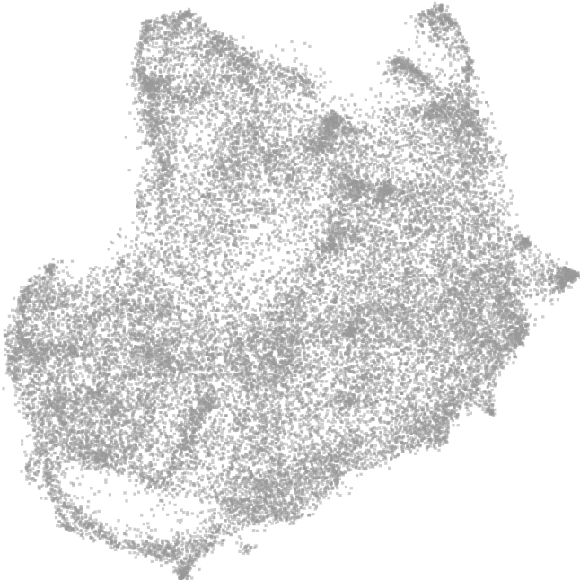
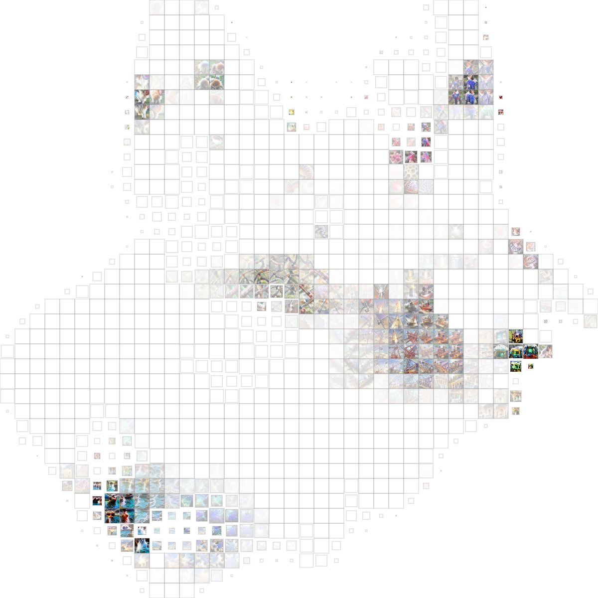
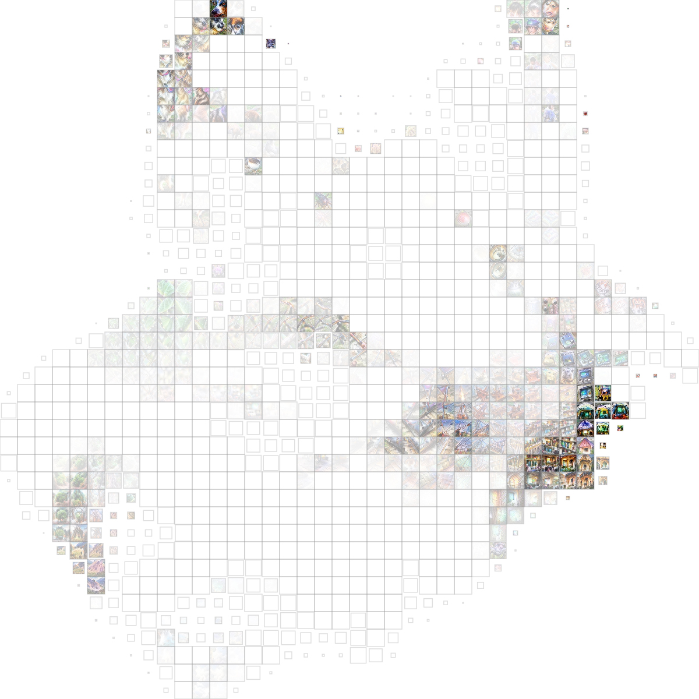
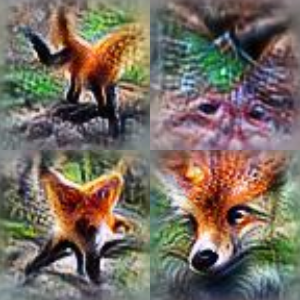
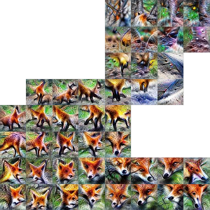
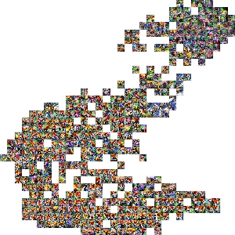

# 激活圖譜

## 輸入

- 一個訓練好的影像分類網路和要看的那一層；Activation Atlas 用 GoogLeNet（原文叫 InceptionV1），主要看網路中間的 mixed4c（[Exploring Neural Networks with Activation Atlases](../sources/activation-atlas.md) § Looking at a Single Image；[Exploring Neural Networks with Activation Atlases](../sources/activation-atlas.md) § Aggregating Multiple Images）。
- 一大批影像：原文從 ImageNet 訓練資料隨機選一百萬張；圖譜只會顯示這批資料的分布裡出現的激活值（[Exploring Neural Networks with Activation Atlases](../sources/activation-atlas.md) § Introduction）。

> 原文（activation-atlas）：As a result, they will only show the activations that exist within the distribution of the sample data.

## 步驟

1. 把每張影像送進網路，跑到要看的那一層，收集激活值（activation）（[Exploring Neural Networks with Activation Atlases](../sources/activation-atlas.md) § Looking at a Single Image）。因為是卷積網路，同一組通道在前一層的每個重疊區塊（patch）上都算一次（原文說同樣的 neurons），所以一張影像在一層有好幾百個激活向量，也就是[激活網格](activation-grid.md)的每一格（[Exploring Neural Networks with Activation Atlases](../sources/activation-atlas.md) § Looking at a Single Image）。
2. 每張影像隨機取一個位置的激活向量（activation vector，原文叫 spatial activation），避開影像邊緣；一百萬張影像得到一百萬個激活向量，每個可能有 512 維（[Exploring Neural Networks with Activation Atlases](../sources/activation-atlas.md) § Aggregating Multiple Images）。
3. 用 UMAP 或 t-SNE 這類降維（dimensionality reduction）方法把激活向量投影到二維，保留原本空間的一部分局部結構，相似的激活向量排在附近（[Exploring Neural Networks with Activation Atlases](../sources/activation-atlas.md) § Aggregating Multiple Images）。
4. 在二維圖上畫格子，把每個格子（grid cell）裡的激活向量取平均（[Exploring Neural Networks with Activation Atlases](../sources/activation-atlas.md) § Aggregating Multiple Images）。
5. 對每個格子的平均激活向量做特徵視覺化（feature visualization，原文在這裡也叫 feature inversion），得到這一格的圖示；可以再依格子裡平均了多少個激活向量（密度）調整格子大小（[Exploring Neural Networks with Activation Atlases](../sources/activation-atlas.md) § Aggregating Multiple Images）。
6. 對每個激活向量算歸因向量（attribution vector）；每一格顯示格子裡歸因向量的平均，標上這一格最支持的類別（[Exploring Neural Networks with Activation Atlases](../sources/activation-atlas.md) § Aggregating Multiple Images；[Exploring Neural Networks with Activation Atlases](../sources/activation-atlas.md) § Exploring Neural Networks with Activation Atlases）。

> 原文（activation-atlas）：Thus, when we pass an entire image through the network, each neuron will be evaluated hundreds of times, once for each overlapping patch of the image.

> 原文（activation-atlas）：For each cell in our grid, we average all the activations that lie within the boundaries of that cell, and use feature visualization to create an iconic representation.


圖：步驟 3 的結果，mixed4c 的激活向量用 UMAP 降到二維後畫成點，相似的激活向量排在附近（[Exploring Neural Networks with Activation Atlases](../sources/activation-atlas.md) § Aggregating Multiple Images）

圖見原文：[Exploring Neural Networks with Activation Atlases：Aggregating Multiple Images（從一百萬張影像到激活圖譜的流程）](https://distill.pub/2019/activation-atlas/#process)（[Exploring Neural Networks with Activation Atlases](../sources/activation-atlas.md) § Aggregating Multiple Images）

### 聚焦單一類別

1. 算每個激活值對某個類別（例如「消防船」fireboat）的貢獻，對應到圖示的不透明度；貢獻小或負的區域完全透明（[Exploring Neural Networks with Activation Atlases](../sources/activation-atlas.md) § Focusing on a Single Classification）。
2. mixed5b 的激活值和 logit 之間是線性關係，貢獻可以直接算；和輸出之間隔了好幾層時，作者用後面那幾層的線性近似來估計（[Exploring Neural Networks with Activation Atlases](../sources/activation-atlas.md) § Focusing on a Single Classification）。

### 類別激活圖譜

1. 把其他激活值移除，而不只是調暗，對和這個類別有關的激活向量重新降維，做成類別激活圖譜（class activation atlas）（[Exploring Neural Networks with Activation Atlases](../sources/activation-atlas.md) § Further Isolating Classes）。
2. 選激活值的方法有兩種：只留最強歸因指向這個類別的激活值，會包含整體強度低的背景偵測器；或依大小篩選，保留和這個類別強相關、但自己可能更支持別的類別的激活值，例如浮潛者旁邊的魚（[Exploring Neural Networks with Activation Atlases](../sources/activation-atlas.md) § Further Isolating Classes）。
3. 比較兩個類別時，橫軸畫兩個類別的歸因差，縱軸用 t-SNE 把相似的激活向量排在一起（[Exploring Neural Networks with Activation Atlases](../sources/activation-atlas.md) § Further Isolating Classes）。

> 原文（activation-atlas）：We'll plot the difference between the attributions of the "snorkel" and "scuba diver" horizontally, and use t-SNE to cluster similar activations vertically.

圖見原文：[Exploring Neural Networks with Activation Atlases：Further Isolating Classes（「snorkel」的類別激活圖譜）](https://distill.pub/2019/activation-atlas/#class-subset)（[Exploring Neural Networks with Activation Atlases](../sources/activation-atlas.md) § Further Isolating Classes）

圖見原文：[Exploring Neural Networks with Activation Atlases：Further Isolating Classes（「snorkel」和「scuba diver」的歸因差）](https://distill.pub/2019/activation-atlas/#class-gradient-snorkel)（[Exploring Neural Networks with Activation Atlases](../sources/activation-atlas.md) § Further Isolating Classes）

## 輸出

**一層的激活圖譜。** mixed4c 的圖譜裡，左上是動物的頭，比較像眼睛、毛、鼻子這類一般哺乳類的組成部分，而不是分成不同的動物類別；往下依序是毛和四足動物的背、腳、地面，再過渡到海灘和水；另一側有文字偵測器、人、依顏色排列的圓形食物和水果（[Exploring Neural Networks with Activation Atlases](../sources/activation-atlas.md) § Aggregating Multiple Images）。同一組激活值會支持很多類別，例如辨認「seashore」用的海水，也用來分類「starfish」和「sea lion」（[Exploring Neural Networks with Activation Atlases](../sources/activation-atlas.md) § Aggregating Multiple Images）。

> 原文（activation-atlas）：While not unexpected, it is reassuring to see that the activations that are used to identify the sea for the class "seashore" are the same ones used when classifying "starfish" or "sea lion".

**圖譜上的路徑。** 可以在圖譜上畫出彎曲的路徑，對應人看得懂的性質：水果的大小和數量、畫面裡的人數、從水到海灘到岩壁、植物的模糊程度（[Exploring Neural Networks with Activation Atlases](../sources/activation-atlas.md) § Aggregating Multiple Images）。但這些路徑是事後在低維投影裡畫的，不知道它們在原本的高維[激活空間](../concepts/activation-space.md)裡怎麼走（[Exploring Neural Networks with Activation Atlases](../sources/activation-atlas.md) § Aggregating Multiple Images）。

> 原文（activation-atlas）：It is important to note that these paths are constructed after the fact in the low-dimensional projection.

**前面的層。** 前面的層平均歸因很小，最支持的類別相當隨意，因為紋理這類低階視覺特徵沒有脈絡時不太能區分類別；層與層的比較見[逐層抽象](../concepts/layer-abstraction.md)（[Exploring Neural Networks with Activation Atlases](../sources/activation-atlas.md) § Aggregating Multiple Images）。

> 原文（activation-atlas）：At early layers, the average attribution is very small and the top classes are fairly arbitrary because low-level visual features like textures tend to not be very discriminative without context.

**聚焦單一類別。** mixed4d 的「消防船」圖譜有好幾群：窗戶、間歇泉和水花、像起重機的東西；其中窗戶那一群單獨看時更支持「路面電車」（streetcar）（[Exploring Neural Networks with Activation Atlases](../sources/activation-atlas.md) § Focusing on a Single Classification）。從輸入範例看，建築物和水的背景是區分這兩類的簡單方法（[Exploring Neural Networks with Activation Atlases](../sources/activation-atlas.md) § Focusing on a Single Classification）。

> 原文（activation-atlas）：If we look at a couple of input examples, we can see how buildings and water backgrounds are an easy way to differentiate between a "fireboat" and a "streetcar".



圖：同一張 mixed4d 圖譜，上圖的不透明度依對「消防船」的貢獻，下圖依對「路面電車」的貢獻（[Exploring Neural Networks with Activation Atlases](../sources/activation-atlas.md) § Focusing on a Single Classification）

**類別激活圖譜。** 以「snorkel」為例，可以清楚看到海洋、水下和彩色面罩；比較兩個相近的類別，找到了[多用途特徵](../concepts/multi-use-features.md)（[Exploring Neural Networks with Activation Atlases](../sources/activation-atlas.md) § Further Isolating Classes）。

> 原文（activation-atlas）：In the "snorkel" example we can clearly see ocean, underwater, and colorful masks.

## 公式與參數

**特徵視覺化的目標。** 一般要畫激活空間裡的方向 $v$ 時，是讓位置 $(x,y)$ 的激活向量 $h_{x,y}$ 和它的內積 $h_{x,y} \cdot v$ 最大；Activation Atlas 把內積乘上餘弦相似度（cosine similarity），讓角度的權重更大（[Exploring Neural Networks with Activation Atlases](../sources/activation-atlas.md) § Aggregating Multiple Images）：

```math
\frac{(h_{x,y} \cdot v)^{n+1}}{(||h_{x,y}|| \cdot ||v||)^{n}}
```

- $h_{x,y}$：最佳化中的影像在位置 $(x,y)$ 的激活向量（[Exploring Neural Networks with Activation Atlases](../sources/activation-atlas.md) § Aggregating Multiple Images）。
- $v$：要畫的方向，例如一個格子的平均激活向量（[Exploring Neural Networks with Activation Atlases](../sources/activation-atlas.md) § Aggregating Multiple Images）。
- 另外把激活空間白化（whitening），把被拉伸的空間拉回來，也有助於特徵視覺化；作者說還沒完全理解這個現象（[Exploring Neural Networks with Activation Atlases](../sources/activation-atlas.md) § Aggregating Multiple Images）。

> 原文（activation-atlas）：We find it helpful to use an objective that emphasizes angle more heavily by multiplying the dot product by cosine similarity, leading to objectives of the following form:

> 原文（activation-atlas）：We also find that whitening the activation space to unstretch it can help improve feature visualization.

**歸因。** 沿用 Building Blocks：位置 $(x,y)$ 的激活向量對類別 $c$ 的 logit 的歸因如下，見[歸因](attribution.md)（[Exploring Neural Networks with Activation Atlases](../sources/activation-atlas.md) § Aggregating Multiple Images）：

```math
h_{x,y} \cdot \nabla_{h_{x,y}} \text{logit}_c
```

- 歸因向量：每個類別一個值，近似這個激活向量對各類 logit 的影響（[Exploring Neural Networks with Activation Atlases](../sources/activation-atlas.md) § Aggregating Multiple Images）。
- 一格的歸因是格子裡歸因向量的平均，可以看成這一格傾向支持哪些類別，把不同的脈絡平均掉（marginalizing over contexts）（[Exploring Neural Networks with Activation Atlases](../sources/activation-atlas.md) § Aggregating Multiple Images）。

> 原文（activation-atlas）：The attribution vector has an entry for each class, and approximates the amount that the activation vector influenced the logit for each class.

> 原文（activation-atlas）：This average attribution can be thought of as showing what classes that cell tends to support, marginalizing over contexts.

### 參數

- 樣本數：作者一般用一百萬個激活值，發現十萬個常常就夠（[Exploring Neural Networks with Activation Atlases](../sources/activation-atlas.md) § Sampling based）。
- 降維方法和它的超參數（hyperparameters）：UMAP 和 t-SNE 都合理，但結果會不同，而且對超參數很敏感；類別激活圖譜通常用 t-SNE 效果較好（[Exploring Neural Networks with Activation Atlases](../sources/activation-atlas.md) § Dependency on hyperparameters；[Exploring Neural Networks with Activation Atlases](../sources/activation-atlas.md) § Further Isolating Classes）。
- 格子大小：像直方圖的 bin 大小，有點任意，選錯可能把重要的特徵平均掉；原文後面的一些範例把格子大小綁在縮放程度上（[Exploring Neural Networks with Activation Atlases](../sources/activation-atlas.md) § Dependency on hyperparameters）。

> 原文（activation-atlas）：Choosing the wrong bin size can sometimes hide important features in the averages.

  
圖：同一張圖譜用 2×2、8×8、32×32 三種格子大小畫出（[Exploring Neural Networks with Activation Atlases](../sources/activation-atlas.md) § Dependency on hyperparameters）

圖見原文：[Exploring Neural Networks with Activation Atlases：Sampling based（一萬、十萬、一百萬個激活值畫出的圖譜）](https://distill.pub/2019/activation-atlas/#samples)（[Exploring Neural Networks with Activation Atlases](../sources/activation-atlas.md) § Sampling based）

## 為什麼這樣設計

- **平均，而不是畫一百萬個點：** 一張一張看激活網格無法擴展，人腦也不擅長比較大量沒有結構的例子；就像要用直方圖才能理解幾百萬個數字，要先整理、匯總激活值，才看得出模式（[Exploring Neural Networks with Activation Atlases](../sources/activation-atlas.md) § Aggregating Multiple Images）。
- **畫特徵視覺化，而不是輸入影像：** CNN codes 顯示模型認為相似的影像，可以推測網路回應哪些特徵；特徵視覺化讓這些關聯明確得多（[Exploring Neural Networks with Activation Atlases](../sources/activation-atlas.md) § Introduction）。
- **看激活向量，而不是單一神經元：** 網路很少單獨使用一個神經元；激活圖譜顯示神經元的常見組合（[Exploring Neural Networks with Activation Atlases](../sources/activation-atlas.md) § Introduction）。
- **降維後分格，而不是分群（clustering）：** 作者試過 k-means、spherical k-means、DBSCAN，群中心的視覺化主觀上更差、更難懂；降維後分格還能有多種細節層級，又保持空間一致，圖譜才能縮放（[Exploring Neural Networks with Activation Atlases](../sources/activation-atlas.md) § Dimensionality reduction vs clustering）。

> 原文（activation-atlas）：In the same way that we need a tool like a histogram in order to understand millions of numbers, we need a way to aggregate and organize activations if we want to see meaningful patterns in millions of them.

> 原文（activation-atlas）：However, the images produced by visualizing the resulting centroids were subjectively worse and less interpretable than the technique described in this article.

## 比較

### 三種看隱藏層的介面

| | 激活網格 | 矩陣分解 | 激活圖譜 |
|---|---|---|---|
| 看的資料 | 一張影像每個位置的激活向量（[The Building Blocks of Interpretability](../sources/building-blocks.md) § What Does the Network See?） | 一張影像的激活值，分成少數幾個神經元群組（[The Building Blocks of Interpretability](../sources/building-blocks.md) § Making Things Human-Scale） | 一百萬張影像，每張取一個位置的激活向量（[Exploring Neural Networks with Activation Atlases](../sources/activation-atlas.md) § Aggregating Multiple Images） |
| 怎麼整理 | 照影像上的位置排成網格（[The Building Blocks of Interpretability](../sources/building-blocks.md) § What Does the Network See?） | 把特徵圖攤平成矩陣，做矩陣分解（[The Building Blocks of Interpretability](../sources/building-blocks.md) § Making Things Human-Scale） | 降維到二維後畫格子，每格取平均（[Exploring Neural Networks with Activation Atlases](../sources/activation-atlas.md) § Aggregating Multiple Images） |
| 看到什麼 | 網路怎麼看這一張影像（[Exploring Neural Networks with Activation Atlases](../sources/activation-atlas.md) § Aggregating Multiple Images） | 少數幾個神經元群組，濃縮成網路在這張影像上的簡短故事（[The Building Blocks of Interpretability](../sources/building-blocks.md) § Making Things Human-Scale） | 從網路的眼睛看出去的全局地圖，呈現神經元的常見組合（[Exploring Neural Networks with Activation Atlases](../sources/activation-atlas.md) § Introduction） |

### 降維後分格和分群

| | 降維後分格（原文採用） | 分群（k-means 等） |
|---|---|---|
| 代表點 | 格子裡激活向量的平均，不保證接近網路實際產生的激活值群（[Exploring Neural Networks with Activation Atlases](../sources/activation-atlas.md) § Dimensionality reduction vs clustering） | 群中心，照定義接近網路產生的激活值群（[Exploring Neural Networks with Activation Atlases](../sources/activation-atlas.md) § Dimensionality reduction vs clustering） |
| 視覺化結果 | 原文的圖譜用這個做法（[Exploring Neural Networks with Activation Atlases](../sources/activation-atlas.md) § Dimensionality reduction vs clustering） | 主觀上更差、更難懂（[Exploring Neural Networks with Activation Atlases](../sources/activation-atlas.md) § Dimensionality reduction vs clustering） |

作者說兩種做法之間怎麼取捨，仍是開放問題（[Exploring Neural Networks with Activation Atlases](../sources/activation-atlas.md) § Dimensionality reduction vs clustering）。

## 相關頁面

- [Exploring Neural Networks with Activation Atlases](../sources/activation-atlas.md)
- [激活網格](activation-grid.md)
- [矩陣分解](matrix-factorization.md)
- [歸因](attribution.md)
- [特徵視覺化](feature-visualization.md)
- [正則化與預條件](regularization-and-preconditioning.md)
- [激活空間](../concepts/activation-space.md)
- [多用途特徵](../concepts/multi-use-features.md)
- [逐層抽象](../concepts/layer-abstraction.md)
- [The Building Blocks of Interpretability](../sources/building-blocks.md)
