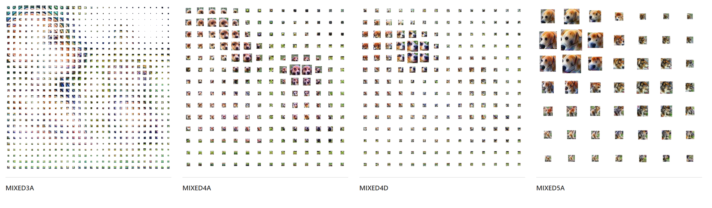

# 激活網格

## 輸入

- 一張輸入影像，以及要看的那一層；Building Blocks 用 GoogLeNet，比較 mixed3a、mixed4a、mixed4d、mixed5a 四層（[The Building Blocks of Interpretability](../sources/building-blocks.md) § What Does the Network See?）。
- 那一層的特徵圖（feature map）：每個元素（原文叫 spatial position）上有一個激活向量（activation vector），由這個位置上所有通道的激活值（activation）組成（[The Building Blocks of Interpretability](../sources/building-blocks.md) § Making Sense of Hidden Layers）。

## 步驟

1. 取一個元素的激活向量（[The Building Blocks of Interpretability](../sources/building-blocks.md) § What Does the Network See?）。
2. 用特徵視覺化（feature visualization）把整個激活向量畫出來：最佳化一張影像，讓它在這個位置的激活值和原本的激活向量內積最大；這樣畫的是這個位置上所有被激發的神經元（neuron）的組合，不是單一神經元（[The Building Blocks of Interpretability](../sources/building-blocks.md) § What Does the Network See?）。
3. 對所有元素做同樣的事，照位置排成網格，就能看到網路在每個位置偵測到什麼，也能看到網路對整張影像的理解（[The Building Blocks of Interpretability](../sources/building-blocks.md) § What Does the Network See?）。
4. 依激活向量的大小縮放每一格的面積，表示網路在那個位置偵測得多強（[The Building Blocks of Interpretability](../sources/building-blocks.md) § What Does the Network See?）。

圖見原文：[The Building Blocks of Interpretability：What Does the Network See?（把一個位置的激活向量畫出來）](https://distill.pub/2018/building-blocks/#ActivationVecVis)（[The Building Blocks of Interpretability](../sources/building-blocks.md) § What Does the Network See?）

> 原文（building-blocks）：Applying this technique to all the activation vectors allows us to not only see what the network detects at each position, but also what the network understands of the input image as a whole.

> 原文（building-blocks）：By scaling the area of each cell by the magnitude of the activation vector, we can indicate how strongly the network detected features at that position

## 輸出


圖：mixed3a、mixed4a、mixed4d、mixed5a 四層的激活網格，每格的面積依激活向量的大小縮放（[The Building Blocks of Interpretability](../sources/building-blocks.md) § What Does the Network See?）

跨層比較時，網路的理解從前面幾層的邊緣，變成後面幾層更複雜的形狀和物件部位（[The Building Blocks of Interpretability](../sources/building-blocks.md) § What Does the Network See?）。圖中越後面的層，網格的格數越少（[The Building Blocks of Interpretability](../sources/building-blocks.md) § What Does the Network See?）。

> 原文（building-blocks）：And, by working across layers (eg. "mixed3a", "mixed4d"), we can observe how the network's understanding evolves: from detecting edges in earlier layers, to more sophisticated shapes and object parts in the latter.

## 公式與參數

步驟 2 的最佳化目標（[The Building Blocks of Interpretability](../sources/building-blocks.md) § What Does the Network See?）：

```math
\max_{I} \; \mathbf{a}_{x,y}(I) \cdot \mathbf{v}_{x,y}
```

- $\mathbf{v}_{x,y}$：原本的輸入影像在位置 $(x,y)$ 的激活向量（[The Building Blocks of Interpretability](../sources/building-blocks.md) § What Does the Network See?）。
- $\mathbf{a}_{x,y}(I)$：最佳化中的影像 $I$ 在同一個位置的激活向量（[The Building Blocks of Interpretability](../sources/building-blocks.md) § What Does the Network See?）。
- 參數：要看哪一層；每格面積依激活向量的大小 $\lVert \mathbf{v}_{x,y} \rVert$ 縮放（[The Building Blocks of Interpretability](../sources/building-blocks.md) § What Does the Network See?）。

## 為什麼這樣設計

- 畫激活向量而不是單一神經元：[語意字典](../concepts/semantic-dictionary.md)（semantic dictionary）讓我們細看一個位置上每個神經元偵測什麼；把整個激活向量一起畫，看的是這些神經元的組合（[The Building Blocks of Interpretability](../sources/building-blocks.md) § What Does the Network See?）。
- 縮放格子：沒縮放的網格少了一項關鍵資訊，也就是激活值的大小（[The Building Blocks of Interpretability](../sources/building-blocks.md) § What Does the Network See?）。

> 原文（building-blocks）：These visualizations, however, omit a crucial piece of information: the magnitude of the activations.

## 相關頁面

- [The Building Blocks of Interpretability](../sources/building-blocks.md)
- [語意字典](../concepts/semantic-dictionary.md)
- [特徵圖](../concepts/feature-map.md)
- [特徵視覺化](feature-visualization.md)
- [激活空間](../concepts/activation-space.md)
- [歸因](attribution.md)
