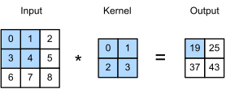
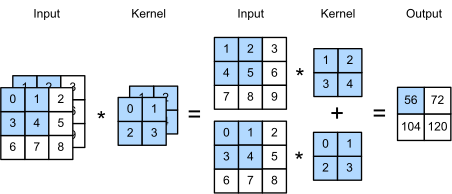
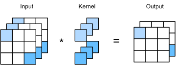

# 卷積運算

## 輸入

- 輸入張量 $\mathbf{X}$：單通道時是 $n_h \times n_w$；有 $c_i$ 個輸入通道時是 $c_i \times n_h \times n_w$（[d2l](../sources/d2l-ch7.md) § 7.2.1. The Cross-Correlation Operation；[d2l](../sources/d2l-ch7.md) § 7.4.1. Multiple Input Channels）。
- 卷積核 $\mathbf{K}$：單通道時是 $k_h \times k_w$；多輸入通道時是 $c_i \times k_h \times k_w$；再有 $c_o$ 個輸出通道時是 $c_o \times c_i \times k_h \times k_w$（[d2l](../sources/d2l-ch7.md) § 7.4.1. Multiple Input Channels；[d2l](../sources/d2l-ch7.md) § 7.4.2. Multiple Output Channels）。
- 卷積層另有一個純量偏置（[d2l](../sources/d2l-ch7.md) § 7.2.2. Convolutional Layers）。

## 步驟

1. 把卷積窗口（convolution window，形狀等於卷積核的高和寬）放在輸入的左上角（[d2l](../sources/d2l-ch7.md) § 7.2.1. The Cross-Correlation Operation）。
2. 窗口由左到右、由上到下滑過輸入。每到一個位置，就把窗口內的輸入子張量和卷積核對應的值相乘、再全部加總，得到一個純量，當作輸出在對應位置的值（[d2l](../sources/d2l-ch7.md) § 7.2.1. The Cross-Correlation Operation）。
3. 卷積層再把結果加上偏置（[d2l](../sources/d2l-ch7.md) § 7.2.2. Convolutional Layers）。

> 原文（d2l-ch7）：When the convolution window slides to a certain position, the input subtensor contained in that window and the kernel tensor are multiplied elementwise and the resulting tensor is summed up yielding a single scalar value.


圖：二維卷積運算。陰影部分是第一個輸出元素，以及計算它用到的輸入和卷積核的值：$0\times0+1\times1+3\times2+4\times3=19$（[d2l](../sources/d2l-ch7.md) § 7.2.1. The Cross-Correlation Operation）

### 多個通道

- 多輸入通道：每個通道各自和對應的卷積核切片做卷積，再把各通道的結果加起來，得到一張二維輸出（[d2l](../sources/d2l-ch7.md) § 7.4.1. Multiple Input Channels）。
- 多輸出通道：每個輸出通道有自己的一組 $c_i \times k_h \times k_w$ 卷積核，並從輸入的所有通道取值（[d2l](../sources/d2l-ch7.md) § 7.4.2. Multiple Output Channels）。

> 原文（d2l-ch7）：Notice that all we are doing is performing a cross-correlation operation per channel and then adding up the results.


圖：兩個輸入通道的卷積運算，第一個輸出元素是兩個通道各自的結果相加：$(1\times1+2\times2+4\times3+5\times4)+(0\times0+1\times1+3\times2+4\times3)=56$（[d2l](../sources/d2l-ch7.md) § 7.4.1. Multiple Input Channels）

### 特例：1×1 卷積

$k_h = k_w = 1$ 的卷積用最小的窗口，失去辨認高寬方向相鄰元素之間交互作用的能力，只在通道維度上計算（[d2l](../sources/d2l-ch7.md) § 7.4.3. 1×1 Convolutional Layer）。它等於在每個像素位置套用同一個全連接層，把 $c_i$ 個輸入值變成 $c_o$ 個輸出值；權重在所有位置共用（[d2l](../sources/d2l-ch7.md) § 7.4.3. 1×1 Convolutional Layer）。

> 原文（d2l-ch7）：The only computation of the \(1\times 1\) convolution occurs on the channel dimension.


圖：1×1 卷積核，3 個輸入通道、2 個輸出通道，輸入和輸出的高寬相同（[d2l](../sources/d2l-ch7.md) § 7.4.3. 1×1 Convolutional Layer）

卷積層後面通常接非線性，所以 1×1 卷積不能直接併進其他卷積裡（[d2l](../sources/d2l-ch7.md) § 7.4.3. 1×1 Convolutional Layer）。

## 輸出

- 單一輸出通道時是一張二維張量。不填充時，卷積核要整個落在影像裡才能計算，所以輸出比輸入小：$(n_h-k_h+1) \times (n_w-k_w+1)$（[d2l](../sources/d2l-ch7.md) § 7.2.1. The Cross-Correlation Operation）。
- 有 $c_o$ 個輸出通道時就是 $c_o$ 張（[d2l](../sources/d2l-ch7.md) § 7.4.2. Multiple Output Channels）。
- 卷積層的輸出叫特徵圖（[d2l](../sources/d2l-ch7.md) § 7.2.6. Feature Map and Receptive Field）。
- 用填充和步幅可以改變輸出大小，見[填充與步幅](padding-and-stride.md)（[d2l](../sources/d2l-ch7.md) § 7.3. Padding and Stride）。

## 公式與參數

不填充、步幅 1 時的輸出大小（[d2l](../sources/d2l-ch7.md) § 7.2.1. The Cross-Correlation Operation）：

```math
(n_h-k_h+1) \times (n_w-k_w+1)
```

d2l 推導出的多通道卷積層，$d$ 是輸出通道的索引，$\Delta$ 是局部範圍（[d2l](../sources/d2l-ch7.md) § 7.1.4. Channels）：

```math
[\mathsf{H}]_{i,j,d} = \sum_{a = -\Delta}^{\Delta} \sum_{b = -\Delta}^{\Delta} \sum_c [\mathsf{V}]_{a, b, c, d} [\mathsf{X}]_{i+a, j+b, c}
```

數學上嚴格的二維卷積（[d2l](../sources/d2l-ch7.md) § 7.1.3. Convolutions）：

```math
(f * g)(i, j) = \sum_a\sum_b f(a, b) g(i-a, j-b)
```

| 參數 | 說明 |
|---|---|
| 卷積核形狀 | $c_o \times c_i \times k_h \times k_w$（[d2l](../sources/d2l-ch7.md) § 7.4.2. Multiple Output Channels） |
| 1×1 卷積層的權重數 | $c_o \times c_i$，另加偏置（[d2l](../sources/d2l-ch7.md) § 7.4.3. 1×1 Convolutional Layer） |
| 計算成本 | $\mathcal{O}(h \cdot w \cdot k^2 \cdot c_i \cdot c_o)$（[d2l](../sources/d2l-ch7.md) § 7.4.4. Discussion） |

## 為什麼這樣設計

d2l 用邊緣偵測說明卷積核能做什麼。輸入是 6×8 的「影像」，中間四欄是黑（0）、其餘是白（1）；卷積核 $\mathbf{K} = [1, -1]$，高 1、寬 2。左右相鄰的值相同時輸出 0，不同時不是 0：白到黑的邊緣輸出 1，黑到白輸出 −1。這個卷積核是有限差分，近似水平方向的一階導數；把影像轉置後再算，輸出全是 0，因為它只偵測垂直邊緣（[d2l](../sources/d2l-ch7.md) § 7.2.3. Object Edge Detection in Images）。

> 原文（d2l-ch7）：The kernel K only detects vertical edges.

卷積核大了、層數多了，就不可能手動指定每個卷積核該做什麼（[d2l](../sources/d2l-ch7.md) § 7.2.4. Learning a Kernel）。d2l 只用輸入和輸出這組資料，從隨機的卷積核開始，用平方誤差和梯度更新 10 次，學到的卷積核就很接近 $[1, -1]$（[d2l](../sources/d2l-ch7.md) § 7.2.4. Learning a Kernel）。

> 原文（d2l-ch7）：Indeed, the learned kernel tensor is remarkably close to the kernel tensor K we defined earlier.

卷積可以用來偵測邊緣和線條、模糊或銳化影像；最重要的是卷積核可以直接從資料學出來（[d2l](../sources/d2l-ch7.md) § 7.2.7. Summary）。

計算卷積層的梯度時，反向傳播做的是轉置卷積（transposed convolution），所以梯度裡可能出現棋盤狀假影，見[棋盤狀假影](../concepts/checkerboard-artifacts.md)；轉置卷積也是產生影像時常用的上採樣做法，見[上採樣](upsampling.md)（[Deconvolution and Checkerboard Artifacts](../sources/deconv-checkerboard.md) § Artifacts in Gradients；[Deconvolution and Checkerboard Artifacts](../sources/deconv-checkerboard.md) § Deconvolution & Overlap）。

> 原文（deconv-checkerboard）：Whenever we compute the gradients of a convolutional layer, we do deconvolution (transposed convolution) on the backward pass.

## 比較

卷積層實際算的是互相關（cross-correlation），不是數學上嚴格的卷積（[d2l](../sources/d2l-ch7.md) § 7.2.1. The Cross-Correlation Operation）。

| | 互相關 | 嚴格卷積 |
|---|---|---|
| 怎麼算 | 窗口內的輸入和卷積核對應的值相乘再加總（[d2l](../sources/d2l-ch7.md) § 7.2.1. The Cross-Correlation Operation） | 先把卷積核上下、左右翻轉，再做互相關（[d2l](../sources/d2l-ch7.md) § 7.2.5. Cross-Correlation and Convolution） |
| 公式的索引 | 輸入取 $(i+a, j+b)$（[d2l](../sources/d2l-ch7.md) § 7.1.3. Convolutions） | 取 $(i-a, j-b)$（[d2l](../sources/d2l-ch7.md) § 7.1.3. Convolutions） |
| 在深度學習裡 | 卷積層實際做的運算，照慣例叫卷積（[d2l](../sources/d2l-ch7.md) § 7.2.5. Cross-Correlation and Convolution） | 改用它的話，學到的卷積核就是互相關卷積核翻轉後的樣子，輸出不變（[d2l](../sources/d2l-ch7.md) § 7.2.5. Cross-Correlation and Convolution） |

> 原文（d2l-ch7）：It is noteworthy that since kernels are learned from data in deep learning, the outputs of convolutional layers remain unaffected no matter such layers perform either the strict convolution operations or the cross-correlation operations.

> 原文（d2l-ch7）：In keeping with standard terminology in deep learning literature, we will continue to refer to the cross-correlation operation as a convolution even though, strictly-speaking, it is slightly different.

## 相關頁面

- [d2l 第 7 章](../sources/d2l-ch7.md)
- [卷積層](../concepts/convolutional-layer.md)
- [通道](../concepts/channel.md)
- [感受野](../concepts/receptive-field.md)
- [填充與步幅](padding-and-stride.md)
- [池化](pooling.md)
- [上採樣](upsampling.md)
- [棋盤狀假影](../concepts/checkerboard-artifacts.md)
