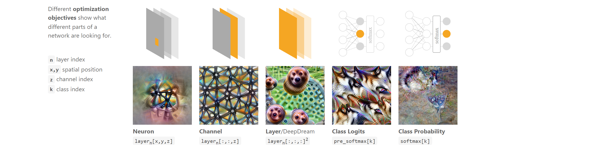
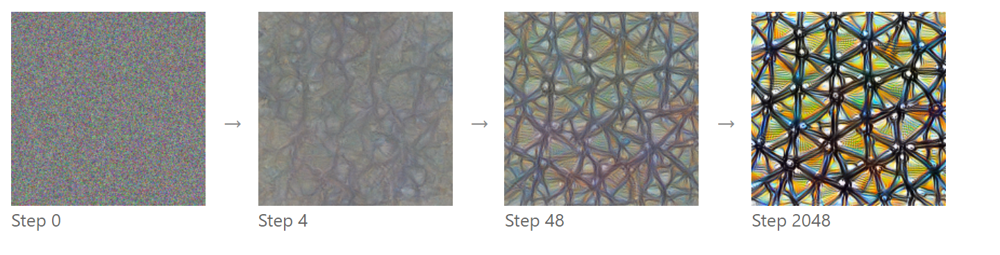
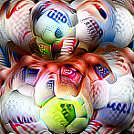
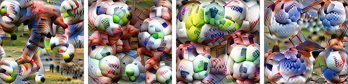
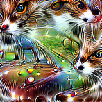
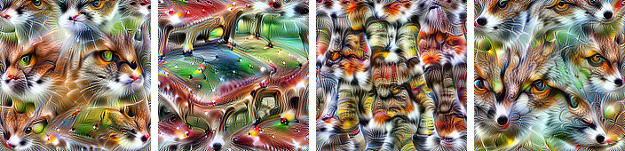

# 特徵視覺化

## 輸入

- 一個訓練好的網路。原文用在 ImageNet 上訓練的 GoogLeNet（[Feature Visualization](../sources/feature-visualization.md) § Feature Visualization）。
- 一個最佳化目標（optimization objective），也就是想讓網路的哪個部分反應變大：一個神經元、一整個通道、一整層，或分類器的一個類別（[Feature Visualization](../sources/feature-visualization.md) § Optimization Objectives）。
- 起點是一張隨機雜訊影像（[Feature Visualization](../sources/feature-visualization.md) § Feature Visualization by Optimization）。

| 目標 | 寫法 | 看的是什麼 | 出處 |
|---|---|---|---|
| 神經元 | $\text{layer}_n[x,y,z]$ | 第 $n$ 層、空間位置 $(x,y)$、第 $z$ 個通道上的一個值 | （[Feature Visualization](../sources/feature-visualization.md) § Optimization Objectives） |
| 通道 | $\text{layer}_n[:,:,z]$ | 第 $z$ 個通道的所有空間位置 | （[Feature Visualization](../sources/feature-visualization.md) § Optimization Objectives） |
| 層（DeepDream） | $\text{layer}_n[:,:,:]^2$ | 整層，找這層覺得「有趣」的影像 | （[Feature Visualization](../sources/feature-visualization.md) § Optimization Objectives） |
| 類別 logits | $\text{pre\_softmax}[k]$ | 第 $k$ 類在 softmax 之前的值 | （[Feature Visualization](../sources/feature-visualization.md) § Optimization Objectives） |
| 類別機率 | $\text{softmax}[k]$ | 第 $k$ 類在 softmax 之後的機率 | （[Feature Visualization](../sources/feature-visualization.md) § Optimization Objectives） |


圖：五種最佳化目標和各自的結果。$n$ 是層的編號、$x,y$ 是空間位置、$z$ 是通道編號、$k$ 是類別編號（[Feature Visualization](../sources/feature-visualization.md) § Optimization Objectives）

原文把文中的例子都叫 neuron，圖說寫成「Layer mixed5a, Unit 9」這種標籤；作者也說文中大部分圖片用的是通道目標（[Feature Visualization](../sources/feature-visualization.md) § Optimization Objectives；[Feature Visualization](../sources/feature-visualization.md) § Achieving Diversity with Optimization）。

> 原文（feature-visualization）：We used the channel objective to create most of the images in this article.

## 步驟

1. 從隨機雜訊開始（[Feature Visualization](../sources/feature-visualization.md) § Feature Visualization by Optimization）。
2. 神經網路對輸入大致可微，所以可以算目標對輸入影像的導數（[Feature Visualization](../sources/feature-visualization.md) § Feature Visualization by Optimization）。
3. 依導數一步步調整影像，往目標變大的方向走（[Feature Visualization](../sources/feature-visualization.md) § Feature Visualization by Optimization）。
4. 不加任何限制會得到滿是高頻圖樣的影像，所以實際做時要加正則化，或改在去相關的空間裡最佳化，見[正則化與預條件](regularization-and-preconditioning.md)（[Feature Visualization](../sources/feature-visualization.md) § The Enemy of Feature Visualization；[Feature Visualization](../sources/feature-visualization.md) § Preconditioning and Parameterization）。
5. 想看同一個特徵的不同面向時，在目標上加多樣性項，讓多個例子彼此不同（[Feature Visualization](../sources/feature-visualization.md) § Achieving Diversity with Optimization）。
6. 想看神經元怎麼互動時，把兩個目標一起最佳化，或在兩個目標之間內插，見[激活空間](../concepts/activation-space.md)（[Feature Visualization](../sources/feature-visualization.md) § Interaction between Neurons）。

> 原文（feature-visualization）：Starting from random noise, we optimize an image to activate a particular neuron (layer mixed4a, unit 11).


圖：從隨機雜訊開始最佳化，讓 mixed4a 層 unit 11 激發；圖中依序是第 0、4、48、2048 步的影像（[Feature Visualization](../sources/feature-visualization.md) § Feature Visualization by Optimization）

## 輸出

- 一張讓目標反應很強的影像；加了多樣性項時是多個彼此不同的例子（[Feature Visualization](../sources/feature-visualization.md) § Feature Visualization by Optimization；[Feature Visualization](../sources/feature-visualization.md) § Achieving Diversity with Optimization）。
- 在 GoogLeNet 上，由低層到高層的結果依序像邊緣、紋理、圖案、部件、物體（[Feature Visualization](../sources/feature-visualization.md) § Feature Visualization）。
- 低層的例子加上多樣性項，可以看出一個特徵的不同面向；高層的例子效果更明顯，會出現不同種類的物體（[Feature Visualization](../sources/feature-visualization.md) § Achieving Diversity with Optimization）。



圖：mixed5a 層 unit 9。第一張是單純最佳化的結果，第二張是加上多樣性項的四個結果，出現好幾種球（[Feature Visualization](../sources/feature-visualization.md) § Achieving Diversity with Optimization）

> 原文（feature-visualization）：For example, one neuron responds to different kinds of balls, even though they have a variety of appearances.



圖：mixed4e 層 unit 55。第一張是單純最佳化的結果；第二張加上多樣性項後出現貓、狐狸，也出現汽車（[Feature Visualization](../sources/feature-visualization.md) § Achieving Diversity with Optimization）

## 公式與參數

這篇用的多樣性項借用藝術風格轉換的做法：先算各通道的 Gram 矩陣 $G$，$G_{i,j}$ 是通道 $i$ 和通道 $j$ 的反應攤平後的內積（[Feature Visualization](../sources/feature-visualization.md) § Achieving Diversity with Optimization）。

```math
G_{i,j} = \sum_{x,y} \text{layer}_n\text{[x, y, i]} \cdot \text{layer}_n\text{[x, y, j]}
```

多樣性項是視覺化兩兩之間餘弦相似度的負值，$a$、$b$ 是不同的視覺化；再把這一項和原本的最佳化目標一起最大化（[Feature Visualization](../sources/feature-visualization.md) § Achieving Diversity with Optimization）。

```math
C_{\text{diversity}} = - \sum_{a} \sum_{b\neq a} ~ \frac{\text{vec}(G_a) \cdot \text{vec}(G_b)}{||\text{vec}(G_a)||~||\text{vec}(G_b)||}
```

> 原文（feature-visualization）：We then maximize the diversity term jointly with the regular optimization objective.

多樣性項可以有很多種形式，作者說還不太了解各自的好處；一種是懲罰不同例子之間的餘弦相似度，另一種是借用風格轉換，讓特徵用不同的風格呈現（[Feature Visualization](../sources/feature-visualization.md) § Achieving Diversity with Optimization）。

文中圖片的最佳化步數、學習率和變換設定，寫在[正則化與預條件](regularization-and-preconditioning.md)（[Feature Visualization](../sources/feature-visualization.md) § Preconditioning and Parameterization）。

## 為什麼這樣設計

**為什麼用最佳化，不直接在資料集裡找。** 最佳化能把真正造成行為的東西，和只是跟原因一起出現的東西分開（[Feature Visualization](../sources/feature-visualization.md) § Why visualize by optimization?）。它也比較有彈性：例如可以問一個例子要怎麼改，才會讓另一個神經元也激發；也能看特徵在訓練過程中怎麼演變（[Feature Visualization](../sources/feature-visualization.md) § Why visualize by optimization?）。

> 原文（feature-visualization）：It turns out that optimization approach can be a powerful way to understand what a model is really looking for, because it separates the things causing behavior from things that merely correlate with the causes.

圖見原文：[Feature Visualization：Why visualize by optimization?](https://distill.pub/2017/feature-visualization/#example-optimization-comparison)（[Feature Visualization](../sources/feature-visualization.md) § Why visualize by optimization?）

Building Blocks 做[語意字典](../concepts/semantic-dictionary.md)時也用以最佳化為基礎的特徵視覺化，理由同樣是避免假相關；作者說也可以用其他方法（[The Building Blocks of Interpretability](../sources/building-blocks.md) § Making Sense of Hidden Layers）。[激活網格](activation-grid.md)和[矩陣分解](matrix-factorization.md)的神經元群組，也都用特徵視覺化畫出來（[The Building Blocks of Interpretability](../sources/building-blocks.md) § What Does the Network See?；[The Building Blocks of Interpretability](../sources/building-blocks.md) § Making Things Human-Scale）。

> 原文（building-blocks）：We use optimization-based feature visualization to avoid spurious correlation, but one could use other methods.

**為什麼類別目標多用 logits。** 要提高 softmax 給某一類的機率，最容易的做法常常是壓低其他類，而不是讓這一類更像；作者的經驗是最佳化 softmax 之前的 logits，影像的視覺品質比較好（[Feature Visualization](../sources/feature-visualization.md) § Optimization Objectives）。

> 原文（feature-visualization）：From our experience, optimizing pre-softmax logits produces images of better visual quality.

**為什麼要加多樣性項。** 資料集範例可以看到一整段不同強度的激活；最佳化通常只給一個極端的正例，可能只呈現特徵的一個面向（[Feature Visualization](../sources/feature-visualization.md) § Diversity）。例如 mixed4a 層 unit 143 單純最佳化的結果有兩隻眼睛、只有向下彎的邊，看起來像在找狗頭頂；加上多樣性項後有的結果沒有眼睛、有的有向上彎的邊，所以要把預期放寬成主要是毛的紋理，再拿資料集範例核對，大致正確（[Feature Visualization](../sources/feature-visualization.md) § Achieving Diversity with Optimization）。

> 原文（feature-visualization）：Diverse feature visualizations allow us to more closely pinpoint what activates a neuron, to the degree that we can make, and — by looking at dataset examples — check predictions about what inputs will activate the neuron.

## 比較

| 做法 | 好處 | 問題 | 出處 |
|---|---|---|---|
| 資料集範例 | 能找到多樣的例子，也能看不同強度的激活 | 只能看資料集裡固定的例子；分不開原因和只是一起出現的東西 | （[Feature Visualization](../sources/feature-visualization.md) § Diversity；[Feature Visualization](../sources/feature-visualization.md) § Why visualize by optimization?） |
| 單純最佳化 | 分得開原因和相關；有彈性 | 通常只給一個極端的正例；不加限制會得到高頻雜訊 | （[Feature Visualization](../sources/feature-visualization.md) § Why visualize by optimization?；[Feature Visualization](../sources/feature-visualization.md) § Diversity；[Feature Visualization](../sources/feature-visualization.md) § The Enemy of Feature Visualization） |
| 最佳化加多樣性項 | 看得到同一個特徵的不同面向 | 推開彼此的壓力可能讓不相干的假影（例如眼睛）出現；可能以不自然的方式變得不同 | （[Feature Visualization](../sources/feature-visualization.md) § Achieving Diversity with Optimization） |
| 以資料集為基礎的分群（Wei et al.） | 拆開特徵的方式比較自然 | 對理解模型在不同資料上的行為，幫助可能沒那麼大 | （[Feature Visualization](../sources/feature-visualization.md) § Achieving Diversity with Optimization） |

## 相關頁面

- [Feature Visualization（來源）](../sources/feature-visualization.md)
- [正則化與預條件](regularization-and-preconditioning.md)
- [激活空間](../concepts/activation-space.md)
- [通道](../concepts/channel.md)
- [卷積層](../concepts/convolutional-layer.md)
- [The Building Blocks of Interpretability](../sources/building-blocks.md)
- [語意字典](../concepts/semantic-dictionary.md)
- [激活網格](activation-grid.md)
- [矩陣分解](matrix-factorization.md)
