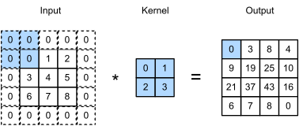
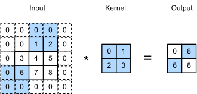
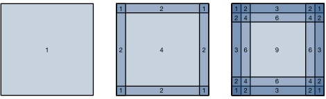

# 填充與步幅

## 輸入

- 輸入大小 $n_h \times n_w$、卷積核大小 $k_h \times k_w$（[d2l](../sources/d2l-ch7.md) § 7.3. Padding and Stride）。
- 填充 $p_h$、$p_w$：高方向一共補幾列（大約上下各一半）、寬方向一共補幾行（大約左右各一半）（[d2l](../sources/d2l-ch7.md) § 7.3.1. Padding）。
- 步幅 $s_h$、$s_w$：高、寬方向每次滑動跨過幾列、幾行（[d2l](../sources/d2l-ch7.md) § 7.3.2. Stride）。

## 步驟

1. 填充（padding）：在輸入的邊界外補上額外的像素，讓影像的有效大小變大；補的值通常是 0（[d2l](../sources/d2l-ch7.md) § 7.3.1. Padding）。
2. 步幅（stride）：窗口從左上角開始滑動，每次跨過 $s_h$ 列或 $s_w$ 行，跳過中間的位置（[d2l](../sources/d2l-ch7.md) § 7.3.2. Stride）。
3. 窗口再往右滑就填不滿輸入時，那個位置沒有輸出，除非再補一行填充（[d2l](../sources/d2l-ch7.md) § 7.3.2. Stride）。
4. 池化層也一樣可以設填充和步幅來調整輸出大小（[d2l](../sources/d2l-ch7.md) § 7.5.2. Padding and Stride）。

> 原文（d2l-ch7）：We refer to the number of rows and columns traversed per slide as stride.


圖：3×3 輸入四周補 0 成為 5×5，配 2×2 卷積核，輸出變成 4×4（[d2l](../sources/d2l-ch7.md) § 7.3.1. Padding）


圖：高方向步幅 3、寬方向步幅 2。產生第一欄第二個元素時，窗口往下滑三列；產生第一列第二個元素時，窗口往右滑兩行（[d2l](../sources/d2l-ch7.md) § 7.3.2. Stride）

## 輸出

- 只填充、步幅 1：輸出是 $(n_h-k_h+p_h+1)\times(n_w-k_w+p_w+1)$，高寬各比不填充時多 $p_h$、$p_w$（[d2l](../sources/d2l-ch7.md) § 7.3.1. Padding）。
- 填充加步幅：見下面的公式（[d2l](../sources/d2l-ch7.md) § 7.3.2. Stride）。
- 設 $p_h=k_h-1$、$p_w=k_w-1$ 時，輸出簡化成 $\lfloor(n_h+s_h-1)/s_h\rfloor \times \lfloor(n_w+s_w-1)/s_w\rfloor$；如果輸入高寬可以被步幅整除，就是 $(n_h/s_h) \times (n_w/s_w)$（[d2l](../sources/d2l-ch7.md) § 7.3.2. Stride）。

## 公式與參數

一般情況的輸出大小（[d2l](../sources/d2l-ch7.md) § 7.3.2. Stride）：

```math
\lfloor(n_h-k_h+p_h+s_h)/s_h\rfloor \times \lfloor(n_w-k_w+p_w+s_w)/s_w\rfloor
```

| 參數 | 說明 |
|---|---|
| 預設值 | 填充 0、步幅 1（[d2l](../sources/d2l-ch7.md) § 7.3.3. Summary and Discussion） |
| 保持大小的填充 | $p_h=k_h-1$、$p_w=k_w-1$；$k_h$ 是奇數時上下各補 $p_h/2$ 列，是偶數時上方補 $\lceil p_h/2\rceil$、下方補 $\lfloor p_h/2\rfloor$，寬方向同理（[d2l](../sources/d2l-ch7.md) § 7.3.1. Padding） |
| 簡稱 | 上下、左右對稱時叫 $(p_h, p_w)$ 填充，$p_h = p_w$ 時叫填充 $p$；兩個方向步幅相同時叫步幅 $s$（[d2l](../sources/d2l-ch7.md) § 7.3.3. Summary and Discussion） |
| 例子 | 3×3 卷積核、四周各補 1，8×8 輸入的輸出也是 8×8；高寬步幅都設 2，輸出高寬減半（[d2l](../sources/d2l-ch7.md) § 7.3.1. Padding；[d2l](../sources/d2l-ch7.md) § 7.3.2. Stride） |

> 原文（d2l-ch7）：By default, the padding is 0 and the stride is 1.

## 為什麼這樣設計

不填充時，每過一層輸出就縮小一點，疊多層之後差很多：240×240 的影像經過十層 5×5 卷積，剩下 200×200，切掉 30%，原影像邊界上的資訊也跟著沒了（[d2l](../sources/d2l-ch7.md) § 7.3. Padding and Stride）。而且角落的像素幾乎沒被用到（[d2l](../sources/d2l-ch7.md) § 7.3.1. Padding）。填充讓輸出和輸入一樣高寬，也讓每個像素被用到的次數一樣（[d2l](../sources/d2l-ch7.md) § 7.3.3. Summary and Discussion）。

> 原文（d2l-ch7）：If we start with a \(240 \times 240\) pixel image, ten layers of \(5 \times 5\) convolutions reduce the image to \(200 \times 200\) pixels, slicing off \(30 \%\) of the image and with it obliterating any interesting information on the boundaries of the original image.


圖：卷積核大小分別是 1×1、2×2、3×3 時，影像各位置的像素被用到幾次（[d2l](../sources/d2l-ch7.md) § 7.3.1. Padding）

CNN 常用奇數高寬的卷積核，例如 1、3、5、7：上下、左右補一樣多就能保持大小；而且這時輸出 `Y[i, j]` 正好是以 `X[i, j]` 為中心的窗口算出來的（[d2l](../sources/d2l-ch7.md) § 7.3.1. Padding）。

> 原文（d2l-ch7）：CNNs commonly use convolution kernels with odd height and width values, such as 1, 3, 5, or 7.

零填充計算簡單，運算子可以隱式處理、不必另外配置記憶體；同時它讓 CNN 能靠學到「空白」在哪裡，在影像裡編碼隱含的位置資訊（[d2l](../sources/d2l-ch7.md) § 7.3.3. Summary and Discussion）。

> 原文（d2l-ch7）：At the same time, it allows CNNs to encode implicit position information within an image, simply by learning where the "whitespace" is.

步幅用在為了計算效率、或想要降採樣的時候；卷積核很大時特別有用，因為它已經蓋住影像中很大的範圍（[d2l](../sources/d2l-ch7.md) § 7.3.2. Stride）。

## 相關頁面

- [d2l 第 7 章](../sources/d2l-ch7.md)
- [卷積運算](convolution-operation.md)
- [池化](pooling.md)
