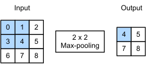

# 池化

## 輸入

- 輸入張量，可以有多個通道（[d2l](../sources/d2l-ch7.md) § 7.5.3. Multiple Channels）。
- 池化窗口（pooling window）的形狀，例如 2×2；一般寫成 $p \times q$ 池化層（[d2l](../sources/d2l-ch7.md) § 7.5.1. Maximum Pooling and Average Pooling）。
- 填充與步幅（[d2l](../sources/d2l-ch7.md) § 7.5.2. Padding and Stride）。

## 步驟

1. 固定形狀的池化窗口從輸入的左上角開始，依步幅由左到右、由上到下滑過所有區域（[d2l](../sources/d2l-ch7.md) § 7.5.1. Maximum Pooling and Average Pooling）。
2. 每到一個位置，取窗口內元素的最大值（最大池化，max-pooling）或平均值（平均池化，average pooling），得到一個輸出（[d2l](../sources/d2l-ch7.md) § 7.5.1. Maximum Pooling and Average Pooling）。
3. 多通道時，每個通道分開池化，不像卷積層那樣把各通道加起來（[d2l](../sources/d2l-ch7.md) § 7.5.3. Multiple Channels）。

> 原文（d2l-ch7）：These operations are called maximum pooling (max-pooling for short) and average pooling, respectively.

> 原文（d2l-ch7）：When processing multi-channel input data, the pooling layer pools each input channel separately, rather than summing the inputs up over channels as in a convolutional layer.


圖：池化窗口 2×2 的最大池化，陰影部分是第一個輸出元素和它用到的輸入：$\max(0, 1, 3, 4)=4$（[d2l](../sources/d2l-ch7.md) § 7.5.1. Maximum Pooling and Average Pooling）

## 輸出

- 上圖的輸出是 2×2，四個值分別是各窗口的最大值 4、5、7、8（[d2l](../sources/d2l-ch7.md) § 7.5.1. Maximum Pooling and Average Pooling）。
- 輸出通道數等於輸入通道數（[d2l](../sources/d2l-ch7.md) § 7.5.3. Multiple Channels）。
- 輸出大小和卷積一樣由填充、步幅決定，見[填充與步幅](padding-and-stride.md)。深度學習框架預設步幅等於池化窗口大小，例如 3×3 的窗口預設步幅就是 3×3（[d2l](../sources/d2l-ch7.md) § 7.5.2. Padding and Stride）。

> 原文（d2l-ch7）：Since pooling aggregates information from an area, deep learning frameworks default to matching pooling window sizes and stride.

- 計算感受野時，池化層和卷積層用同一組參數描述，池化窗口的大小就是公式裡的卷積核大小 $k_l$，見[感受野的計算](receptive-field-computation.md)（[Computing Receptive Fields](../sources/computing-receptive-fields.md) § Problem setup）。

## 公式與參數

上圖四個輸出的計算（[d2l](../sources/d2l-ch7.md) § 7.5.1. Maximum Pooling and Average Pooling）：

```math
\max(0, 1, 3, 4)=4,\quad \max(1, 2, 4, 5)=5,\quad \max(3, 4, 6, 7)=7,\quad \max(4, 5, 7, 8)=8
```

| 參數 | 說明 |
|---|---|
| 可學習參數 | 沒有，池化層沒有卷積核，運算是確定的（[d2l](../sources/d2l-ch7.md) § 7.5.1. Maximum Pooling and Average Pooling） |
| 常用窗口 | 2×2，把輸出的空間解析度降為四分之一（[d2l](../sources/d2l-ch7.md) § 7.5.4. Summary） |
| 填充與步幅 | 和卷積層的用法相同，可以手動覆寫框架預設（[d2l](../sources/d2l-ch7.md) § 7.5.2. Padding and Stride；[d2l](../sources/d2l-ch7.md) § 7.5.4. Summary） |

> 原文（d2l-ch7）：However, unlike the cross-correlation computation of the inputs and kernels in the convolutional layer, the pooling layer contains no parameters (there is no kernel).

## 為什麼這樣設計

池化有兩個目的：減輕卷積層對位置的敏感，以及在空間上降採樣（[d2l](../sources/d2l-ch7.md) § 7.5. Pooling）。

> 原文（d2l-ch7）：This section introduces pooling layers, which serve the dual purposes of mitigating the sensitivity of convolutional layers to location and of spatially downsampling representations.

對位置敏感的例子：把黑白分界的影像整張往右移一個像素，邊緣偵測的輸出可能差很多。現實中物體很少剛好出現在同一個位置，連快門造成的相機震動都可能讓畫面移動一個像素左右（[d2l](../sources/d2l-ch7.md) § 7.5. Pooling）。把邊緣偵測卷積層的輸出接到 2×2 最大池化，圖案在高或寬方向移動一個元素以內時仍偵測得到（[d2l](../sources/d2l-ch7.md) § 7.5.1. Maximum Pooling and Average Pooling）。

> 原文（d2l-ch7）：That is to say, using the \(2\times 2\) max-pooling layer, we can still detect if the pattern recognized by the convolutional layer moves no more than one element in height or width.

降採樣的目的：逐步匯總資訊、讓圖越來越粗，最後學到整張影像的表示，同時在中間層保留卷積層的優點；降低空間解析度也會加快感受野變大（[d2l](../sources/d2l-ch7.md) § 7.5. Pooling）。

## 比較

| | 最大池化 | 平均池化 |
|---|---|---|
| 怎麼算 | 取窗口內的最大值（[d2l](../sources/d2l-ch7.md) § 7.5.1. Maximum Pooling and Average Pooling） | 取窗口內的平均值（[d2l](../sources/d2l-ch7.md) § 7.5.1. Maximum Pooling and Average Pooling） |
| 由來 | Riesenhuber and Poggio (1999) 在認知神經科學中提出，語音辨識裡更早就有一個版本（[d2l](../sources/d2l-ch7.md) § 7.5.1. Maximum Pooling and Average Pooling） | 幾乎和 CNN 一樣早；類似把影像降採樣，但平均相鄰像素，得到訊噪比較好的影像（[d2l](../sources/d2l-ch7.md) § 7.5.1. Maximum Pooling and Average Pooling） |
| 建議 | 幾乎所有情況都比平均池化好，因為它讓輸出有一定程度的不變性（[d2l](../sources/d2l-ch7.md) § 7.5.1. Maximum Pooling and Average Pooling；[d2l](../sources/d2l-ch7.md) § 7.5.4. Summary） | 不如最大池化（[d2l](../sources/d2l-ch7.md) § 7.5.4. Summary） |

> 原文（d2l-ch7）：Lastly, of the two popular pooling choices, max-pooling is preferable to average pooling, as it confers some degree of invariance to output.

降低解析度不只有池化：隨機池化（stochastic pooling）和分數最大池化（fractional max-pooling）把匯總和隨機化結合，有時能稍微提高準確率（[d2l](../sources/d2l-ch7.md) § 7.5.4. Summary）。

## 相關頁面

- [d2l 第 7 章](../sources/d2l-ch7.md)
- [平移不變性](../concepts/translation-invariance.md)
- [感受野](../concepts/receptive-field.md)
- [通道](../concepts/channel.md)
- [卷積運算](convolution-operation.md)
- [填充與步幅](padding-and-stride.md)
- [感受野的計算](receptive-field-computation.md)
