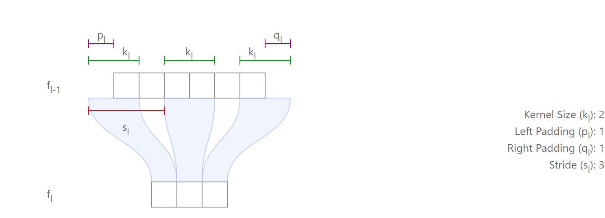
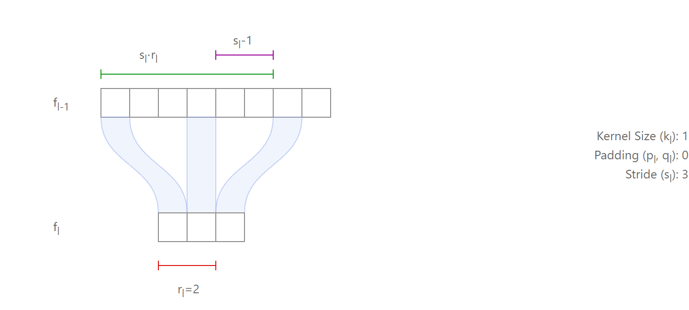
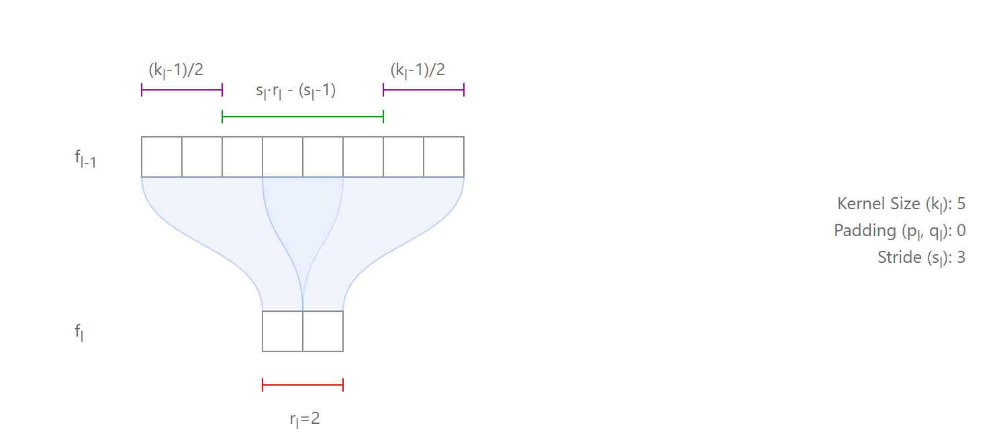
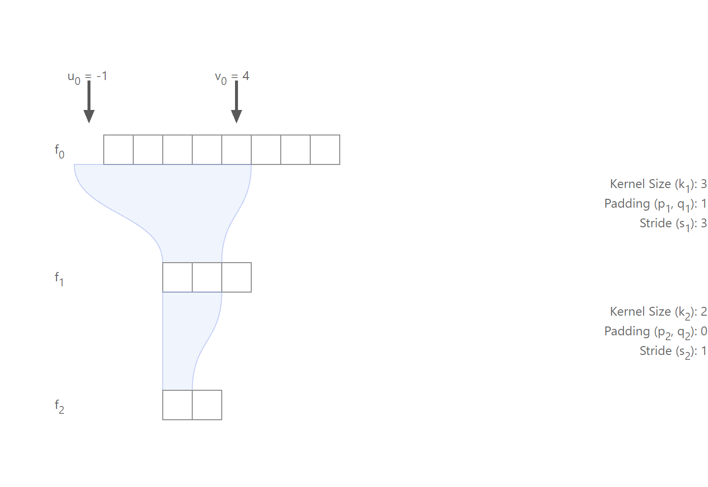
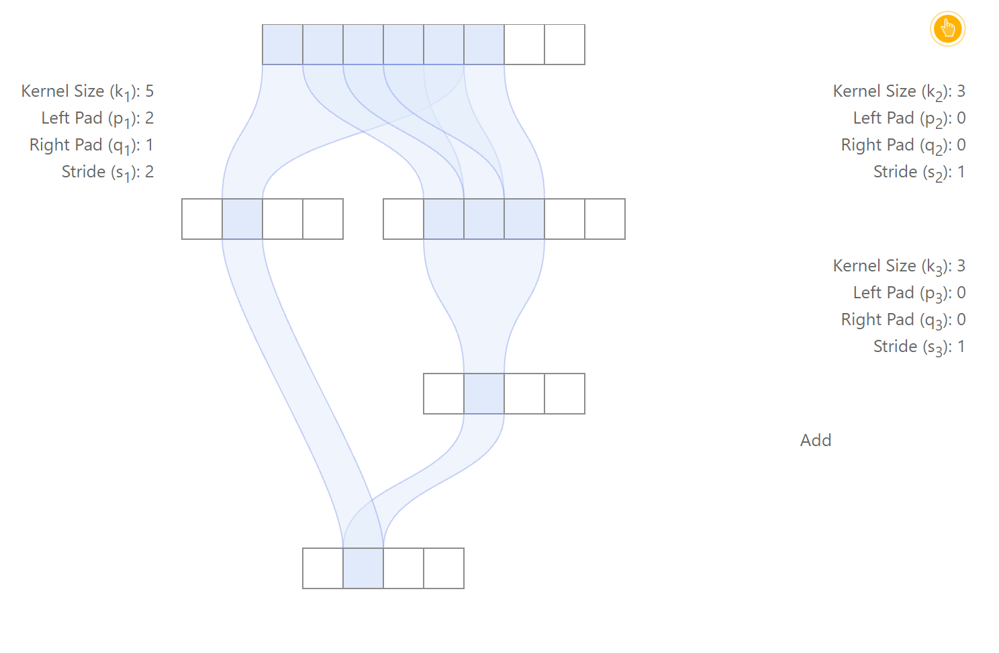
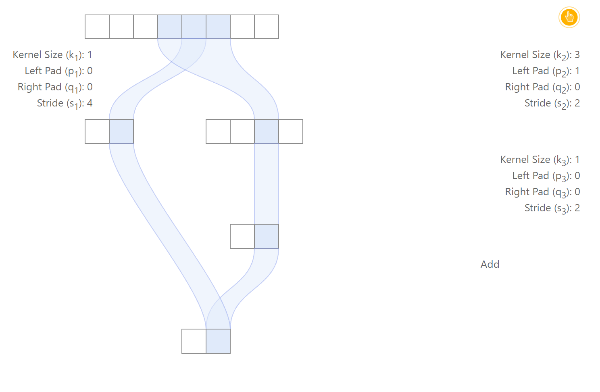

# 感受野的計算

## 輸入

- 一個有 $L$ 層的全卷積網路。第 $l$ 層的輸出是特徵圖 $f_l$，大小 $h_l \times w_l \times d_l$，其中 $d_l$ 是通道數（原文叫 depth）；輸入影像記成 $f_0$（[Computing Receptive Fields](../sources/computing-receptive-fields.md) § Problem setup；[d2l](../sources/d2l-ch7.md) § 7.1.4. Channels）。
- 每層四個參數：卷積核大小 $k_l$、步幅 $s_l$、輸入左側的填充 $p_l$、右側的填充 $q_l$（[Computing Receptive Fields](../sources/computing-receptive-fields.md) § Problem setup）。
- 只看一個維度；二維影像的高、寬分開套用。通道數不影響感受野的計算（[Computing Receptive Fields](../sources/computing-receptive-fields.md) § Problem setup）。
- 適用輸出只依賴局部輸入的層：卷積、池化，以及非線性、相加這類逐元素運算；逐元素運算的卷積核大小當成 1（[Computing Receptive Fields](../sources/computing-receptive-fields.md) § Problem setup）。
- 有多條路徑時，網路寫成有向無環的計算圖（computation graph）：節點是層，邊是層之間的連接（[Computing Receptive Fields](../sources/computing-receptive-fields.md) § Arbitrary computation graphs）。


圖：第 $l$ 層的四個參數。這張圖是卷積核大小 2、左右填充各 1、步幅 3，$f_{l-1}$ 是輸入、$f_l$ 是輸出（[Computing Receptive Fields](../sources/computing-receptive-fields.md) § Problem setup）

## 步驟

### 單一路徑：感受野大小

1. 設 $r_l$ 是最後一層特徵圖 $f_L$ 的一個元素在 $f_l$ 上用到幾個元素，所以 $r_L = 1$（[Computing Receptive Fields](../sources/computing-receptive-fields.md) § Computing receptive field size）。
2. 最後一層的每個元素直接連到 $f_{L-1}$ 的 $k_L$ 個元素，所以 $r_{L-1} = k_L$（[Computing Receptive Fields](../sources/computing-receptive-fields.md) § Computing receptive field size）。
3. 一般情況先看 $k_l = 1$：$f_l$ 的 $r_l$ 個元素蓋住 $f_{l-1}$ 的 $s_l \cdot r_l - (s_l - 1)$ 個元素。$s_l \cdot r_l$ 蓋住整個來源範圍，但多算了 $s_l - 1$ 個，所以要減掉（[Computing Receptive Fields](../sources/computing-receptive-fields.md) § Computing receptive field size）。
4. 有些情況下區域裡會有「洞」，也就是中間有輸入元素沒被用到（[Computing Receptive Fields](../sources/computing-receptive-fields.md) § Computing receptive field size）。
5. $k_l > 1$ 時再加上 $k_l - 1$ 個元素，分在區域的左右兩邊；$k_l$ 是偶數也一樣成立（[Computing Receptive Fields](../sources/computing-receptive-fields.md) § Computing receptive field size）。
6. 從 $r_L = 1$ 用遞迴式一路往回推到 $r_0$，或直接用下面的閉式（[Computing Receptive Fields](../sources/computing-receptive-fields.md) § Computing receptive field size）。

> 原文（computing-receptive-fields）：For example, if we use a kernel size of \(5\) (\(k_l=5\)), there would be \(2\) extra features used on each side, adding \(4\) in total.


圖：卷積核大小 1、不填充、步幅 3。$f_l$ 的 $r_l = 2$ 個元素（紅）對應到 $f_{l-1}$：綠色的 $s_l \cdot r_l$ 多算了紫色的 $s_l - 1$ 個；區域中間有沒用到的元素（[Computing Receptive Fields](../sources/computing-receptive-fields.md) § Computing receptive field size）


圖：卷積核大小 5、不填充、步幅 3。在 $s_l \cdot r_l - (s_l - 1)$ 的左右各加 $(k_l - 1)/2 = 2$ 個元素（[Computing Receptive Fields](../sources/computing-receptive-fields.md) § Computing receptive field size）

### 單一路徑：感受野區域與中心

1. 設 $u_l$、$v_l$ 是要算的那個 $f_L$ 元素在 $f_l$ 上用到的區域最左、最右座標；座標從 0 開始，$u_L = v_L$ 就是該元素的位置（[Computing Receptive Fields](../sources/computing-receptive-fields.md) § Computing receptive field region in input image）。
2. 往回推一層：$u_l = 0$ 是 $f_l$ 的第一個元素，它的最左端在 $f_{l-1}$ 的 $-p_l$；$u_l = 1$ 時在 $-p_l + s_l$，依此類推；右端 $v_{l-1}$ 再多加 $k_l - 1$（[Computing Receptive Fields](../sources/computing-receptive-fields.md) § Computing receptive field region in input image）。
3. 解開遞迴式得到 $u_0$、$v_0$ 的閉式；而且 $r_0 = v_0 - u_0 + 1$（[Computing Receptive Fields](../sources/computing-receptive-fields.md) § Computing receptive field region in input image）。
4. 實際計算時，先算好有效步幅（effective stride）$S_0$、有效填充（effective padding）$P_0$ 和感受野大小 $r_0$；之後任何輸出位置 $u_L$ 都能直接算出 $u_0$ 和 $v_0$（[Computing Receptive Fields](../sources/computing-receptive-fields.md) § Computing receptive field region in input image）。
5. 感受野中心定義成 $c_l = (u_l + v_l)/2$，從最左端往右移 $(r_0 - 1)/2$ 就是 $c_0$（[Computing Receptive Fields](../sources/computing-receptive-fields.md) § Computing receptive field region in input image）。


圖：兩層網路。第一層卷積核大小 3、左右填充各 1、步幅 3；第二層卷積核大小 2、不填充、步幅 1。$f_2$ 第一個元素在輸入上的區域是 $u_0 = -1$ 到 $v_0 = 4$，包含左邊的填充（[Computing Receptive Fields](../sources/computing-receptive-fields.md) § Computing receptive field region in input image）

### 多路徑：對齊

1. 每條從輸入到輸出的路徑，都可以單獨用上面的公式算（[Computing Receptive Fields](../sources/computing-receptive-fields.md) § Arbitrary computation graphs）。
2. 對齊問題：依路徑不同，同一個輸出元素可能用到沒對齊的輸入區域；各輸出元素用到的區域，相對位置也可能不一樣，所以感受野大小不一定在每個位置都相同（[Computing Receptive Fields](../sources/computing-receptive-fields.md) § Arbitrary computation graphs）。
3. 網路對齊（aligned）時，所有路徑讓輸出元素的中心落在同樣的位置，各路徑的有效步幅必須相同；整個網路的感受野大小取所有路徑中最大的，有效填充取感受野最大那條路徑的（[Computing Receptive Fields](../sources/computing-receptive-fields.md) § Arbitrary computation graphs）。
4. 演算法：把計算圖做拓撲排序，再依反向拓撲順序走訪各層；走到某一層時，它到輸出層的所有路徑都已經考慮過。遇到感受野更大的新路徑，就用遞迴式更新該層的參數，同時檢查各路徑是否符合對齊條件；走到輸入層就得到整個網路的參數（[Computing Receptive Fields](../sources/computing-receptive-fields.md) § Arbitrary computation graphs）。

> 原文（computing-receptive-fields）：By visiting layers in reverse topological order, we ensure that all paths from a given layer \(l\) to the output layer \(L\) have been taken into account when \(l\) is visited.


圖：沒對齊的例子。前三層是卷積，最後一層把兩條路徑相加；只有左邊的分支有填充（左 2、右 1）。兩條路徑在輸入上的區域中心不同。原文是互動圖，滑過不同輸出元素可以看到：左數第 2 個元素用到 6 個輸入，第 3 個只用到 5 個（[Computing Receptive Fields](../sources/computing-receptive-fields.md) § Arbitrary computation graphs）


圖：對齊的例子。兩條路徑讓輸出元素的中心落在同樣的位置；感受野大小 3、有效步幅 4、有效填充 1（[Computing Receptive Fields](../sources/computing-receptive-fields.md) § Arbitrary computation graphs）

## 輸出

- 感受野大小 $r_0$：輸出特徵圖的一個元素在輸入影像上用到的範圍（[Computing Receptive Fields](../sources/computing-receptive-fields.md) § Computing receptive field size）。
- 感受野區域 $[u_0, v_0]$ 和中心 $c_0$：某個輸出元素在輸入影像上的位置。中心可以拿來當作該元素在輸入影像中的位置（[Computing Receptive Fields](../sources/computing-receptive-fields.md) § Computing receptive field region in input image）。
- 用了填充時，邊界元素的感受野會包含填充的區域，所以每個輸出元素在原影像上實際用到的大小可能不同（[Computing Receptive Fields](../sources/computing-receptive-fields.md) § Computing receptive field size）。
- 多路徑時：整個網路的感受野參數，以及網路有沒有對齊（[Computing Receptive Fields](../sources/computing-receptive-fields.md) § Arbitrary computation graphs）。

## 公式與參數

感受野大小的遞迴式與閉式（[Computing Receptive Fields](../sources/computing-receptive-fields.md) § Computing receptive field size；[Computing Receptive Fields](../sources/computing-receptive-fields.md) § Solving recurrence equations: receptive field size）：

```math
r_{l-1} = s_l \cdot r_l + (k_l - s_l), \qquad r_0 = \sum_{l=1}^{L} \left( (k_l - 1) \prod_{i=1}^{l-1} s_i \right) + 1
```

幾個特例：所有卷積核大小都是 1 時，感受野也是 1；所有步幅都是 1 時，感受野是各層 $(k_l - 1)$ 的總和再加 1；某一層的步幅大於 1 時，它底下所有層的區域都按比例變大（[Computing Receptive Fields](../sources/computing-receptive-fields.md) § Computing receptive field size）。

> 原文（computing-receptive-fields）：If the stride is greater than 1 for a particular layer, the region increases proportionally for all layers below that one.

感受野區域的遞迴式與閉式（[Computing Receptive Fields](../sources/computing-receptive-fields.md) § Computing receptive field region in input image；[Computing Receptive Fields](../sources/computing-receptive-fields.md) § Solving recurrence equations: receptive field region）：

```math
u_{l-1} = -p_l + u_l \cdot s_l, \qquad v_{l-1} = -p_l + v_l \cdot s_l + k_l - 1
```

```math
u_0 = u_L \prod_{i=1}^{L} s_i - \sum_{l=1}^{L} p_l \prod_{i=1}^{l-1} s_i, \qquad v_0 = u_0 + r_0 - 1
```

有效步幅、有效填充與中心（[Computing Receptive Fields](../sources/computing-receptive-fields.md) § Computing receptive field region in input image）：

```math
S_l = \prod_{i=l+1}^{L} s_i, \qquad P_l = \sum_{m=l+1}^{L} p_m \prod_{i=l+1}^{m-1} s_i
```

```math
S_{l-1} = s_l \cdot S_l, \qquad P_{l-1} = s_l \cdot P_l + p_l, \qquad u_0 = -P_0 + u_L \cdot S_0, \qquad c_0 = -P_0 + u_L \cdot S_0 + \frac{r_0 - 1}{2}
```

每一層的填充都是 $p_l = (k_l - 1)/2$ 時，輸出元素的感受野中心對齊輸入的第一個像素，落在 $0, S_0, 2S_0, 3S_0, \ldots$；這時所有 $k_l$ 都必須是奇數（[Computing Receptive Fields](../sources/computing-receptive-fields.md) § Computing receptive field region in input image）。

多路徑網路在每一層都對齊的條件：任兩條路徑 $i$、$j$ 對所有層 $l$ 都滿足（[Computing Receptive Fields](../sources/computing-receptive-fields.md) § Arbitrary computation graphs）：

```math
S_l^{(i)} = S_l^{(j)}, \qquad -P_l^{(i)} + \frac{r_l^{(i)} - 1}{2} = -P_l^{(j)} + \frac{r_l^{(j)} - 1}{2}
```

| 符號 | 意思 |
|---|---|
| $k_l$、$s_l$ | 卷積核大小、步幅，都是正整數（[Computing Receptive Fields](../sources/computing-receptive-fields.md) § Problem setup） |
| $p_l$、$q_l$ | 輸入左側、右側的填充，非負整數。和 d2l 的 $p_h$ 不同，$p_h$ 是高方向總共補幾列（[Computing Receptive Fields](../sources/computing-receptive-fields.md) § Problem setup；[d2l](../sources/d2l-ch7.md) § 7.3.1. Padding） |
| $r_l$ | 輸出特徵圖的一個元素在 $f_l$ 上用到幾個元素；$r_0$ 是感受野大小（[Computing Receptive Fields](../sources/computing-receptive-fields.md) § Computing receptive field size） |
| $u_l$、$v_l$、$c_l$ | 感受野區域在 $f_l$ 上的最左、最右座標與中心（[Computing Receptive Fields](../sources/computing-receptive-fields.md) § Computing receptive field region in input image） |
| $S_l$ | 有效步幅：$f_l$ 和輸出特徵圖 $f_L$ 之間的步幅（[Computing Receptive Fields](../sources/computing-receptive-fields.md) § Computing receptive field region in input image） |
| $P_l$ | 有效填充：$f_l$ 和輸出特徵圖 $f_L$ 之間的填充（[Computing Receptive Fields](../sources/computing-receptive-fields.md) § Computing receptive field region in input image） |

## 為什麼這樣設計

為什麼要算感受野：例如物體偵測要在多個尺度上表示物體，才能認出大小不同的物體，這時常要知道一個元素在輸入上涵蓋多大的範圍；網路的感受野太小，可能認不出大的物體（[Computing Receptive Fields](../sources/computing-receptive-fields.md) § Computing Receptive Fields of Convolutional Neural Networks）。

> 原文（computing-receptive-fields）：However, these computations are often done by hand, which is both tedious and error-prone.

為什麼還要算區域：知道大小之外，很多情況需要精確找出產生某個元素的輸入區域，例如給定 $f_L(i, j)$，問它是輸入影像的哪一塊產生的（[Computing Receptive Fields](../sources/computing-receptive-fields.md) § Computing receptive field region in input image）。

為什麼要對齊：語意分割、邊緣偵測這類輸出也是影像的任務，以及局部特徵的比對和檢索，都很需要輸出元素對齊（[Computing Receptive Fields](../sources/computing-receptive-fields.md) § Arbitrary computation graphs）。

為什麼用反向拓撲順序：每條路徑各自算再記帳合併也可以，但最差複雜度高；拓撲排序後每一層只依賴排在它前面的層，反向走一次就考慮完所有路徑（[Computing Receptive Fields](../sources/computing-receptive-fields.md) § Arbitrary computation graphs）。

## 比較

| | 每條路徑各自算 | 反向拓撲順序 |
|---|---|---|
| 做法 | 每條從輸入到輸出的路徑各自套公式，再記帳算出整個網路的參數（[Computing Receptive Fields](../sources/computing-receptive-fields.md) § Arbitrary computation graphs） | 拓撲排序後反向走訪，遇到感受野更大的路徑就更新該層參數（[Computing Receptive Fields](../sources/computing-receptive-fields.md) § Arbitrary computation graphs） |
| 最差複雜度 | $\mathcal{O}(\lvert\mathcal{E}\rvert \times \lvert\mathcal{L}\rvert)$（[Computing Receptive Fields](../sources/computing-receptive-fields.md) § Arbitrary computation graphs） | $\mathcal{O}(\lvert\mathcal{E}\rvert + \lvert\mathcal{L}\rvert)$（[Computing Receptive Fields](../sources/computing-receptive-fields.md) § Arbitrary computation graphs） |

| | 沒對齊 | 對齊 |
|---|---|---|
| 輸出元素的中心 | 不同路徑對到不同位置（[Computing Receptive Fields](../sources/computing-receptive-fields.md) § Arbitrary computation graphs） | 所有路徑對到同樣的位置（[Computing Receptive Fields](../sources/computing-receptive-fields.md) § Arbitrary computation graphs） |
| 感受野大小 | 可能隨輸出位置不同，上圖例子是 6 和 5（[Computing Receptive Fields](../sources/computing-receptive-fields.md) § Arbitrary computation graphs） | 取所有路徑中最大的（[Computing Receptive Fields](../sources/computing-receptive-fields.md) § Arbitrary computation graphs） |

## 相關頁面

- [Computing Receptive Fields](../sources/computing-receptive-fields.md)
- [感受野](../concepts/receptive-field.md)
- [填充與步幅](padding-and-stride.md)
- [池化](pooling.md)
- [通道](../concepts/channel.md)
