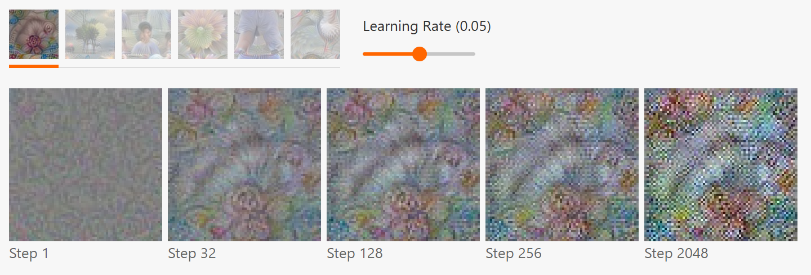
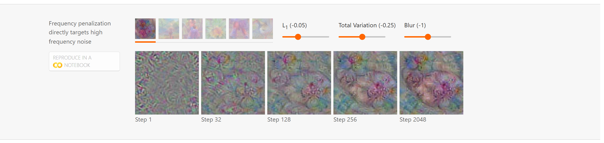
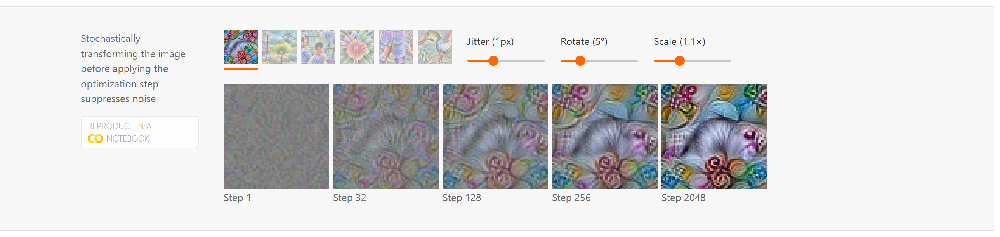
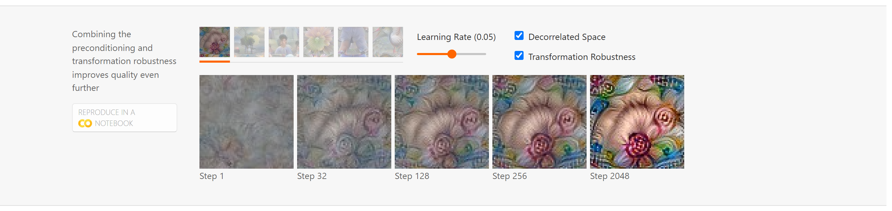

# 正則化與預條件

## 輸入

- [特徵視覺化](feature-visualization.md)的設定：訓練好的網路、最佳化目標、隨機雜訊的起始影像（[Feature Visualization](../sources/feature-visualization.md) § Feature Visualization by Optimization）。
- 要處理的問題：不加限制的最佳化會得到一種神經網路的錯覺，影像滿是雜訊和沒有意義的高頻圖樣，網路卻對它反應很強（[Feature Visualization](../sources/feature-visualization.md) § The Enemy of Feature Visualization）。
- 最佳化夠久也會看到一些神經元真正偵測的東西，但影像被高頻圖樣佔滿；這些圖樣看起來和對抗樣本（adversarial examples）的現象密切相關（[Feature Visualization](../sources/feature-visualization.md) § The Enemy of Feature Visualization）。

> 原文（feature-visualization）：Instead, you end up with a kind of neural network optical illusion — an image full of noise and nonsensical high-frequency patterns that the network responds strongly to.

圖：沒有正則化、學習率 0.05 時第 1、32、128、256、2048 步的結果；就算仔細調學習率，還是會得到雜訊。結果有放大，好看清細節和假影（[Feature Visualization](../sources/feature-visualization.md) § The Enemy of Feature Visualization）

> 原文（feature-visualization）：Even if you carefully tune learning rate, you'll get noise.

高頻圖樣為什麼形成，作者說還不完全了解；看起來重要的一部分是有步幅的卷積和池化，它們會在梯度裡造成高頻圖樣：反向傳播經過每一個有步幅的卷積或池化，梯度大小都會出現棋盤狀假影（[Feature Visualization](../sources/feature-visualization.md) § The Enemy of Feature Visualization）。步幅見[填充與步幅](padding-and-stride.md)，池化見[池化](pooling.md)，假影怎麼形成見[棋盤狀假影](../concepts/checkerboard-artifacts.md)。

> 原文（feature-visualization）：Each strided convolution or pooling creates checkerboard patterns in the gradient magnitudes when we backprop through it.

## 步驟

### 正則化三類

**頻率懲罰（frequency penalization）** 直接針對高頻雜訊（[Feature Visualization](../sources/feature-visualization.md) § Three Families of Regularization）。

1. 明確懲罰相鄰像素之間的變異，也就是總變差（total variation）；或每一步最佳化都把影像模糊一次，間接懲罰高頻雜訊（[Feature Visualization](../sources/feature-visualization.md) § Three Families of Regularization）。
2. 在傅立葉空間看，模糊等於在目標上加一個 L2 懲罰，依每個傅立葉分量的頻率決定懲罰多少（[Feature Visualization](../sources/feature-visualization.md) § Three Families of Regularization）。
3. 改用會保留邊緣的雙邊濾波器（bilateral filter）取代模糊，可以稍微改善（[Feature Visualization](../sources/feature-visualization.md) § Three Families of Regularization）。

圖：頻率懲罰。預設值是 L1 −0.05、總變差 −0.25、模糊 −1，下排是第 1 到 2048 步的結果；原文是互動圖，可以換目標、拉滑桿調整數值（[Feature Visualization](../sources/feature-visualization.md) § Three Families of Regularization）

**變換穩健性（transformation robustness）** 找的是稍微變換之後，仍然讓目標強烈激發的例子（[Feature Visualization](../sources/feature-visualization.md) § Three Families of Regularization）。

1. 每一步最佳化之前，隨機抖動、旋轉或縮放影像（[Feature Visualization](../sources/feature-visualization.md) § Three Families of Regularization）。
2. 對影像來說少量變換似乎就很有效，和比較一般的高頻正則化一起用時尤其明顯（[Feature Visualization](../sources/feature-visualization.md) § Three Families of Regularization）。
3. Deconvolution and Checkerboard Artifacts 發現，DeepDream 在不同位移上最佳化的抖動，能抵消一部分梯度裡的棋盤狀假影，見[棋盤狀假影](../concepts/checkerboard-artifacts.md)（[Deconvolution and Checkerboard Artifacts](../sources/deconv-checkerboard.md) § Artifacts in Gradients）。

> 原文（feature-visualization）：Concretely, this means that we stochastically jitter, rotate or scale the image before applying the optimization step.

圖：變換穩健性。預設值是抖動 1 像素、旋轉 5°、縮放 1.1 倍，下排是第 1 到 2048 步的結果（[Feature Visualization](../sources/feature-visualization.md) § Three Families of Regularization）

**學習先驗（learned priors）** 先學一個真實資料的模型，再要求結果符合它（[Feature Visualization](../sources/feature-visualization.md) § Three Families of Regularization）。

1. 一種做法是學一個生成器（例如 GAN 或 VAE），把潛在空間（latent space）的點對應到資料的例子，再在潛在空間裡最佳化（[Feature Visualization](../sources/feature-visualization.md) § Three Families of Regularization）。
2. 另一種是學一個能給出機率梯度的先驗，和目標一起最佳化；同時最佳化先驗和某一類的機率，就得到以這一類為條件的生成模型（[Feature Visualization](../sources/feature-visualization.md) § Three Families of Regularization）。
3. Wei et al. 至少對顏色分布近似了一個生成模型先驗：懲罰輸出的小塊，和從訓練資料收集的小塊資料庫裡最近的小塊之間的距離（[Feature Visualization](../sources/feature-visualization.md) § Three Families of Regularization）。

### 預條件

1. 有些方法降低的是梯度裡的高頻，不是影像本身的高頻；作者說不確定這算不算正則化，因為它抵抗高頻，但梯度一直往高頻推時，高頻還是會形成（[Feature Visualization](../sources/feature-visualization.md) § Preconditioning and Parameterization）。
2. 這樣變換梯度，在最佳化裡叫預條件（preconditioning）：可以看成換一種空間的參數化（parameterization），或換一種距離的定義，用最陡下降最佳化同一個目標（[Feature Visualization](../sources/feature-visualization.md) § Preconditioning and Parameterization）。
3. 好的第一個選擇是讓資料去相關（decorrelated）並白化（whitened）的預條件；對影像來說，就是在傅立葉基底裡做梯度下降，並把各頻率縮放到能量相等（[Feature Visualization](../sources/feature-visualization.md) § Preconditioning and Parameterization）。
4. 顏色也要去相關：傅立葉轉換只在空間上去相關，顏色之間仍有相關；作者量了訓練集裡顏色之間的相關，再用 Cholesky 分解去相關（[Feature Visualization](../sources/feature-visualization.md) § Preconditioning and Parameterization）。

> 原文（feature-visualization）：A good first guess is one that makes your data decorrelated and whitened.

不同的距離定義會給出不同的最陡下降方向：一般的 L2 梯度、L∞ 距離下的方向、去相關空間裡的方向都是同一個目標的有效下降方向，但彼此差很多；在去相關空間裡最佳化會減少高頻，用 L∞ 則會增加高頻（[Feature Visualization](../sources/feature-visualization.md) § Preconditioning and Parameterization）。

> 原文（feature-visualization）：Notice that optimizing in the decorrelated space reduces high frequencies, while using L∞ increases them.

圖見原文：[Feature Visualization：Preconditioning and Parameterization](https://distill.pub/2017/feature-visualization/#steepest-descent)（[Feature Visualization](../sources/feature-visualization.md) § Preconditioning and Parameterization）

圖：在去相關空間裡最佳化，再加上變換穩健性，學習率 0.05；兩個選項都可以在原文的互動圖裡關掉比較（[Feature Visualization](../sources/feature-visualization.md) § Preconditioning and Parameterization）

## 輸出

- 高頻雜訊較少的視覺化。用去相關的下降方向，得到的視覺化差很多；作者說很難公平比較，但結果看起來好很多，也比較快成形（[Feature Visualization](../sources/feature-visualization.md) § Preconditioning and Parameterization）。
- 預條件和變換穩健性一起用，品質還會更好（[Feature Visualization](../sources/feature-visualization.md) § Preconditioning and Parameterization）。

> 原文（feature-visualization）：It's hard to do really fair comparisons because of hyperparameters, but the resulting visualizations seem a lot better — and develop faster, too.

- Activation Atlas 畫圖譜時沿用這裡的正則化，特別是變換穩健性；另外把激活空間白化，作者說這有助於特徵視覺化，但還不完全理解原因（上面預條件的白化是對影像做的），見[激活圖譜](activation-atlas.md)（[Exploring Neural Networks with Activation Atlases](../sources/activation-atlas.md) § Aggregating Multiple Images；[Feature Visualization](../sources/feature-visualization.md) § Preconditioning and Parameterization）。

> 原文（activation-atlas）：We perform feature visualization with the regularizations described in Feature Visualization (in particular, transformation robustness).

## 公式與參數

除非另外註明，原文的圖片都在顏色去相關、傅立葉轉換後的空間裡最佳化 2560 步，用 Adam、學習率 0.05，每一步依序做以下變換（[Feature Visualization](../sources/feature-visualization.md) § Preconditioning and Parameterization）：

1. 輸入四周補 16 像素，避免邊緣假影（[Feature Visualization](../sources/feature-visualization.md) § Preconditioning and Parameterization）。
2. 抖動最多 16 像素（[Feature Visualization](../sources/feature-visualization.md) § Preconditioning and Parameterization）。
3. 從 1、0.975、1.025、0.95、1.05 隨機挑一個倍率縮放（[Feature Visualization](../sources/feature-visualization.md) § Preconditioning and Parameterization）。
4. 從 −5 到 5 度（每 1 度一格）隨機挑一個角度旋轉（[Feature Visualization](../sources/feature-visualization.md) § Preconditioning and Parameterization）。
5. 再抖動一次，最多 8 像素（[Feature Visualization](../sources/feature-visualization.md) § Preconditioning and Parameterization）。
6. 裁掉補上的邊（[Feature Visualization](../sources/feature-visualization.md) § Preconditioning and Parameterization）。

> 原文（feature-visualization）：Images were optimized for 2560 steps in a color-decorrelated fourier-transformed space, using Adam at a learning rate of 0.05.

## 為什麼這樣設計

**為什麼一定要加結構。** 處理高頻雜訊一直是特徵視覺化研究的主要挑戰之一；想得到有用的視覺化，就要用某種先驗、正則化或限制加上比較自然的結構（[Feature Visualization](../sources/feature-visualization.md) § The Spectrum of Regularization）。

> 原文（feature-visualization）：If you want to get useful visualizations, you need to impose a more natural structure using some kind of prior, regularizer, or constraint.

**為什麼不只用頻率懲罰。** 頻率懲罰在壓掉雜訊的同時，也會壓掉邊緣這類合理的高頻特徵（[Feature Visualization](../sources/feature-visualization.md) § Three Families of Regularization）。

> 原文（feature-visualization）：Unfortunately, these approaches also discourage legitimate high-frequency features like edges along with noise.

**為什麼學習先驗要小心。** 學習先驗得到最逼真的視覺化，但可能分不清哪些來自被視覺化的模型、哪些來自先驗（[Feature Visualization](../sources/feature-visualization.md) § Three Families of Regularization）。

> 原文（feature-visualization）：This approach produces the most photorealistic visualizations, but it may be unclear what came from the model being visualized and what came from the prior.

**為什麼預條件有用。** 預條件改變哪個方向最陡、每個方向走多快，但不改變最小值在哪裡；局部最小值很多時，它會改變最佳化最後落進哪一個，所以選對預條件能讓最佳化問題容易很多（[Feature Visualization](../sources/feature-visualization.md) § Preconditioning and Parameterization）。

> 原文（feature-visualization）：This changes which direction of descent will be steepest, and how fast the optimization moves in each direction, but it does not change what the minimums are.

**預條件是不是也在正則化。** 作者說很難確定：一方面，最佳化步數指數增加時梯度下降似乎還在改善，表示它沒有收斂、只是走得很慢；另一方面，關掉其他所有正則化時，預條件似乎能減少高頻圖樣（[Feature Visualization](../sources/feature-visualization.md) § Preconditioning and Parameterization）。

> 原文（feature-visualization）：On the other hand, if you turn off all other regularizers, the preconditioner seems to reduce high-frequency patterns.

## 比較

各種做法依正則化的強弱排成一條光譜：一端完全不正則化，得到對抗樣本；另一端是在資料集裡找範例，會碰到資料集範例的那些限制；中間是三類正則化（[Feature Visualization](../sources/feature-visualization.md) § The Spectrum of Regularization）。弱的正則化避免誤導的相關，但和實際使用的關聯較少；強的正則化給出比較逼真的例子，但有誤導相關的風險（[Feature Visualization](../sources/feature-visualization.md) § The Spectrum of Regularization）。

> 原文（feature-visualization）：On one extreme, if we don't regularize at all, we end up with adversarial examples.

| 順序 | 做法 | 出處 |
|---|---|---|
| 1（最弱） | 不正則化 | （[Feature Visualization](../sources/feature-visualization.md) § The Spectrum of Regularization） |
| 2 | 頻率懲罰 | （[Feature Visualization](../sources/feature-visualization.md) § The Spectrum of Regularization） |
| 3 | 變換穩健性 | （[Feature Visualization](../sources/feature-visualization.md) § The Spectrum of Regularization） |
| 4 | 學習先驗 | （[Feature Visualization](../sources/feature-visualization.md) § The Spectrum of Regularization） |
| 5（最強） | 資料集範例 | （[Feature Visualization](../sources/feature-visualization.md) § The Spectrum of Regularization） |

原文的光譜圖把前人的研究依正則化強弱排列（[Feature Visualization](../sources/feature-visualization.md) § The Spectrum of Regularization）：

| 研究 | 做法 | 出處 |
|---|---|---|
| Erhan et al., 2009 | 提出核心想法；正則化很少 | （[Feature Visualization](../sources/feature-visualization.md) § The Spectrum of Regularization） |
| Szegedy et al., 2013 | 對抗樣本；用資料集範例做視覺化 | （[Feature Visualization](../sources/feature-visualization.md) § The Spectrum of Regularization） |
| Mahendran & Vedaldi, 2015 | 提出總變差正則化；從表示重建輸入 | （[Feature Visualization](../sources/feature-visualization.md) § The Spectrum of Regularization） |
| Nguyen et al., 2015 | 探討反例；提出影像模糊 | （[Feature Visualization](../sources/feature-visualization.md) § The Spectrum of Regularization） |
| Mordvintsev et al., 2015 | 提出抖動和多尺度；探索類別的 GMM 先驗 | （[Feature Visualization](../sources/feature-visualization.md) § The Spectrum of Regularization） |
| Øygard et al., 2015 | 提出梯度模糊，也用抖動 | （[Feature Visualization](../sources/feature-visualization.md) § The Spectrum of Regularization） |
| Tyka et al., 2016 | 用雙邊濾波器正則化，也用抖動 | （[Feature Visualization](../sources/feature-visualization.md) § The Spectrum of Regularization） |
| Mordvintsev et al., 2016 | 正規化梯度的各頻率，也用抖動 | （[Feature Visualization](../sources/feature-visualization.md) § The Spectrum of Regularization） |
| Nguyen et al., 2016 | 用 GAN 生成器參數化影像 | （[Feature Visualization](../sources/feature-visualization.md) § The Spectrum of Regularization） |
| Nguyen et al., 2016 | 用去噪自編碼器當先驗，做成生成模型 | （[Feature Visualization](../sources/feature-visualization.md) § The Spectrum of Regularization） |

圖見原文：[Feature Visualization：The Spectrum of Regularization](https://distill.pub/2017/feature-visualization/#feature-vis-history)（[Feature Visualization](../sources/feature-visualization.md) § The Spectrum of Regularization）

## 相關頁面

- [Feature Visualization（來源）](../sources/feature-visualization.md)
- [特徵視覺化](feature-visualization.md)
- [填充與步幅](padding-and-stride.md)
- [池化](pooling.md)
- [棋盤狀假影](../concepts/checkerboard-artifacts.md)
- [激活圖譜](activation-atlas.md)
- [Exploring Neural Networks with Activation Atlases](../sources/activation-atlas.md)
