# 上採樣

## 輸入

- 低解析度、高層次的描述。產生影像時，網路常從這種描述逐步放大：先描述大概的影像，再補上細節；所以需要上採樣（upsampling），從低解析度的影像得到高解析度的影像（[Deconvolution and Checkerboard Artifacts](../sources/deconv-checkerboard.md) § Deconvolution & Overlap）。
- 轉置卷積（transposed convolution）的兩個參數：卷積核大小（在大圖上畫的方形大小）和步幅（原文圖上方各點之間的間隔）（[Deconvolution and Checkerboard Artifacts](../sources/deconv-checkerboard.md) § Deconvolution & Overlap）。

> 原文（deconv-checkerboard）：This allows the network to describe the rough image and then fill in the details.

## 步驟

### 轉置卷積

1. 小圖的每一點，在大圖上「畫」一塊方形（[Deconvolution and Checkerboard Artifacts](../sources/deconv-checkerboard.md) § Deconvolution & Overlap）。
2. 方形重疊的位置會被畫到比較多；卷積核大小不能被步幅整除時，有些位置被畫到的比其他位置多，這叫不均勻重疊（uneven overlap）（[Deconvolution and Checkerboard Artifacts](../sources/deconv-checkerboard.md) § Deconvolution & Overlap）。
3. 二維時，兩個軸的不均勻重疊相乘，形成深淺不一的棋盤狀假影（checkerboard artifacts）（[Deconvolution and Checkerboard Artifacts](../sources/deconv-checkerboard.md) § Deconvolution & Overlap）。
4. 產生影像時通常疊好幾層轉置卷積逐步放大；疊起來的轉置卷積可能互相抵消假影，但常常累積，在各種尺度上產生假影（[Deconvolution and Checkerboard Artifacts](../sources/deconv-checkerboard.md) § Deconvolution & Overlap）。

> 原文（deconv-checkerboard）：Roughly, deconvolution layers allow the model to use every point in the small image to "paint" a square in the larger one.

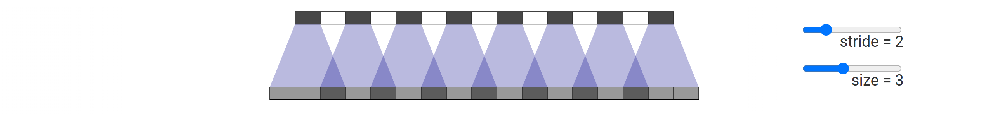
圖：一維的轉置卷積，步幅 2、大小 3。上排深色格子是小圖的點，下排是放大後的輸出，顏色較深的位置被兩塊方形重疊到；原文是互動圖，可以拉滑桿改步幅和大小（[Deconvolution and Checkerboard Artifacts](../sources/deconv-checkerboard.md) § Deconvolution & Overlap）

圖見原文：[Deconvolution and Checkerboard Artifacts：Deconvolution & Overlap（二維的不均勻重疊）](https://distill.pub/2016/deconv-checkerboard/#deconv2d)（[Deconvolution and Checkerboard Artifacts](../sources/deconv-checkerboard.md) § Deconvolution & Overlap）

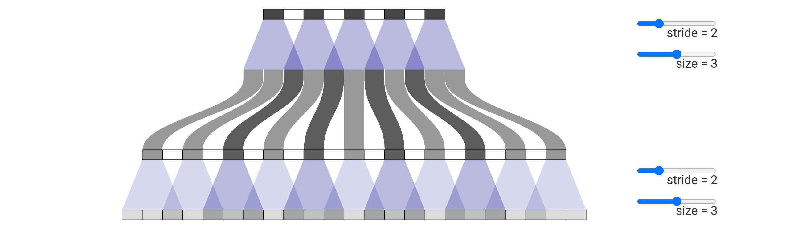
圖：兩層步幅 2、大小 3 的轉置卷積疊起來，最下排的深淺有好幾種層次（[Deconvolution and Checkerboard Artifacts](../sources/deconv-checkerboard.md) § Deconvolution & Overlap）

> 原文（deconv-checkerboard）：While it's possible for these stacked deconvolutions to cancel out artifacts, they often compound, creating artifacts on a variety of scales.

### resize-convolution

1. 先把影像放大到較高的解析度，用最近鄰插值（nearest-neighbor interpolation）或雙線性插值（bilinear interpolation）（[Deconvolution and Checkerboard Artifacts](../sources/deconv-checkerboard.md) § Better Upsampling）。
2. 再做一層卷積層算特徵（[Deconvolution and Checkerboard Artifacts](../sources/deconv-checkerboard.md) § Better Upsampling）。
3. 在 TensorFlow 裡可以用 `tf.image.resize_images()` 放大；先用 `tf.pad()` 補邊再用 `tf.nn.conv2d()` 做卷積，避免邊界假影（[Deconvolution and Checkerboard Artifacts](../sources/deconv-checkerboard.md) § Code）。

> 原文（deconv-checkerboard）：Another approach is to separate out upsampling to a higher resolution from convolution to compute features.

## 輸出

- 高解析度的影像（[Deconvolution and Checkerboard Artifacts](../sources/deconv-checkerboard.md) § Deconvolution & Overlap）。
- 用轉置卷積時，輸出常帶棋盤狀假影，輸出不尋常的顏色時最明顯：層通常有偏置，輸出平均色很容易；顏色離平均色越遠（例如亮紅），轉置卷積要貢獻的就越多（[Deconvolution and Checkerboard Artifacts](../sources/deconv-checkerboard.md) § Deconvolution & Overlap）。
- 生成對抗網路（GAN）把生成器（generator）的轉置卷積層換成最近鄰放大加卷積後，不同頻率的假影都消失了（[Deconvolution and Checkerboard Artifacts](../sources/deconv-checkerboard.md) § Image Generation Results）。

> 原文（deconv-checkerboard）：The further a color — like bright red — is away from the average color, the more deconvolution needs to contribute.

 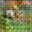 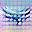 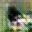
圖：GAN 的生成器最後兩層用轉置卷積、其他層用 resize-convolution，出現頻率 2 和 4 的假影（[Deconvolution and Checkerboard Artifacts](../sources/deconv-checkerboard.md) § Image Generation Results）

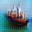 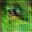 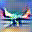 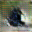
圖：只有最後一層用轉置卷積，出現頻率 2 的假影（[Deconvolution and Checkerboard Artifacts](../sources/deconv-checkerboard.md) § Image Generation Results）

 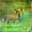 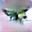 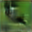
圖：所有層都用 resize-convolution，沒有假影（[Deconvolution and Checkerboard Artifacts](../sources/deconv-checkerboard.md) § Image Generation Results）

> 原文（deconv-checkerboard）：Simply switching out the standard deconvolutional layers for nearest-neighbor resize followed by convolution causes artifacts of different frequencies to disappear.

## 公式與參數

轉置卷積和 resize-convolution 都是線性運算，都可以寫成矩陣，這樣比較容易看出差別（[Deconvolution and Checkerboard Artifacts](../sources/deconv-checkerboard.md) § Better Upsampling）。

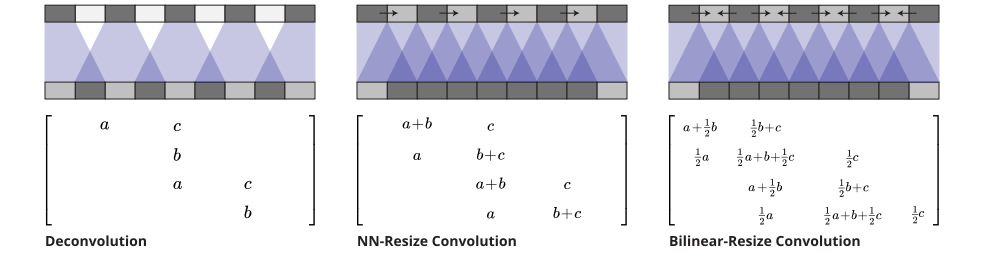
圖：三種上採樣寫成矩陣，由左到右是轉置卷積、最近鄰 resize-convolution、雙線性 resize-convolution；卷積核的三個權重是 $a, b, c$（[Deconvolution and Checkerboard Artifacts](../sources/deconv-checkerboard.md) § Better Upsampling）

| 參數 | 說明 |
|---|---|
| 不均勻重疊的條件 | 卷積核大小不能被步幅整除（[Deconvolution and Checkerboard Artifacts](../sources/deconv-checkerboard.md) § Deconvolution & Overlap） |
| 不均勻的程度 | 一維時，步幅 2、大小 3 的轉置卷積有些輸出接收的輸入是其他輸出的兩倍；二維時變成四倍（[Deconvolution and Checkerboard Artifacts](../sources/deconv-checkerboard.md) § Deconvolution & Overlap） |
| 步幅 1 的轉置卷積 | 成功的模型常把它放在最後一層，很能壓制假影：能去掉頻率整除其大小的假影，並減少頻率小於其大小的其他假影；但假影還是會漏出來（[Deconvolution and Checkerboard Artifacts](../sources/deconv-checkerboard.md) § Deconvolution & Overlap） |

> 原文（deconv-checkerboard）：For example, in one dimension, a stride 2, size 3 deconvolution has some outputs with twice the number of inputs as others, but in two dimensions this becomes a factor of four.

## 為什麼這樣設計

**為什麼轉置卷積很難學會避開假影。** 理論上，模型可以學會在重疊不均勻的位置小心寫入，讓輸出平衡；但這很難做到，有多個通道交互作用時更難；而且避開假影會大幅限制可用的卷積核，犧牲模型容量（[Deconvolution and Checkerboard Artifacts](../sources/deconv-checkerboard.md) § Overlap & Learning）。

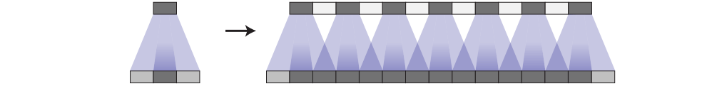
圖：不均勻重疊（大小 3）時，權重仔細安排可以讓輸出平衡；左邊是一個點畫出的方形，右邊是整排的輸出（[Deconvolution and Checkerboard Artifacts](../sources/deconv-checkerboard.md) § Overlap & Learning）

> 原文（deconv-checkerboard）：In theory, our models could learn to carefully write to unevenly overlapping positions so that the output is evenly balanced.

**均勻重疊也不保險。** 不只不均勻重疊的模型學不會避開，均勻重疊的模型也常學出造成類似假影的卷積核；這不像不均勻重疊那樣是預設行為，但仍然很容易發生，實際上這些模型還是有假影，只是看起來比較輕微（[Deconvolution and Checkerboard Artifacts](../sources/deconv-checkerboard.md) § Overlap & Learning）。

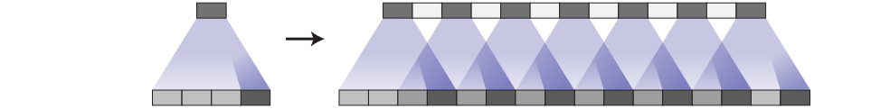
圖：均勻重疊（大小 4）時學到的權重，輸出仍然深淺交替（[Deconvolution and Checkerboard Artifacts](../sources/deconv-checkerboard.md) § Overlap & Learning）

> 原文（deconv-checkerboard）：In fact, not only do models with uneven overlap not learn to avoid this, but models with even overlap often learn kernels that cause similar artifacts!

作者認為可能有很多因素，例如 GAN 的鑑別器（discriminator）和它的梯度；但很大一部分問題看起來是轉置卷積本身：最好的情況是很脆弱，即使仔細挑大小，也很容易表示出會產生假影的函數；最壞的情況是產生假影就是它的預設行為（[Deconvolution and Checkerboard Artifacts](../sources/deconv-checkerboard.md) § Overlap & Learning）。

> 原文（deconv-checkerboard）：At best, deconvolution is fragile because it very easily represents artifact creating functions, even when the size is carefully chosen.

**為什麼 resize-convolution 比較好。** 作者想找的上採樣做法，不以假影為預設行為，最好還會抵抗假影（[Deconvolution and Checkerboard Artifacts](../sources/deconv-checkerboard.md) § Better Upsampling）。寫成矩陣時，轉置卷積對每個輸出窗口都有獨立的一項；resize-convolution 隱含地把權重綁在一起，這種方式會抑制高頻假影（[Deconvolution and Checkerboard Artifacts](../sources/deconv-checkerboard.md) § Better Upsampling）。

> 原文（deconv-checkerboard）：Where deconvolution has a unique entry for each output window, resize-convolution is implicitly weight-tying in a way that discourages high frequency artifacts.

## 比較

| 做法 | 怎麼做 | 假影 | 出處 |
|---|---|---|---|
| 轉置卷積 | 小圖的每一點在大圖上畫一塊方形 | 不均勻重疊時，產生假影是預設行為；均勻重疊也常有比較輕微的假影 | （[Deconvolution and Checkerboard Artifacts](../sources/deconv-checkerboard.md) § Deconvolution & Overlap；[Deconvolution and Checkerboard Artifacts](../sources/deconv-checkerboard.md) § Overlap & Learning） |
| 子像素卷積（sub-pixel convolution） | 讓卷積核大小能被步幅整除，避開重疊問題；近來在影像超解析度（super-resolution）上有成果 | 有幫助，但轉置卷積還是很容易產生假影 | （[Deconvolution and Checkerboard Artifacts](../sources/deconv-checkerboard.md) § Better Upsampling） |
| 最近鄰 resize-convolution | 用最近鄰插值放大，再做卷積 | 修好棋盤狀假影；作者用它的結果最好 | （[Deconvolution and Checkerboard Artifacts](../sources/deconv-checkerboard.md) § Better Upsampling） |
| 雙線性 resize-convolution | 用雙線性插值放大，再做卷積 | 修好棋盤狀假影；但作者很難讓它好用，可能是太抗拒高頻的影像特徵 | （[Deconvolution and Checkerboard Artifacts](../sources/deconv-checkerboard.md) § Better Upsampling） |

> 原文（deconv-checkerboard）：We've had our best results with nearest-neighbor interpolation, and had difficulty making bilinear resize work.

作者不認為兩種 resize-convolution 是上採樣的最終解法，只是它們確實修好了棋盤狀假影（[Deconvolution and Checkerboard Artifacts](../sources/deconv-checkerboard.md) § Better Upsampling）。

## 相關頁面

- [Deconvolution and Checkerboard Artifacts（來源）](../sources/deconv-checkerboard.md)
- [棋盤狀假影](../concepts/checkerboard-artifacts.md)
- [卷積運算](convolution-operation.md)
- [填充與步幅](padding-and-stride.md)
