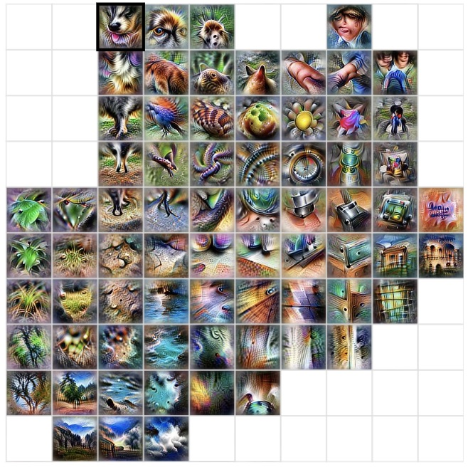

# 用激活圖譜探索神經網路（Exploring Neural Networks with Activation Atlases）

- 作者：Shan Carter、Zan Armstrong、Ludwig Schubert、Ian Johnson、Chris Olah ／ 年份：2019 ／ 原文：https://distill.pub/2019/activation-atlas/ ／ 授權：CC BY 4.0

## 一句話

從一百萬張影像各取一個位置的激活向量，降到二維、畫上格子，把每一格的平均激活向量用特徵視覺化畫出來，做成激活圖譜（activation atlas）：用網路的眼睛看一層能表示的概念的全貌（§ 全文）。

> 原文（activation-atlas）：By combining these two techniques, we can get the advantages of each in one view — a global map seen through the eyes of the network.

## 重點

**1. 激活圖譜給出一層的全貌。** 把一張影像的激活向量畫出來（Building Blocks 的激活網格），只看得到網路怎麼看這一張影像，看不到全貌（§ Introduction）。激活圖譜的做法類似 Karpathy 的 CNN codes：依激活值把大量資料排在一起；但每一處顯示的不是輸入資料，而是平均激活向量的特徵視覺化（feature visualization）（§ Introduction）。

> 原文（activation-atlas）：Unfortunately, visualizing activations has a major weakness — it is limited to seeing only how the network sees a single input.

圖：一小張激活圖譜，每一格是一個平均激活向量的特徵視覺化；原文開頭用它和單一神經元、兩兩神經元、單張影像的激活向量並列，說明激活圖譜取樣了更多可能出現的激活值，給出更大的全貌（§ Introduction）

**2. 看神經元的常見組合，不只看單一神經元。** 理論上把基底神經元逐一畫出來就能得到全貌，但網路很少單獨使用一個神經元；就像 26 個字母是英文的基底，看字母怎麼組成單字，比只看字母更能看出能表達哪些概念（§ Introduction）。激活圖譜顯示的就是神經元的常見組合（§ Introduction）。

> 原文（activation-atlas）：In practice, however, neurons are rarely used by the network in isolation, and it may be difficult to understand them that way.

**3. 越後面的層越接近類別。** 前面的層（例如 mixed3b）似乎表示紋理和簡單圖案；中間的層（例如 mixed4c）的圖示（icon）是眼睛、葉子、水這類很多類別共用的概念；最後的層（例如 mixed5b）的抽象概念和輸出類別更接近（§ Looking at Multiple Layers）。後面的層除了把概念細分，也把舊概念組合成新概念，見[逐層抽象](../concepts/layer-abstraction.md)（§ Looking at Multiple Layers）。

> 原文（activation-atlas）：In the final layers (eg. mixed5b), abstractions become more closely aligned with the output classes.

**4. 類別激活圖譜找出多用途特徵。** 只留下對某個類別貢獻最大的激活值，做成類別激活圖譜（class activation atlas），可以清楚看到網路用哪些偵測器（detector）判斷這個類別（§ Further Isolating Classes）。比較兩個相近的類別時，作者發現多用途特徵（multi-use features），例如網路用「蒸汽火車頭」的偵測器辨認氣瓶，幫助判斷「水肺潛水員」，見[多用途特徵](../concepts/multi-use-features.md)（§ Further Isolating Classes）。

> 原文（activation-atlas）：We'll call these "multi-use" features — detectors that react to very different concepts that are nonetheless visually similar.

**5. 照圖譜做的補丁能改變分類。** 作者照類別激活圖譜的發現，把像某個圖示的東西貼進影像，做成補丁（patch）；十種補丁各在該類別 1,000 張 ImageNet 訓練影像上測試，約五分之二的影像被翻成目標類別（§ Testing dozens of patches on thousands of images）。

> 原文（activation-atlas）：While they aren't effective in all cases, they do flip the image classification to the target class in about 2 in 5 images.

## 方法

- 模型：GoogLeNet，原文叫 InceptionV1，2014 年 ImageNet 大規模視覺辨識挑戰賽（ILSVRC）分類項目的冠軍；層的名稱是 mixed3a、mixed3b、mixed4a 等，每一層建立在前面的層上（§ Looking at a Single Image）。
- 層：主要看網路中間的 mixed4c；也比較 mixed3b、mixed4c、mixed5b 三層，以及 mixed4a 到 mixed4e 連續五層（§ Aggregating Multiple Images；§ Looking at Multiple Layers）。
- 資料：從 ImageNet 訓練資料隨機選一百萬張影像，每張影像隨機取一個位置的激活向量（原文叫 spatial activation），避開影像邊緣（§ Introduction；§ Aggregating Multiple Images）。
- 降維用 UMAP；類別激活圖譜通常改用 t-SNE，作者推測是因為資料稀疏得多（§ Aggregating Multiple Images；§ Further Isolating Classes）。
- 特徵視覺化沿用 Feature Visualization 的正則化，特別是變換穩健性，但目標函數稍有不同；歸因沿用 Building Blocks 的做法，見[激活圖譜](../methods/activation-atlas.md)（§ Aggregating Multiple Images）。
- 分工：Shan Carter 寫了大部分文章、做了大部分實驗；Ludwig Schubert 做了手工補丁的數值分析；最初的想法來自 Ian Johnson（§ Author Contributions）。

> 原文（activation-atlas）：InceptionV1 consists of a number of layers, which we refer to as "mixed3a", "mixed3b", "mixed4a", etc., and sometimes shortened to just "3a".

> 原文（activation-atlas）：Shan Carter wrote the majority of the article and performed most of the experiments.

圖見原文：[Exploring Neural Networks with Activation Atlases：Aggregating Multiple Images（從一百萬張影像到激活圖譜的流程）](https://distill.pub/2019/activation-atlas/#process)（§ Aggregating Multiple Images）

## 結論

- 激活圖譜是看卷積視覺網路的新方法：隱藏層裡概念的全局、有層次、人看得懂的概觀（§ Conclusion and Future Work）。
- 作者把激活圖譜看成機器學到的影像字母表：簡單的基本概念組合再組合，形成複雜得多的視覺概念（§ New interfaces）。
- 可能的新介面：把圖譜當調色盤，沾一個概念來畫圖；用圖譜搜尋大型影像資料集；像直方圖一樣摘要大量影像；換一個資料集收集激活值，就能用圖譜檢查陌生的資料集（§ New interfaces）。
- 了解隱藏層能幫助建立對模型的信心，找出模型沒照我們的意思做的地方；目前的圖譜還不能比較兩個模型，作者把比較模型列為未來工作（§ Surfacing Inner Properties of Models）。

> 原文（activation-atlas）：They give us a global, hierarchical, and human-interpretable overview of concepts within the hidden layers.

> 原文（activation-atlas）：We think of activation atlases as revealing a machine-learned alphabet for images — a collection of simple, atomic concepts that are combined and recombined to form much more complex visual ideas.

## 限制

- 以取樣為基礎：只能顯示取樣到的激活值構成的流形（manifold）；資料要來自我們關心的分布，樣本也要夠多，才能涵蓋整個流形；作者一般用一百萬個激活值，發現十萬個常常就夠（§ Introduction；§ Sampling based）。
- 不呈現組合結構：幾百個基底神經元可以混合出任何激活向量；圖譜靠取樣找出有意思的激活向量，卻完全失去原本的組合結構（§ Doesn't Surface Compositionality）。
- 層與層之間沒有對齊：兩層並排看時，相似的特徵出現在隨機的位置（§ No alignment between layers）。
- 計算量大：從頭到尾通常要幾分鐘到幾小時（§ Computationally expensive）。
- 依賴超參數：降維步驟的超參數會大幅影響結果；格子大小像直方圖的 bin 大小，選錯可能把重要的特徵平均掉（§ Dependency on hyperparameters）。
- 前面的層平均歸因很小，最支持的類別相當隨意（§ Aggregating Multiple Images）。
- 補丁不是每次都有效，也只在一個模型上測過；對抗補丁（adversarial patch）有效得多（§ Testing dozens of patches on thousands of images）。

> 原文（activation-atlas）：In this article we generally used one million activations but we found that 100,000 activations was often sufficient.

圖見原文：[Exploring Neural Networks with Activation Atlases：Sampling based（一萬、十萬、一百萬個激活值畫出的圖譜）](https://distill.pub/2019/activation-atlas/#samples)（§ Sampling based）

## 相關頁面

- [激活圖譜](../methods/activation-atlas.md)
- [多用途特徵](../concepts/multi-use-features.md)
- [逐層抽象](../concepts/layer-abstraction.md)
- [激活網格](../methods/activation-grid.md)
- [歸因](../methods/attribution.md)
- [特徵視覺化](../methods/feature-visualization.md)
- [激活空間](../concepts/activation-space.md)
- [The Building Blocks of Interpretability](building-blocks.md)
- [Feature Visualization](feature-visualization.md)
