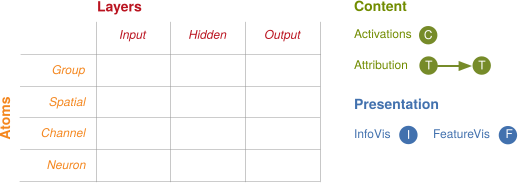
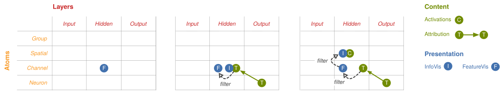

# 可解釋性的組成元件（The Building Blocks of Interpretability）

- 作者：Chris Olah、Arvind Satyanarayan、Ian Johnson、Shan Carter、Ludwig Schubert、Katherine Ye、Alexander Mordvintsev ／ 年份：2018 ／ 原文：https://distill.pub/2018/building-blocks/ ／ 授權：CC BY 4.0

## 一句話

把特徵視覺化、歸因、矩陣分解這些可解釋性（interpretability）方法當成可以組合的元件，做成可解釋性介面（interpretability interface）：看網路在每個位置偵測到什麼、這些偵測怎麼組成最後的分類，同時把資訊量壓到人看得完（§ 全文）。

> 原文（building-blocks）：In this article, we treat existing interpretability methods as fundamental and composable building blocks for rich user interfaces.

## 重點

**1. 一層的激活值可以看成一個立方體。** 原文把每一層學到的表示看成三維的立方體：x、y 軸是影像上的位置，z 軸是通道（原文也叫 detector），每一格是一個激活值（activation），也就是一個神經元（neuron）激發的程度（§ Making Sense of Hidden Layers）。本 Wiki 把這個激活立方體（cube of activations）當作特徵圖（feature map）的別名（§ Making Sense of Hidden Layers）。從不同方向切，可以看單一神經元、元素（原文叫 spatial position）或通道的激活值（§ Making Sense of Hidden Layers）。

> 原文（building-blocks）：Each cell in the cube is an activation, or the amount a neuron fires.

**2. 語意字典讓隱藏層的數字有意義。** 語意字典（semantic dictionary）把每個神經元的激活值配上那個神經元的特徵視覺化（feature visualization），再依激活值大小排序（§ Making Sense of Hidden Layers）。作者主張用影像代表網路學到的抽象概念，不要化成文字，因為化成文字會失真（§ Making Sense of Hidden Layers）。

> 原文（building-blocks）：Doing so, however, is a lossy operation — even for familiar abstractions, the network may have learned a deeper nuance.

**3. 激活網格看出網路在每個位置看到什麼。** 對每個元素的激活向量（activation vector）做視覺化，排成激活網格（activation grid）；跨層比較，網路的理解從前面幾層的邊緣，變成後面幾層更複雜的形狀和物件部位（§ What Does the Network See?）。

> 原文（building-blocks）：And, by working across layers (eg. "mixed3a", "mixed4d"), we can observe how the network's understanding evolves: from detecting edges in earlier layers, to more sophisticated shapes and object parts in the latter.

**4. 在隱藏層上做歸因。** 歸因（attribution）解釋神經元之間的關係，回答網路怎麼把偵測到的東西組成後面的決定（§ How Are Concepts Assembled?）。最常見的顯著圖（saliency map）只標出輸入像素；作者改成問某個位置偵測到的高層概念（例如垂耳）重不重要，也在隱藏層之間做歸因（§ Spatial Attribution with Saliency Maps；§ Channel Attribution）。

> 原文（building-blocks）：Rather than asking whether the color of a particular pixel was important for the "labrador retriever" classification, we instead ask whether the high-level idea detected at that position (such as "floppy ear") was important.

**5. 用矩陣分解把資訊壓到人看得完。** 只看元素或通道會漏掉重要的部分，看全部神經元又太多；把立方體攤成「元素 × 通道」的矩陣做矩陣分解（matrix factorization），得到少數幾個神經元群組（neuron groups）（§ Making Things Human-Scale）。

> 原文（building-blocks）：By flattening our cube into a matrix of spatial locations and channels, we can apply these techniques to get more meaningful groups of neurons.

## 方法

- 模型：GoogLeNet，一個影像分類模型；選它是因為它的神經元看起來特別有語意（§ The Building Blocks of Interpretability）。
- 層：激活網格比較 mixed3a、mixed4a、mixed4d、mixed5a 四層；開頭的互動圖看 mixed4d 的通道（§ What Does the Network See?；§ The Space of Interpretability Interfaces）。
- 範例：一張有拉布拉多犬的影像，看網路怎麼偵測到垂耳、垂耳又怎麼影響分類（§ The Building Blocks of Interpretability）。
- 特徵視覺化用以最佳化為基礎的做法，避免假相關（§ Making Sense of Hidden Layers）。
- 歸因一律用線性近似（linear approximation）；空間歸因時另外處理最大池化的梯度，並抵消棋盤狀假影（§ How Are Concepts Assembled?）。
- 分工：Ian 和 Chris 創了 semantic dictionaries 這個詞；歸因和矩陣分解的程式碼大多是 Chris 寫的（§ Author Contributions）。

> 原文（building-blocks）：In this article, we use GoogLeNet, an image classification model, to demonstrate our interface ideas because its neurons seem unusually semantically meaningful.

> 原文（building-blocks）：Ian and Chris coined the term "semantic dictionaries."

圖見原文：[The Building Blocks of Interpretability：開頭（比較拉布拉多犬和虎斑貓的互動圖）](https://distill.pub/2018/building-blocks/#Teaser)（§ The Building Blocks of Interpretability）

作者把介面看成元件的組合：每個元件用某種呈現方式（特徵視覺化或資訊視覺化）顯示某種內容（激活值或歸因）；內容放在 substrate 上，substrate 由要看哪幾層、每層怎麼切成 atoms 決定（§ The Space of Interpretability Interfaces）。這個設計空間可以畫成格子，欄是層、列是 atoms，內容和呈現方式畫成格子上的點和連線（§ The Space of Interpretability Interfaces）。

> 原文（building-blocks）：We can think of an interface as a union of individual elements.

圖：介面設計空間。欄是輸入、隱藏、輸出層，列是 group、spatial、channel、neuron 四種 atoms；綠色符號是內容（激活值、歸因），藍色符號是呈現方式（資訊視覺化、特徵視覺化）（§ The Space of Interpretability Interfaces）

開頭的互動圖用來比較一張影像的兩個可能分類，拆成三步：用特徵視覺化看 mixed4d 的通道；算輸出歸因，篩出特定類別；滑鼠移到通道上時，顯示它在各元素的激活值熱圖（§ The Space of Interpretability Interfaces）。

> 原文（building-blocks）：To understand a classification, we focus on the channels of the mixed4d layer.

圖：開頭互動圖的三步畫在設計空間上。第一格在隱藏層的通道放特徵視覺化（F）；第二格從輸出層的神經元對通道做歸因（T），用資訊視覺化（I）呈現並篩選通道；第三格把篩出的通道展開到各個元素，用資訊視覺化顯示激活值（C）（§ The Space of Interpretability Interfaces）

## 結論

- 可解釋性介面有很大的設計空間，要做出強大又可信的介面還有很多工作（§ Conclusion & Future Work）。
- 作者認為可信的關鍵標誌是介面不會誤導：使用者看了介面明確顯示的資訊後，不應該對模型得出錯誤的判斷（§ How Trustworthy Are These Interfaces?）。
- 如果成功，可解釋性可以幫助人類有意義地監督 AI，建立公平、安全、對齊的系統（§ Conclusion & Future Work）。

> 原文（building-blocks）：We have a lot of work left ahead of us to build powerful and trustworthy interfaces for interpretability.

## 限制

- 介面是推測性的；可信度問題集中在最後一節討論（§ The Building Blocks of Interpretability）。
- 歸因方法很多，還沒有明確正確的答案；作者的介面不依賴特定的歸因方法，換成別的方法也可以（§ How Are Concepts Assembled?）。
- 近來的研究指出很多歸因技術不可靠；歸因也可能路徑相依（§ How Trustworthy Are These Interfaces?）。
- 有些神經元意義不乾淨，例如同時回應貓和車的多義神經元（§ How Trustworthy Are These Interfaces?）。
- 神經元群組只解釋一張影像，每張影像都要重算；跨層「相容」的形式化，作者沒有把握是最好的（§ Making Things Human-Scale）。
- 作者列出的未來方向：把資料集範例當成另一種 substrate、用人類對模型決策過程的回饋來訓練模型、比較多個模型（§ The Space of Interpretability Interfaces）。

> 原文（building-blocks）：With regards to attribution, recent work suggests that many of our current techniques are unreliable.

## 相關頁面

- [特徵圖](../concepts/feature-map.md)
- [語意字典](../concepts/semantic-dictionary.md)
- [激活網格](../methods/activation-grid.md)
- [歸因](../methods/attribution.md)
- [矩陣分解](../methods/matrix-factorization.md)
- [特徵視覺化](../methods/feature-visualization.md)
- [激活空間](../concepts/activation-space.md)
- [棋盤狀假影](../concepts/checkerboard-artifacts.md)
- [Feature Visualization](feature-visualization.md)
- [Exploring Neural Networks with Activation Atlases](activation-atlas.md)
- [激活圖譜](../methods/activation-atlas.md)
