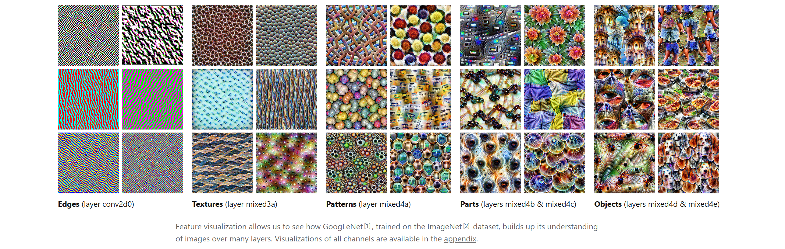

# 特徵視覺化（Feature Visualization）

- 作者：Chris Olah、Alexander Mordvintsev、Ludwig Schubert ／ 年份：2017 ／ 原文：https://distill.pub/2017/feature-visualization/ ／ 授權：CC BY 4.0

## 一句話

用最佳化產生輸入影像，看網路的神經元、通道或整層在找什麼；文章整理了讓結果多樣、理解神經元互動、壓掉高頻雜訊的做法，並把壓雜訊的各種正則化排成一條光譜（§ 全文）。

## 重點

**1. 特徵視覺化回答「網路在找什麼」。** 可解釋性研究有兩條主線：特徵視覺化（feature visualization）和歸因（attribution）；特徵視覺化用產生範例的方式，回答網路或網路的某一部分在找什麼（§ Feature Visualization）。這篇只談特徵視覺化（§ Feature Visualization）。

> 原文（feature-visualization）：Feature visualization answers questions about what a network — or parts of a network — are looking for by generating examples.

**2. 做法是對輸入做最佳化。** 神經網路對輸入大致可微，所以可以用導數一步步調整輸入，讓某個神經元激發，或讓輸出出現某種行為（§ Feature Visualization by Optimization）。最佳化目標可以是一個神經元、一整個通道、一整層，或分類器的類別（§ Optimization Objectives）。和在資料集裡找範例相比，最佳化能把真正造成行為的東西，和只是跟原因一起出現的東西分開（§ Why visualize by optimization?）。

> 原文（feature-visualization）：Neural networks are, generally speaking, differentiable with respect to their inputs.

**3. 只看一張最佳化結果可能被誤導。** 最佳化通常只給一個極端的正例，可能只呈現特徵的一個面向；加上多樣性項（diversity term）可以讓多個例子彼此不同（§ Diversity；§ Achieving Diversity with Optimization）。有些例子對應到奇怪的混合概念，例如 mixed4e 層 unit 55 同時回應兩種動物的臉和車身；作者認為這暗示神經元不一定是理解網路的正確語意單位（§ Achieving Diversity with Optimization）。

> 原文（feature-visualization）：Examples like these suggest that neurons are not necessarily the right semantic units for understanding neural nets.

**4. 神經元的組合可以看成激活空間裡的向量。** 作者把所有神經元激活值的組合定義成激活空間（activation space），每個神經元的激活值是這個空間的基底向量，神經元的組合是空間裡的一個向量（§ Interaction between Neurons）。他們的經驗是隨機方向常常也看得懂，但比例低於基底方向（§ Interaction between Neurons）。

> 原文（feature-visualization）：Our experience is broadly consistent with both results; we find that random directions often seem interpretable, but at a lower rate than basis directions.

**5. 不加限制的最佳化會得到雜訊，要靠正則化和預條件。** 直接最佳化會得到滿是雜訊和高頻圖樣的影像（§ The Enemy of Feature Visualization）。壓制方法依正則化強弱排成光譜，中間有頻率懲罰、變換穩健性、學習先驗三類（§ The Spectrum of Regularization；§ Three Families of Regularization）。在去相關的空間裡做梯度下降（預條件）也能減少高頻，結果看起來好很多（§ Preconditioning and Parameterization）。

> 原文（feature-visualization）：If you want to get useful visualizations, you need to impose a more natural structure using some kind of prior, regularizer, or constraint.

## 方法

研究對象是在 ImageNet 上訓練的 GoogLeNet；文章從低層到高層看它怎麼一層層建立對影像的理解（§ Feature Visualization）。

> 原文（feature-visualization）：Feature visualization allows us to see how GoogLeNet, trained on the ImageNet dataset, builds up its understanding of images over many layers.

圖：GoogLeNet 由低到高各層的特徵視覺化，圖中標示 Edges（conv2d0）、Textures（mixed3a）、Patterns（mixed4a）、Parts（mixed4b、mixed4c）、Objects（mixed4d、mixed4e）（§ Feature Visualization）

文中大部分圖片用通道當最佳化目標（§ Optimization Objectives）。除非另外註明，圖片都在顏色去相關、傅立葉轉換後的空間裡最佳化 2560 步，用 Adam、學習率 0.05，每一步依序做一組變換（§ Preconditioning and Parameterization）：

- 輸入四周補 16 像素，避免邊緣假影（§ Preconditioning and Parameterization）
- 抖動最多 16 像素（§ Preconditioning and Parameterization）
- 從 1、0.975、1.025、0.95、1.05 隨機挑一個倍率縮放（§ Preconditioning and Parameterization）
- 從 −5 到 5 度（每 1 度一格）隨機挑一個角度旋轉（§ Preconditioning and Parameterization）
- 再抖動一次，最多 8 像素（§ Preconditioning and Parameterization）
- 裁掉補上的邊（§ Preconditioning and Parameterization）

> 原文（feature-visualization）：Images were optimized for 2560 steps in a color-decorrelated fourier-transformed space, using Adam at a learning rate of 0.05.

實作開源在 tensorflow/lucid；GoogLeNet 每個通道的視覺化放在附錄（§ Additional Resources）。

## 結論

- 作者認為特徵視覺化是讓神經網路可解釋的研究方向裡，最有希望、發展最成熟的之一（§ Conclusion）。
- 特徵視覺化本身永遠不會帶來完全令人滿意的理解；作者把它看成基本的建構單元，要和其他工具結合（§ Conclusion）。
- 還待解決的問題包括：理解神經元的互動、找出用哪些單位來理解網路的激活值最有意義、完整呈現一個特徵的各個面向（§ Conclusion）。

> 原文（feature-visualization）：Some issues that stand out include understanding neuron interaction, finding which units are most meaningful for understanding neural net activations, and giving a holistic view of the facets of a feature.

## 限制

- 多樣性項的形式很多，作者說還不太了解各自的好處；推開彼此的壓力可能讓不相干的假影（例如眼睛）出現，結果也可能以不自然的方式變得不同（§ Achieving Diversity with Optimization）。
- 作者坦承幾乎不知道怎麼挑出有意義的方向，也不知道是否真的存在特別有意義的方向；內插只能看少數方向的互動，實際上有數百個方向在互動（§ Interaction between Neurons）。
- 高頻圖樣為什麼形成還不完全清楚，看起來重要的一部分是有步幅的卷積和池化（§ The Enemy of Feature Visualization）。
- 正則化越強，例子越逼真，但越可能出現誤導的相關；學習先驗得到最逼真的結果，但可能分不清哪些來自被視覺化的模型、哪些來自先驗（§ The Spectrum of Regularization；§ Three Families of Regularization）。
- 預條件只是加速下降，還是也有正則化的效果，作者說很難確定（§ Preconditioning and Parameterization）。

> 原文（feature-visualization）：The truth is that we have almost no clue how to select meaningful directions, or whether there even exist particularly meaningful directions.

## 相關頁面

- [特徵視覺化（方法）](../methods/feature-visualization.md)
- [正則化與預條件](../methods/regularization-and-preconditioning.md)
- [激活空間](../concepts/activation-space.md)
- [通道](../concepts/channel.md)
- [池化](../methods/pooling.md)
- [填充與步幅](../methods/padding-and-stride.md)
- [棋盤狀假影](../concepts/checkerboard-artifacts.md)
- [The Building Blocks of Interpretability](building-blocks.md)
- [語意字典](../concepts/semantic-dictionary.md)
- [歸因](../methods/attribution.md)
